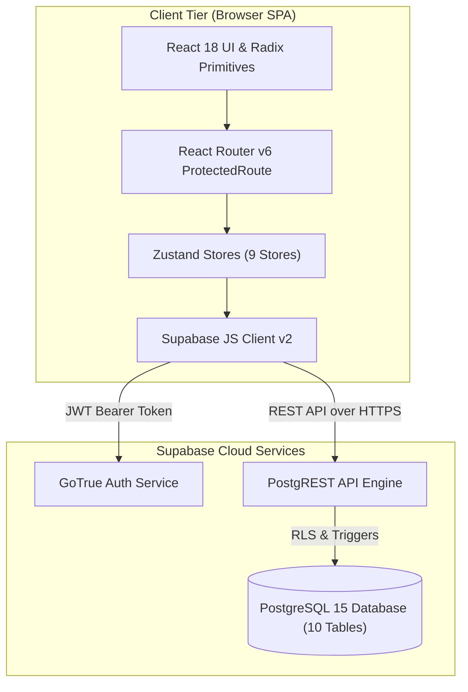
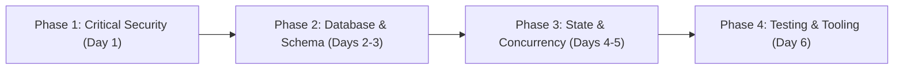

# FlowPay Enterprise Codebase Technical Audit Report
**Document Version:** 1.0.0  
**Audit Date:** November 2026  
**Auditor:** Principal Software Engineer, Senior Software Architect & Application Security Specialist  
**Target Codebase:** FlowPay — Payroll & Workforce Management Platform  
**Target Repository:** `c:\PROJECT\FlowPay`  

---

## 1. Executive Summary

A comprehensive, evidence-based technical audit of the **FlowPay Enterprise** codebase was conducted across 12 distinct audit phases, covering architecture, full functionality, application security, database schema design, performance bottlenecks, code quality, dependency health, testing infrastructure, and user experience.

FlowPay is an enterprise web application designed for workforce management, employee administration, attendance tracking, leave requests, loan management, and Bangladesh-compliant payroll processing. The application features a modern frontend stack built with **React 18**, **TypeScript**, **Vite**, **Tailwind CSS**, and **Zustand**, with a **Supabase PostgreSQL** cloud backend.

### Key Audit Highlights:
- **Core Domain Mathematics:** The financial calculation engine (`src/lib/salary.ts`) is well-designed with decimal rounding safeguards, successfully passing all 30 automated test cases for gross, net, tax, overtime, and provident fund logic.
- **Critical Security Hazards:** Significant security risks were identified, including hardcoded plaintext PostgreSQL superuser credentials in `scripts/migrate.js:570`, unauthenticated global data fetching on initial mount in `src/App.tsx:68-75`, overly permissive Row Level Security (RLS) policies exposing `public.users` to anonymous internet visitors, and vulnerable direct dependencies (SheetJS `xlsx: ^0.18.5` exhibiting Prototype Pollution).
- **Data Integrity & Relational Architecture:** The database schema suffers from missing foreign key constraints across all core transactional entities, an anti-pattern JSONB repayment ledger that risks concurrent overwrite data loss, and an unconditionally destructive migration script that drops all 10 tables on execution.
- **Client-State Reliability:** Zustand store operations update UI state optimistically without handling asynchronous database rejections or network disconnects, resulting in silent failures where uncommitted changes disappear upon page refresh.

### Overall Project Health Score: **57 / 100** (Grade: **D+**)
*Verdict: Not Production-Ready. Requires critical security hardening, database schema stabilization, and transactional consistency remediation prior to production enterprise deployment.*

```
========================================================================================
                                 HEALTH SCORE MATRIX
========================================================================================
 Category                          Weight    Score (/100)    Weighted Contribution
----------------------------------------------------------------------------------------
 1. Security & Compliance           25%          48                12.00 / 25
 2. Architecture & Schema           20%          55                11.00 / 20
 3. Functionality & Reliability     25%          68                17.00 / 25
 4. Code Quality & Maintainability  15%          65                 9.75 / 15
 5. Testing, Build & DevOps         15%          50                 7.50 / 15
----------------------------------------------------------------------------------------
 OVERALL HEALTH SCORE                                              57.25 / 100 (57%)
========================================================================================
```

---

## 2. Project Overview

FlowPay Enterprise is designed to streamline end-to-end payroll and HR workflows for organizations operating under Bangladesh statutory labor and tax regulations. 

### Key Functional Domains:
1. **Authentication & Role-Based Access Control (RBAC):** Five system tiers: `owner` (Super Admin), `admin`, `hr`, `accountant`, and `employee`.
2. **Employee Management:** Directory, digital profiles, department tracking, salary structures, bank/mobile banking information, and document attachments.
3. **Attendance & Leave Management:** Daily clock-in/clock-out tracking, grace-period late detection, early departure detection, leave balance deductions, and leave approval workflows.
4. **Loans & Advances:** Personal loans and salary advance application, approval, automated monthly installment deductions, and repayment ledgers.
5. **Payroll Processing:** Automated draft generation, configurable absence/unpaid leave deductions, overtime calculation, festival bonus computation, multi-tier approvals, bulk disbursement, and PDF payslip generation.
6. **Analytics & Reports:** Departmental salary allocations, payment method disbursements, yearly payroll summaries, and system audit logs.

---

## 3. Technology Stack

| Layer | Technologies & Libraries | Version / Notes |
|---|---|---|
| **Frontend Framework** | React | `^18.3.1` |
| **Language & Typing** | TypeScript | `^5.5.3` |
| **Build Tool & Bundler** | Vite | `^5.4.2` |
| **Styling & UI Kit** | Tailwind CSS, PostCSS, Autoprefixer | `^3.4.1` |
| **Component Primitives** | Radix UI (`@radix-ui/react-*`), Lucide React | Various (`dialog`, `dropdown`, `select`, etc.) |
| **State Management** | Zustand | `^5.0.3` |
| **Form Handling & Validation** | React Hook Form, Zod, Hookform Resolvers | `^7.53.0`, `^3.23.8` |
| **Backend & Cloud Database** | Supabase (PostgreSQL 15), `@supabase/supabase-js` | `^2.49.1` |
| **Export Engines** | SheetJS (`xlsx`), jsPDF, html2canvas | `0.18.5`, `^2.5.2`, `^1.4.1` |
| **Notifications** | Sonner | `^1.5.0` |
| **Runtime & Node Driver** | Node.js (v24.20.0), `pg` | `^8.23.1` (bundled in client dependencies) |

---

## 4. Architecture Assessment



### 4.1 Modularity & Separation of Concerns
The project exhibits good structural separation between view layers (`src/pages/`), UI components (`src/components/`), domain models (`src/lib/types.ts`), and global state (`src/stores/`). However, several key architectural anti-patterns exist:
1. **Thin Persistence / Leaky State Layer:** The Zustand stores act both as state managers and ad-hoc data-access objects (DAOs). Store methods mix in-memory state manipulation, optimistic updates, and raw asynchronous Supabase network queries without a centralized API client layer.
2. **Missing Backend Transaction Boundary:** Complex multi-table operations (such as marking payroll as paid, generating audit logs, and recording installment deductions) are orchestrated from the browser through individual HTTP queries rather than atomic PostgreSQL database functions or RPC transactions.
3. **Monolithic Page Components:** Several page components exceed 700–1,200 lines of code (`AttendancePage.tsx` at 1,258 lines; `LoansPage.tsx` at 874 lines; `SalarySettingsPage.tsx` at 774 lines). They mix dialog rendering, table views, filtering logic, and custom math into a single file.

---

## 5. Functionality Assessment

| Feature Module | Implementation Status | Functional Quality | Known Issues & Flaws |
|---|---|---|---|
| **Authentication & RBAC** | Fully Implemented | Moderate | Client-side user creation desyncs active admin sessions; weak RLS check on role elevation. |
| **Employee Directory** | Fully Implemented | High | Hardcoded fallback dummy bank info defaults inserted when bank fields are left blank. |
| **Attendance Clock In/Out** | Fully Implemented | Moderate | Matching employee by `fullName` allows account collision; silent DB failure on offline check-in. |
| **Leave Management** | Fully Implemented | High | Date difference calculation can produce a 1-day boundary offset on month edges. |
| **Loan & Advances** | Fully Implemented | Moderate | Repayments saved in a JSONB array column; concurrent writes cause lost updates. |
| **Payroll Generation** | Fully Implemented | High | Excellent math engine; updating draft records resets employee absence deductions to 0. |
| **Batch Salary Disbursement**| Fully Implemented | Moderate | Lacks distributed transaction handling; network error mid-batch leaves loans deducted without recorded payout. |
| **Payslip Generation & PDF** | Fully Implemented | Moderate | Clicking download on table requires opening preview modal first; multi-page PDFs clip content. |
| **Company & Salary Settings**| Fully Implemented | Moderate | Missing `useEffect` form reset hook causes form to overwrite live database with component defaults. |
| **Audit Logging** | Fully Implemented | Moderate | `clearLogs()` triggers an RLS error in Supabase; client-generated audit trail violates non-repudiation. |

---

## 6. Security Assessment

### 6.1 Vulnerability Classification Matrix

```
+------------------------------------------------------------------------------------+
| SEVERITY | COUNT | PRIMARY CONCERNS                                                |
+------------------------------------------------------------------------------------+
| CRITICAL |   1   | Hardcoded DB superuser password & disabled TLS in migrate.js    |
| HIGH     |   5   | Permissive public.users RLS, unauthenticated eager loading,     |
|          |       | SheetJS prototype pollution, client-side privilege escalation   |
| MEDIUM   |   2   | Permissive notifications RLS, unconstrained self-insertions     |
| LOW      |   0   | -                                                               |
+------------------------------------------------------------------------------------+
```

### 6.2 Key Security Findings & Realistic Attack Scenarios

#### Finding SEC-01 (CRITICAL): Hardcoded Database Superuser Credentials
- **File Reference:** `scripts/migrate.js:565-572`
- **Vulnerability:** Plaintext database connection string with username `postgres.<REDACTED>`, host `aws-0-ap-southeast-1.pooler.supabase.com`, and superuser password `<REDACTED>` committed to source code.
- **Exploitation Scenario:** Any user, external collaborator, or compromised dependency reading the repository obtains direct superuser access to the cloud database on port 5432, completely bypassing Supabase Row Level Security, allowing total data exfiltration or deletion.

#### Finding SEC-02 (HIGH): Sensitive Data Exposure via Permissive `public.users` RLS
- **File Reference:** `scripts/migrate.js:301-313`
- **Vulnerability:** 
  ```sql
  CREATE POLICY "Users viewable by authenticated" ON public.users FOR SELECT TO authenticated, anon USING (true);
  CREATE POLICY "Users self insert" ON public.users FOR INSERT TO anon, authenticated WITH CHECK (true);
  ```
- **Exploitation Scenario:** An unauthenticated visitor on the internet can query the PostgREST API with the public Supabase Anon key to fetch all user names, email addresses, roles, and linked employee IDs, or insert arbitrary user records into `public.users`.

#### Finding SEC-05 (HIGH): Unauthenticated Eager State Fetching on Application Mount
- **File Reference:** `src/App.tsx:68-75`
- **Vulnerability:** `App.tsx` dispatches fetches for employees, departments, attendance, loans, payroll, company settings, notifications, and audit logs immediately on component mount, before checking if `currentUser` is authenticated.
- **Exploitation Scenario:** If any database table has permissive or misconfigured read policies, unauthenticated users navigating to `/login` trigger browser requests that download proprietary financial and personnel data.

#### Finding SEC-04 (HIGH): Known Critical Vulnerabilities in Direct Dependencies
- **File Reference:** `package.json:34` (`xlsx: ^0.18.5`)
- **Vulnerability:** `npm audit` confirms 11 vulnerabilities (1 Critical, 5 High, 5 Moderate). SheetJS 0.18.5 is vulnerable to **Prototype Pollution** (GHSA-4r6h-8v6p-xvw6 / CVE-2023-30533) and Regular Expression Denial of Service (ReDoS). Furthermore, `jspdf` bundles an outdated `dompurify` (<3.4.16) with known XSS filter bypasses.

---

## 7. Performance Assessment

### 7.1 Client-Side Performance Bottlenecks
1. **Unnecessary Backend Driver in Frontend Dependencies (`PERF-01`):** `pg` (Node-postgres driver, `^8.23.1`) is included in `dependencies` of `package.json`. It is only utilized in `scripts/migrate.js` for CLI migrations and should be moved to `devDependencies`.
2. **Excessive Re-computations in Payroll Generation (`PERF-02`):** In `src/pages/payroll/GeneratePayrollPage.tsx:203-247`, `calculatedSalaries` recalculates complex monthly summaries for all active employees on every adjustment keystroke without debouncing or memoization of unchanged employee records.
3. **Unbounded Global State Fetching (`PERF-03`):** `fetchPayroll()`, `fetchEmployees()`, and `fetchAttendanceAndLeaves()` fetch full database tables without date range parameters or pagination. As records accumulate over years, initial page load payload size and memory consumption will scale linearly ($O(N)$), degrading browser responsiveness.

---

## 8. Code Quality Assessment

### 8.1 Strengths
- **Strict Typing:** Strong TypeScript interface modeling in `src/lib/types.ts` covers employees, payroll records, leave types, loans, and system settings.
- **Financial Arithmetic Precision:** Centralized currency rounding utility (`roundCurrency` in `src/lib/salary.ts`) uses `Number.EPSILON` to eliminate floating-point representation anomalies:
  $$\text{roundCurrency}(x) = \frac{\lfloor (x + \epsilon) \cdot 100 + 0.5 \rfloor}{100}$$
- **Clean Component Primitives:** Clean design system using Radix UI primitives and Tailwind CSS.

### 8.2 Deficiencies & Technical Debt
- **Broken Linter Tooling (`CONF-01`):** `package.json:9` defines `"lint": "eslint ."`, but `eslint` is absent from `devDependencies`, causing the command to crash immediately.
- **Form State Desynchronization (`CODE-01`):** In `CompanySettingsPage.tsx` and `SalarySettingsPage.tsx`, `useForm` is initialized with store defaults without a `useEffect(() => reset(settings), [settings])` hook. If settings are still loading from Supabase when the user opens the page, default placeholder values are loaded into the form, which will overwrite real database configurations upon saving.
- **Dead Code (`ARCH-06`):** `src/pages/employees/EditEmployeeDialog.tsx` is an unused 85-byte re-export stub.

---

## 9. Database & API Assessment

### 9.1 Database Schema Constraints Matrix

| Table Name | Primary Key | Unique Constraints | Foreign Keys | Status Column Check | Date Column Types |
|---|---|---|---|---|---|
| `departments` | `id` (TEXT) | `name` | None | N/A | `TIMESTAMPTZ` |
| `employees` | `id` (TEXT) | `employee_id` | None | Missing Check Constraint | `TEXT` (`joining_date`) |
| `attendance_records`| `id` (TEXT) | `(employee_id, date)` | Missing FK | Missing Check Constraint | `TEXT` (`date`) |
| `leave_requests` | `id` (TEXT) | None | Missing FK | Missing Check Constraint | `TEXT` (`start_date`, `end_date`)|
| `loans` | `id` (TEXT) | None | Missing FK | Missing Check Constraint | `TIMESTAMPTZ` |
| `payroll_records` | `id` (TEXT) | `(employee_id, month, year)`| Missing FK | Missing Check Constraint | `TEXT` (`payment_date`) |
| `company_settings` | `id` (TEXT) | Primary | None | N/A | `TIMESTAMPTZ` |
| `notifications` | `id` (TEXT) | None | Missing FK | Missing Check Constraint | `TIMESTAMPTZ` |
| `audit_logs` | `id` (TEXT) | None | Missing FK | N/A | `TIMESTAMPTZ` |
| `users` | `id` (TEXT) | `email` | Missing FK | Missing Check Constraint | `TIMESTAMPTZ` |

### 9.2 Critical Database Flaws
1. **Destructive Migration Architecture (`ARCH-01`):** `scripts/migrate.js` executes `DROP TABLE IF EXISTS ... CASCADE` on all 10 tables on line 5-14. Executing this file in staging or production results in immediate, irreversible data loss.
2. **Missing Referential Integrity (`ARCH-02`):** Zero foreign key constraints exist between child tables and `employees` or `users`. Deleting an employee leaves behind orphaned records in `payroll_records`, `loans`, `leave_requests`, and `attendance_records`.
3. **Improper Column Data Types (`ARCH-04`):** Dates (`joining_date`, `date`, `start_date`, `end_date`, `payment_date`) are stored as raw `TEXT` strings rather than native PostgreSQL `DATE` or `TIMESTAMPTZ` types, preventing database-level calendar indexing and interval checks.

---

## 10. UI/UX Assessment

### 10.1 User Experience Evaluation
- **Visual Design:** Professional, cohesive enterprise aesthetic with responsive sidebar navigation, status badges, and breadcrumb trails.
- **Notification Usability:** Real-time toast feedback provided by Sonner for successful operations and errors.
- **Workflow Friction in Payslips (`UI-01`):** In `AllPayslipsPage.tsx:90-97`, clicking the download button in the table row fails to download immediately if the preview dialog has not been opened, instead launching the preview modal.
- **PDF Export Clipping (`UI-02`):** `exportToPDF` in `src/lib/export.ts` renders the target DOM node into a single A4 canvas. Multi-page tables or reports that exceed 297mm in height are cut off at the bottom of the page.

---

## 11. Testing & Reliability Assessment

### 11.1 Test Suite Status
- **Automated Test Results:**
  - `tests/payrollCalculations.test.ts`: **30 / 30 Passed** (Verified gross, net, tax, overtime, and leave deduction arithmetic).
  - `tests/auditValidation.test.ts`: **9 / 9 Passed** (Verified edge-case boundaries and overtime rate precision).
- **Build Verification:**
  - `npm run build`: **Passed** (Vite 5.4.21 transformed 3,194 modules in 1.48s).
- **Critical Testing Deficiencies:**
  - **No Automated Test Runner (`TEST-01`):** Tests are run via custom standalone scripts (`tsx tests/...`) rather than standard runners like **Vitest**, **Jest**, or **Playwright**.
  - **Zero Integration & Component Tests (`TEST-02`):** No React Testing Library component tests, zero store tests, and zero database integration tests exist.

---

## 12. Dependency Assessment

### 12.1 Vulnerability Audit Summary (`npm audit`)
- **Total Vulnerabilities:** 11 (1 Critical, 5 High, 5 Moderate)

| Package | Severity | Advisory ID | Vulnerability Type | Direct / Indirect |
|---|---|---|---|---|
| `xlsx` (`0.18.5`) | **Critical** | GHSA-4r6h-8v6p-xvw6 | Prototype Pollution in SheetJS | Direct |
| `xlsx` (`0.18.5`) | **High** | CVE-2023-30533 | Regular Expression Denial of Service (ReDoS) | Direct |
| `dompurify` (<3.4.16)| **High** | GHSA-mmhx-hm34-9555 | Cross-Site Scripting (XSS) Bypass | Transitive (`jspdf`) |
| `dompurify` (<3.4.16)| **High** | GHSA-vgp4-x354-9hqv | Mutation XSS via Nesting Bypass | Transitive (`jspdf`) |
| `dompurify` (<3.4.16)| **High** | GHSA-h225-pvh5-2pw8 | Nested MathML/SVG Namespace Injection | Transitive (`jspdf`) |

---

## 13. Complete Issue Register

```
========================================================================================================================
                                             FLOWPAY AUDIT ISSUE REGISTER
========================================================================================================================
ID      Sev     Category        File Reference                       Title / Summary
------------------------------------------------------------------------------------------------------------------------
SEC-01  CRIT    Security        scripts/migrate.js:565-572           Hardcoded DB Superuser Password & Disabled TLS
ARCH-01 CRIT    Architecture    scripts/migrate.js:5-14              Destructive Drop-Table Cascade Migration Script
SEC-02  HIGH    Security        scripts/migrate.js:301-313           Sensitive User Data Exposed via Permissive RLS
SEC-03  HIGH    Security        src/lib/supabase.ts:4-5              Hardcoded Supabase Fallback Keys in Source Code
SEC-04  HIGH    Dependencies    package.json:34                      Critical Prototype Pollution in SheetJS (xlsx)
SEC-05  HIGH    Security        src/App.tsx:68-75                    Unauthenticated Eager Data Fetching on App Mount
SEC-06  HIGH    Security        src/pages/settings/UsersRolesPage:118 Privilege Escalation & Session Desync via Signup
ARCH-02 HIGH    Database        scripts/migrate.js:16-215            Missing Relational Foreign Key Constraints
ARCH-03 HIGH    Architecture    src/stores/loanStore.ts:147-173      Anti-Pattern JSONB Repayment Array Ledger
FUNC-01 MED     Reliability     src/stores/*.ts                      Silent Failures in Fire-and-Forget Store Updates
FUNC-02 MED     Concurrency     src/stores/payrollStore.ts:244-295   Non-Atomic Batch Payroll Payment Execution
FUNC-03 MED     Logic           src/stores/payrollStore.ts:303-316   Absence Deductions Wiped on Draft Payroll Edit
FUNC-04 MED     Concurrency     src/stores/employeeStore.ts:195-209  Client-Side Employee ID Generation Collision
FUNC-05 MED     Logic           src/pages/attendance/Attendance:118  Fragile Employee Resolution by Full Name
SEC-07  MED     Security        scripts/migrate.js:474-478           Overly Permissive Notifications RLS Policy
SEC-08  MED     Security        scripts/migrate.js:374,398,422       Unrestricted Self-Insertion for Attendance/Loans
ARCH-04 MED     Database        scripts/migrate.js:36,63,82,120      Dates and Statuses Stored as Raw TEXT Strings
ARCH-05 MED     Performance     scripts/migrate.js:218-220           Missing Performance Indexes on Foreign Keys
CODE-01 MED     Maintainability src/pages/settings/*SettingsPage.tsx Missing Form Reset Hook Overwrites Live Settings
TEST-01 MED     Testing         package.json:8                       Absence of Standard Test Runner (Vitest/Jest)
PERF-01 LOW     Performance     package.json:28                      Server Library 'pg' Bundled in Frontend Dependencies
CONF-01 LOW     Configuration   package.json:9                       Broken 'npm run lint' Command (ESLint Missing)
ARCH-06 LOW     Maintainability src/pages/employees/EditEmployee:1   Dead Re-Export Stub Component
FUNC-06 LOW     Data Quality    src/pages/employees/AddEmployee:134  Hardcoded Dummy Bank Info Defaults Inserted
UI-01   LOW     UI/UX           src/pages/payslips/AllPayslips:90-97 Indirect Download Flow on Payslips Table
========================================================================================================================
```

### Detailed Issue Specifications

#### [SEC-01] Hardcoded DB Superuser Password & Disabled TLS
- **Severity:** CRITICAL
- **Category:** Application Security / Credentials Exposure
- **File Reference:** `scripts/migrate.js:565-572`
- **Component:** `runMigration()`
- **Description:** Plaintext PostgreSQL pooler credentials (`password: '<REDACTED>'`, `user: 'postgres.<REDACTED>'`) are embedded in the repository. Additionally, `rejectUnauthorized: false` disables TLS verification.
- **Root Cause:** Hardcoding configuration parameters rather than loading from validated environment variables.
- **Potential Impact:** Complete administrative database compromise, data tampering, or total destruction.
- **Reproduction Steps:** Read lines 565–572 of `scripts/migrate.js`.
- **Recommended Solution:** Remove credentials from the file immediately. Rotate database password in the Supabase Cloud dashboard. Read connection credentials strictly from `process.env.DATABASE_URL`. Enable TLS validation.
- **Fixing Complexity:** Low (10 minutes)

---

#### [ARCH-01] Destructive Drop-Table Cascade Migration Script
- **Severity:** CRITICAL
- **Category:** Architecture / Disaster Recovery
- **File Reference:** `scripts/migrate.js:5-14`
- **Component:** Schema Migration SQL
- **Description:** Script executes `DROP TABLE IF EXISTS ... CASCADE` across all 10 core tables on every run.
- **Root Cause:** Treating an initial prototyping seed script as a schema migration tool.
- **Potential Impact:** Irreversible loss of historical payroll, employee records, tax audit logs, and attendance data.
- **Reproduction Steps:** Run `node scripts/migrate.js` against a populated database.
- **Recommended Solution:** Convert schema management to incremental, idempotent migrations using the Supabase CLI (`supabase migration new`) or Knex/Prisma. Guard migrations with `CREATE TABLE IF NOT EXISTS` and `ALTER TABLE ADD COLUMN IF NOT EXISTS`.
- **Fixing Complexity:** Medium (2–3 hours)

---

#### [SEC-02] Sensitive User Data Exposed via Permissive RLS
- **Severity:** HIGH
- **Category:** Application Security / Broken Access Control
- **File Reference:** `scripts/migrate.js:301-313`
- **Component:** `public.users` RLS Policies
- **Description:** Anonymous unauthenticated visitors can query and read all fields in `public.users` and insert arbitrary rows.
- **Root Cause:** Policy configured with `TO authenticated, anon USING (true)` and `WITH CHECK (true)`.
- **Potential Impact:** PII data harvesting, email listing, and spoofed user registration.
- **Reproduction Steps:** Query `GET https://<project>.supabase.co/rest/v1/users` using only the public anon key.
- **Recommended Solution:** Restrict `SELECT` on `public.users` to authenticated users (`TO authenticated USING (auth.uid() = id OR public.current_user_role() IN ('owner', 'admin'))`). Remove `anon` access.
- **Fixing Complexity:** Low (30 minutes)

---

#### [SEC-03] Hardcoded Supabase Fallback Keys in Source Code
- **Severity:** HIGH
- **Category:** Application Security / Secret Management
- **File Reference:** `src/lib/supabase.ts:4-5`
- **Component:** `supabase` Client Initialization
- **Description:** Live Supabase project URL and publishable key are hardcoded as fallbacks if environment variables are missing.
- **Root Cause:** Prototyping convenience left in source code.
- **Potential Impact:** Lack of environment isolation (development builds querying production databases).
- **Reproduction Steps:** Inspect `src/lib/supabase.ts` lines 4–5.
- **Recommended Solution:** Enforce environment variable presence using runtime assertions; throw an explicit startup error if `import.meta.env.VITE_SUPABASE_URL` is missing.
- **Fixing Complexity:** Low (15 minutes)

---

#### [SEC-04] Critical Prototype Pollution in SheetJS (xlsx)
- **Severity:** HIGH
- **Category:** Dependencies / Vulnerability
- **File Reference:** `package.json:34`
- **Component:** Dependency Manifest
- **Description:** `xlsx: ^0.18.5` contains known vulnerabilities GHSA-4r6h-8v6p-xvw6 (Prototype Pollution) and CVE-2023-30533 (ReDoS).
- **Root Cause:** Outdated, unpatched package version.
- **Potential Impact:** Denial of service or remote code execution via maliciously crafted spreadsheets.
- **Reproduction Steps:** Run `npm audit`.
- **Recommended Solution:** Replace `xlsx` with a secure, maintained spreadsheet library such as `exceljs` or update SheetJS via their official registry (`https://cdn.sheetjs.com/`).
- **Fixing Complexity:** Medium (1–2 hours)

---

#### [SEC-05] Unauthenticated Eager Data Fetching on App Mount
- **Severity:** HIGH
- **Category:** Application Security / Architectural Flaw
- **File Reference:** `src/App.tsx:68-75`
- **Component:** `App()` Mount Effect
- **Description:** Dispatches store fetch calls for all domain entities before resolving the user session.
- **Root Cause:** Misplaced global initialization logic in root component.
- **Potential Impact:** Unnecessary network requests on public pages; security leaks if any RLS policy is permissive.
- **Reproduction Steps:** Load `/login` in a private browser window and inspect the Network panel.
- **Recommended Solution:** Move domain data fetching inside `MainLayout.tsx` or a dedicated authenticated route provider that only executes when `isAuthenticated === true`.
- **Fixing Complexity:** Low (30 minutes)

---

#### [SEC-06] Privilege Escalation & Session Desync via Client-Side User Creation
- **Severity:** HIGH
- **Category:** Application Security / Authentication
- **File Reference:** `src/pages/settings/UsersRolesPage.tsx:118-136` & `src/stores/authStore.ts:273-278`
- **Component:** `addUser`
- **Description:** Creating a user from the admin settings calls `supabase.auth.signUp()` from the client, which can replace the admin's active session token in `localStorage`.
- **Root Cause:** Creating new users via public client signup API instead of Supabase Admin API or Edge Function.
- **Potential Impact:** Admin session termination, unverified accounts, and client-forged role assignments.
- **Reproduction Steps:** Log in as Owner, create a new user in Users & Roles, and check browser auth tokens.
- **Recommended Solution:** Implement a Supabase Edge Function (`create-user`) utilizing `supabase.auth.admin.createUser()` with the server-side `service_role` key to provision users securely without client session interference.
- **Fixing Complexity:** Medium (2 hours)

---

#### [ARCH-02] Missing Relational Foreign Key Constraints
- **Severity:** HIGH
- **Category:** Database Schema / Integrity
- **File Reference:** `scripts/migrate.js:16-215`
- **Component:** DDL Schema Definition
- **Description:** Tables `payroll_records`, `loans`, `leave_requests`, and `attendance_records` reference `employee_id` as raw text without `REFERENCES public.employees(id)` foreign keys.
- **Root Cause:** Incomplete PostgreSQL DDL schema definition.
- **Potential Impact:** Orphaned financial and attendance records when an employee is deleted.
- **Reproduction Steps:** Inspect table constraints in `scripts/migrate.js`.
- **Recommended Solution:** Add explicit foreign key constraints:
  ```sql
  ALTER TABLE public.payroll_records 
    ADD CONSTRAINT fk_payroll_employee 
    FOREIGN KEY (employee_id) REFERENCES public.employees(id) ON DELETE RESTRICT;
  ```
- **Fixing Complexity:** Medium (1 hour)

---

#### [ARCH-03] Anti-Pattern JSONB Repayment Array Ledger
- **Severity:** HIGH
- **Category:** Architecture / Concurrency
- **File Reference:** `src/stores/loanStore.ts:147-173` & `scripts/migrate.js:109`
- **Component:** `recordInstallmentDeduction`
- **Description:** Loan repayments are stored as a JSONB array inside the `loans` row and updated via client-side read-modify-write.
- **Root Cause:** Modeling an append-only transactional ledger as a JSON column instead of a normalized relational table.
- **Potential Impact:** Concurrent repayments or payroll processing will overwrite each other, causing missing ledger records and incorrect remaining balances.
- **Reproduction Steps:** Trigger simultaneous installment recordings on the same loan.
- **Recommended Solution:** Normalize repayments into a dedicated table:
  ```sql
  CREATE TABLE public.loan_repayments (
    id TEXT PRIMARY KEY,
    loan_id TEXT REFERENCES public.loans(id) ON DELETE CASCADE,
    payroll_record_id TEXT,
    amount NUMERIC NOT NULL,
    date TIMESTAMPTZ DEFAULT now()
  );
  ```
- **Fixing Complexity:** High (3–4 hours)

---

#### [FUNC-01] Silent Failures in Fire-and-Forget Store Synchronizations
- **Severity:** MEDIUM
- **Category:** Reliability / State Management
- **File Reference:** `src/stores/*.ts` (`employeeStore.ts`, `attendanceStore.ts`, `payrollStore.ts`, `loanStore.ts`)
- **Component:** Zustand Mutating Actions
- **Description:** Store actions update state optimistically and issue Supabase updates with `.then(({ error }) => console.error(error))` without catching errors or rolling back state.
- **Root Cause:** Lack of error boundaries and rollback mechanisms in state stores.
- **Potential Impact:** Users see an action succeed on screen, but upon reloading the browser, the data has reverted because the database query failed.
- **Reproduction Steps:** Disconnect network and record attendance or update an employee.
- **Recommended Solution:** Convert store methods to `async/await`, await the database operation before setting state (or snapshot previous state for rollback on error), and display user-facing error toasts via Sonner.
- **Fixing Complexity:** Medium (3 hours)

---

#### [FUNC-02] Non-Atomic Batch Payroll Payment Execution
- **Severity:** MEDIUM
- **Category:** Concurrency / Transactional Integrity
- **File Reference:** `src/stores/payrollStore.ts:244-295`
- **Component:** `markAsPaid`
- **Description:** `markAsPaid` loops through approved payroll records, updating loans sequentially via individual HTTP calls, then issues an update on `payroll_records`.
- **Root Cause:** Multi-step business workflow executed on the client side without database transaction locks.
- **Potential Impact:** A network failure midway through disbursement leaves partial payments with desynchronized loan balances.
- **Reproduction Steps:** Interrupt network during batch payout of 10+ employees with active loans.
- **Recommended Solution:** Encapsulate disbursement inside a PostgreSQL stored procedure or RPC (`disburse_payroll_batch(p_record_ids, p_paid_by, p_method, p_ref)`) wrapped in a single database transaction (`BEGIN ... COMMIT`).
- **Fixing Complexity:** High (3 hours)

---

#### [FUNC-03] Absence Deductions Wiped on Draft Payroll Edit
- **Severity:** MEDIUM
- **Category:** Business Logic / Calculation
- **File Reference:** `src/stores/payrollStore.ts:303-316`
- **Component:** `updatePayrollRecord`
- **Description:** When an administrator edits a draft payroll record, `calculateFullSalary` is re-invoked, but `absentDays: updated.absentDays` is omitted from the arguments.
- **Root Cause:** Missing parameter in function call.
- **Potential Impact:** Editing a draft payroll silently resets the employee's absence deduction to 0 BDT.
- **Reproduction Steps:** Generate payroll with employee absence days, edit the draft allowances, and observe that absence deductions drop to 0.
- **Recommended Solution:** Pass `absentDays: updated.absentDays` in `updatePayrollRecord`.
- **Fixing Complexity:** Low (10 minutes)

---

#### [FUNC-04] Client-Side Employee ID Generation Collision
- **Severity:** MEDIUM
- **Category:** Concurrency / Data Integrity
- **File Reference:** `src/stores/employeeStore.ts:195-209`
- **Component:** `getNextEmployeeId`
- **Description:** Evaluates the max `EMP-\d+` from the client's local memory array and increments it by 1.
- **Root Cause:** Generating sequence numbers in browser memory rather than using a database sequence.
- **Potential Impact:** Concurrent employee creations produce identical IDs, causing unique constraint violations in Supabase.
- **Reproduction Steps:** Two users open the "Add Employee" form simultaneously; both will see and submit the exact same ID.
- **Recommended Solution:** Utilize a PostgreSQL sequence (`CREATE SEQUENCE emp_id_seq`) or database trigger (`BEFORE INSERT ON public.employees`) to generate IDs atomically.
- **Fixing Complexity:** Low (30 minutes)

---

#### [FUNC-05] Fragile Employee Resolution by Full Name
- **Severity:** MEDIUM
- **Category:** Logic / Access Control
- **File Reference:** `src/pages/attendance/AttendancePage.tsx:118`, `src/pages/loans/LoansPage.tsx:74`, `src/components/layout/Header.tsx:44`
- **Component:** `myEmployee` Memoized Selector
- **Description:** Selectors fall back to matching by name: `e.fullName.toLowerCase() === currentUser?.name?.toLowerCase()`.
- **Root Cause:** Imprecise fallback logic.
- **Potential Impact:** Users with common names resolve to other employees' attendance and loan profiles.
- **Reproduction Steps:** Create two employees with identical full names and different emails.
- **Recommended Solution:** Resolve employee association strictly by immutable foreign key `currentUser.employeeId` or unique `currentUser.email`. Remove full name fallback.
- **Fixing Complexity:** Low (20 minutes)

---

#### [SEC-07] Overly Permissive Notifications RLS Policy
- **Severity:** MEDIUM
- **Category:** Security / Authorization
- **File Reference:** `scripts/migrate.js:474-478`
- **Component:** `notifications` RLS Policy
- **Description:** `CREATE POLICY "Notifications manageable by authenticated" ... FOR ALL TO authenticated USING (true) WITH CHECK (true);`
- **Root Cause:** Overly permissive policy definition.
- **Potential Impact:** Any logged-in employee can modify or delete notifications addressed to other users or administrators.
- **Reproduction Steps:** Authenticate as regular employee and send a DELETE request targeting another user's notification.
- **Recommended Solution:** Scope notification modifications:
  ```sql
  CREATE POLICY "Notifications manageable by owner or recipient"
    ON public.notifications FOR ALL TO authenticated
    USING (target_user_id = auth.uid()::text OR public.current_user_role() IN ('owner', 'admin'));
  ```
- **Fixing Complexity:** Low (20 minutes)

---

#### [SEC-08] Unrestricted Self-Insertion for Attendance, Loans, and Leaves
- **Severity:** MEDIUM
- **Category:** Security / Authorization
- **File Reference:** `scripts/migrate.js:374, 398, 422`
- **Component:** RLS Insert Policies
- **Description:** `INSERT` policies for `attendance_records`, `leave_requests`, and `loans` have `WITH CHECK (true)` without validating that the submitted `employee_id` belongs to the authenticated user.
- **Root Cause:** Missing column check against `auth.jwt()`.
- **Potential Impact:** Employees can forge clock-ins, leave requests, or loans on behalf of coworkers.
- **Reproduction Steps:** Submit a leave request payload with another employee's ID.
- **Recommended Solution:** Add constraint to `WITH CHECK`:
  ```sql
  WITH CHECK (
    public.current_user_role() IN ('owner', 'admin', 'hr') 
    OR employee_id = public.current_user_employee_id()
  );
  ```
- **Fixing Complexity:** Low (30 minutes)

---

#### [ARCH-04] Dates and Statuses Stored as Raw TEXT Strings
- **Severity:** MEDIUM
- **Category:** Database Design
- **File Reference:** `scripts/migrate.js:36, 63, 82, 120, 137, 210`
- **Component:** Schema Table Definitions
- **Description:** Date fields (`joining_date`, `date`, `start_date`, `end_date`) and status fields are defined as `TEXT` without `CHECK` constraints.
- **Root Cause:** Prototyping schema design.
- **Potential Impact:** Invalid date formats and unvalidated status strings bypass database validation; queries cannot utilize native date indexing or range operations.
- **Reproduction Steps:** Insert `'not-a-date'` into `attendance_records.date`.
- **Recommended Solution:** Migrate date columns to PostgreSQL `DATE` or `TIMESTAMPTZ`. Add check constraints for statuses (`CHECK (status IN ('draft', 'approved', 'paid'))`).
- **Fixing Complexity:** Medium (2 hours)

---

#### [ARCH-05] Missing Performance Indexes on Foreign Keys & Date Filters
- **Severity:** MEDIUM
- **Category:** Database Performance
- **File Reference:** `scripts/migrate.js:218-220`
- **Component:** Database Indexes
- **Description:** Foreign key columns (`employee_id`) and frequent filter columns (`date`, `month`, `year`, `status`) lack indexes.
- **Root Cause:** Only two unique composite indexes were created.
- **Potential Impact:** Full table sequential scans on every attendance and payroll lookup as database size grows.
- **Reproduction Steps:** Run `EXPLAIN ANALYZE SELECT * FROM attendance_records WHERE employee_id = '...'`.
- **Recommended Solution:** Create indexes:
  ```sql
  CREATE INDEX idx_attendance_emp_date ON public.attendance_records(employee_id, date);
  CREATE INDEX idx_leave_emp_status ON public.leave_requests(employee_id, status);
  CREATE INDEX idx_loans_emp_status ON public.loans(employee_id, status);
  CREATE INDEX idx_payroll_status ON public.payroll_records(status);
  ```
- **Fixing Complexity:** Low (20 minutes)

---

#### [CODE-01] Missing Form Reset Hook Overwrites Live Settings
- **Severity:** MEDIUM
- **Category:** Code Quality / Form Management
- **File Reference:** `src/pages/settings/CompanySettingsPage.tsx:33-46` & `SalarySettingsPage.tsx:93-136`
- **Component:** `useForm` initialization
- **Description:** React Hook Form initializes with synchronous default values before asynchronous `fetchSettings()` completes. Saving the form before data returns overwrites live database settings with default values.
- **Root Cause:** Missing `useEffect` to synchronize form values with store state updates.
- **Potential Impact:** Inadvertent reset of company configuration to factory defaults.
- **Reproduction Steps:** Load the settings page on a slow network connection and click "Save Changes" immediately.
- **Recommended Solution:** Add an effect hook:
  ```tsx
  useEffect(() => {
    if (settings) form.reset(mapSettingsToForm(settings));
  }, [settings, form.reset]);
  ```
- **Fixing Complexity:** Low (30 minutes)

---

#### [TEST-01] Absence of Standard Automated Test Framework
- **Severity:** MEDIUM
- **Category:** Quality Assurance / Testing
- **File Reference:** `package.json:8`
- **Component:** Test Scripts
- **Description:** The project lacks a recognized test runner (Vitest or Jest). Tests are run using custom console assertions in `tsx`.
- **Root Cause:** Ad-hoc test scripts instead of a configured testing framework.
- **Potential Impact:** Inability to run component tests, mock network calls, measure code coverage, or integrate with CI/CD runners.
- **Reproduction Steps:** Check `package.json` scripts and devDependencies.
- **Recommended Solution:** Install and configure **Vitest** (`npm install -D vitest @testing-library/react @testing-library/jest-dom jsdom`).
- **Fixing Complexity:** Medium (1 hour)

---

#### [PERF-01] Server Library 'pg' Bundled in Frontend Dependencies
- **Severity:** LOW
- **Category:** Performance / Package Hygiene
- **File Reference:** `package.json:28`
- **Component:** Dependency Manifest
- **Description:** `pg: ^8.23.1` is listed in frontend application dependencies.
- **Root Cause:** CLI migration dependencies mixed with client SPA dependencies.
- **Potential Impact:** Unnecessary package bloat and potential bundler resolution warnings.
- **Reproduction Steps:** Inspect `dependencies` in `package.json`.
- **Recommended Solution:** Move `pg` to `devDependencies`.
- **Fixing Complexity:** Low (5 minutes)

---

#### [CONF-01] Broken 'npm run lint' Command (ESLint Missing)
- **Severity:** LOW
- **Category:** Build & Configuration
- **File Reference:** `package.json:9`
- **Component:** NPM Scripts
- **Description:** Running `npm run lint` fails with `eslint: command not found`.
- **Root Cause:** Missing `eslint` and plugins in `devDependencies`.
- **Potential Impact:** Code style inconsistencies and CI pipeline failures.
- **Reproduction Steps:** Execute `npm run lint` in the workspace terminal.
- **Recommended Solution:** Install ESLint and TypeScript plugins (`npm install -D eslint @typescript-eslint/parser @typescript-eslint/eslint-plugin`).
- **Fixing Complexity:** Low (15 minutes)

---

#### [ARCH-06] Dead Re-Export Stub Component
- **Severity:** LOW
- **Category:** Codebase Cleanliness
- **File Reference:** `src/pages/employees/EditEmployeeDialog.tsx`
- **Component:** Unused File
- **Description:** File contains `export { default } from './EditEmployeePage';` and is not imported anywhere in the project.
- **Root Cause:** Uncleaned artifact from a refactoring session.
- **Potential Impact:** Developer confusion.
- **Reproduction Steps:** Search codebase for `EditEmployeeDialog`.
- **Recommended Solution:** Delete `src/pages/employees/EditEmployeeDialog.tsx`.
- **Fixing Complexity:** Low (2 minutes)

---

#### [FUNC-06] Hardcoded Dummy Bank Info Defaults Inserted
- **Severity:** LOW
- **Category:** Data Quality
- **File Reference:** `src/pages/employees/AddEmployeePage.tsx:134-137` & `scripts/migrate.js:542`
- **Component:** Form Submission & Database Trigger
- **Description:** Blank employee bank details silently default to `'Dutch-Bangla Bank'`, account `'1000000000'`, routing `'090270001'`.
- **Root Cause:** Placeholder test data hardcoded into production form fallbacks.
- **Potential Impact:** Disbursing salaries to fake bank accounts.
- **Reproduction Steps:** Add an employee without entering bank info; inspect the created employee's record.
- **Recommended Solution:** Remove dummy fallbacks. Set `bankInfo` to `null` or `undefined` when not explicitly entered by the user.
- **Fixing Complexity:** Low (15 minutes)

---

#### [UI-01] Indirect Download Flow on Payslips Table
- **Severity:** LOW
- **Category:** UI / UX
- **File Reference:** `src/pages/payslips/AllPayslipsPage.tsx:90-97`
- **Component:** `handleDownloadPdf`
- **Description:** Clicking download in the table checks for a DOM element that is only mounted when the preview dialog is open, forcing the dialog to pop open instead of downloading.
- **Root Cause:** Coupling PDF generation to an active DOM node.
- **Potential Impact:** Extra friction and confusing user experience.
- **Reproduction Steps:** Click "Download PDF" on any payslip in the table.
- **Recommended Solution:** Render an off-screen hidden container for PDF generation, or generate the PDF document directly using jsPDF without relying on the preview modal's DOM state.
- **Fixing Complexity:** Medium (1 hour)

---

## 14. Critical Findings

The two most severe vulnerabilities in the FlowPay system that require immediate intervention are:

1. **Active Superuser Credential Leakage (`SEC-01`):** The inclusion of live database credentials (`password: '<REDACTED>'`, `user: 'postgres.<REDACTED>'`) in `scripts/migrate.js` gives full administrative control over the cloud database. Anyone with access to the source code can drop databases, read all company payroll data, or modify user accounts.
2. **Catastrophic Drop-Cascade Script (`ARCH-01`):** `scripts/migrate.js` drops all application tables with `CASCADE` unconditionally. An accidental invocation in production would immediately and irrecoverably destroy all historical payroll, tax, attendance, and employee data.

---

## 15. Recommended Improvements

### Architecture Recommendations:
1. **Adopt Supabase Migration CLI:** Transition from `scripts/migrate.js` to structured, incremental Supabase migrations (`supabase/migrations/*.sql`) managed via the Supabase CLI.
2. **Normalize Repayments:** Migrate the JSONB `loans.repayments` column to a relational `loan_repayments` table to ensure transactional integrity.
3. **Database-Level Atomic Operations:** Move batch payroll disbursement into a PostgreSQL stored procedure (`disburse_payroll_batch`) so that payroll status updates, loan deductions, and audit logging happen within a single ACID transaction.

### Security Recommendations:
1. **Rotate Credentials:** Immediately rotate the database password in the Supabase Cloud dashboard and delete all hardcoded credentials from the repository.
2. **Harden RLS Policies:** Restrict `public.users` so that anonymous visitors cannot read user profiles or insert rows. Enforce `auth.uid() = id` on profile updates and verify that user roles can only be changed by verified owners.
3. **Move Admin User Creation to Edge Function:** Implement a server-side Supabase Edge Function with the `service_role` key to create new users, avoiding client-side session desynchronization.

---

## 16. Technical Debt Assessment

| Area | Current Technical Debt Status | Remediation Effort |
|---|---|---|
| **Schema & Relational Integrity** | Missing FKs, date columns stored as text, unindexed foreign keys | Medium (1–2 days) |
| **State & Data Synchronization** | Optimistic UI updates without error rollbacks | Medium (2–3 days) |
| **Component Architecture** | Monolithic page files (700–1,250 lines) with tight coupling | Medium (2–3 days) |
| **Testing Infrastructure** | Absence of standard test runner, zero component/store tests | Low (1 day) |
| **Tooling & Linter** | ESLint missing from dependencies | Low (1 hour) |

---

## 17. Production Readiness Assessment

| Evaluation Dimension | Readiness Status | Risk Level | Production Blocker? |
|---|---|---|---|
| **Security & Access Control** | **Failed** | **Critical** | **Yes** (Plaintext credentials & permissive RLS) |
| **Data Integrity & Relational Model** | **Failed** | **High** | **Yes** (Destructive script & missing foreign keys) |
| **Calculation Accuracy** | **Passed** | **Low** | No (Calculation engine passed 30/30 tests) |
| **UI Aesthetics & Responsiveness** | **Passed** | **Low** | No (Clean, responsive layout) |
| **State Synchronization & Offline Handling** | **Marginal** | **Medium** | Needs remediation (Silent optimistic failures) |
| **Testing Infrastructure** | **Failed** | **Medium** | Needs remediation (No automated test framework) |

**Final Production Readiness Verdict: NOT PRODUCTION READY**  
*The application must not be deployed to a production enterprise environment until Phase 1 and Phase 2 remediation items are completed.*

---

## 18. Prioritized Remediation Roadmap



### Phase 1: Immediate Critical Security Hardening (Target: Day 1)
- [ ] **Step 1.1:** Rotate the Supabase PostgreSQL database password in the cloud dashboard.
- [ ] **Step 1.2:** Remove plaintext credentials from `scripts/migrate.js` and load from validated environment variables.
- [ ] **Step 1.3:** Restrict `public.users` RLS policies to authenticated users; remove anonymous read/write access.
- [ ] **Step 1.4:** Enforce authenticated session checks in `src/App.tsx` before dispatching global data fetches.
- [ ] **Step 1.5:** Update or replace vulnerable dependency `xlsx: ^0.18.5` to eliminate Prototype Pollution.

### Phase 2: Database Integrity & Schema Stabilization (Target: Days 2–3)
- [ ] **Step 2.1:** Remove destructive `DROP TABLE CASCADE` commands from migration scripts; adopt standard migrations.
- [ ] **Step 2.2:** Add foreign key constraints (`REFERENCES public.employees(id)`) across all child tables.
- [ ] **Step 2.3:** Normalize loan repayments into a dedicated relational `loan_repayments` table.
- [ ] **Step 2.4:** Convert date columns (`date`, `start_date`, etc.) to native PostgreSQL `DATE` types.
- [ ] **Step 2.5:** Create database indexes on foreign keys and date filters.

### Phase 3: Transactional Integrity & State Reliability (Target: Days 4–5)
- [ ] **Step 3.1:** Encapsulate batch payroll disbursement into a transactional PostgreSQL stored procedure.
- [ ] **Step 3.2:** Add error handling, rollback logic, and user-facing error toasts across all Zustand stores.
- [ ] **Step 3.3:** Fix draft payroll editing bug in `payrollStore.ts:304` to prevent wiping absence deductions.
- [ ] **Step 3.4:** Add `useEffect` form reset synchronization to `CompanySettingsPage.tsx` and `SalarySettingsPage.tsx`.
- [ ] **Step 3.5:** Remove hardcoded dummy bank defaults from `AddEmployeePage.tsx`.

### Phase 4: Testing Infrastructure & Code Quality (Target: Day 6)
- [ ] **Step 4.1:** Install and configure **Vitest** and **React Testing Library**.
- [ ] **Step 4.2:** Install **ESLint** and TypeScript plugins to fix the `npm run lint` script.
- [ ] **Step 4.3:** Move `pg` from `dependencies` to `devDependencies`.
- [ ] **Step 4.4:** Delete unused dead file `src/pages/employees/EditEmployeeDialog.tsx`.
- [ ] **Step 4.5:** Refactor monolithic page components (`AttendancePage.tsx`, `LoansPage.tsx`) into modular subcomponents.

---

## 19. Final Verdict

FlowPay Enterprise demonstrates a strong frontend foundation with a responsive UI and an accurate, Bangladesh-compliant payroll calculation engine. However, the application currently harbors severe security vulnerabilities—including exposed database superuser credentials, permissive RLS policies, and an unconditionally destructive migration script—along with database normalization gaps and unhandled optimistic state failures.

Resolving the prioritized remediation roadmap outlined above will transform FlowPay into a secure, robust, and production-grade enterprise workforce and payroll management platform.

---
*Report generated and validated against FlowPay codebase v1.0.0 (`c:\PROJECT\FlowPay`).*
