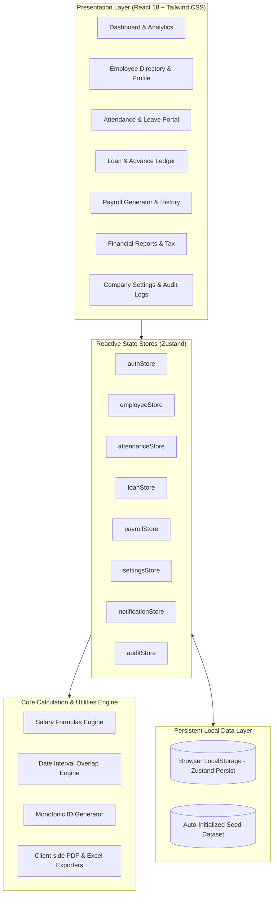
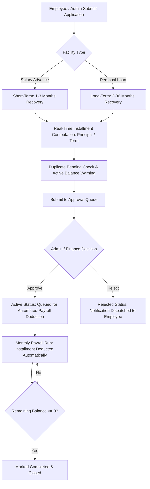
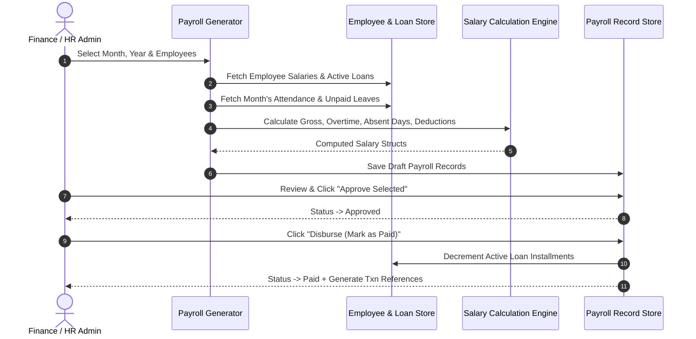
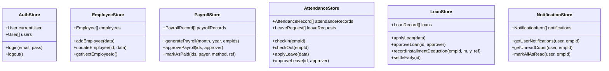

# 📘 FlowPay Enterprise — Comprehensive System Documentation

> **Version:** 2.0.0  
> **Status:** Production-Ready  
> **Architecture:** Client-Side Single Page Application (React 18 + TypeScript + Vite + Zustand)  
> **Author:** FlowPay Core Engineering Team  

---

## 📑 Table of Contents

1. [Executive Summary & Architecture](#1-executive-summary--architecture)
2. [Technology Stack](#2-technology-stack)
3. [Project Directory & File Map](#3-project-directory--file-map)
4. [Role-Based Access Control (RBAC) Matrix](#4-role-based-access-control-rbac-matrix)
5. [Core Functional Modules Deep Dive](#5-core-functional-modules-deep-dive)
   - [5.1 Financial Overview Dashboard](#51-financial-overview-dashboard)
   - [5.2 Employee Lifecycle Management](#52-employee-lifecycle-management)
   - [5.3 Attendance & Leave Tracking System](#53-attendance--leave-tracking-system)
   - [5.4 Loan & Salary Advance Management](#54-loan--salary-advance-management)
   - [5.5 Enterprise Payroll Calculation Engine](#55-enterprise-payroll-calculation-engine)
   - [5.6 Interactive Payslips & PDF Generation](#56-interactive-payslips--pdf-generation)
   - [5.7 Financial & Tax Reports](#57-financial--tax-reports)
   - [5.8 Role-Isolated Notification System](#58-role-isolated-notification-system)
   - [5.9 Audit Trail & System Security Logs](#59-audit-trail--system-security-logs)
   - [5.10 System Settings & Customization](#510-system-settings--customization)
6. [Mathematical Formulations & Payroll Algorithms](#6-mathematical-formulations--payroll-algorithms)
7. [State Architecture & Data Persistence](#7-state-architecture--data-persistence)
8. [Deployment & Infrastructure Guide](#8-deployment--infrastructure-guide)
9. [Developer Guide & Local Setup](#9-developer-guide--local-setup)
10. [Troubleshooting & Frequently Asked Questions](#10-troubleshooting--frequently-asked-questions)

---

## 1. Executive Summary & Architecture

**FlowPay** is a high-performance, enterprise-grade Salary & Payroll Management platform built specifically for modern companies, human resource departments, accountants, and business owners. It automates employee lifecycle management, complex payroll calculations, daily attendance with automatic absent deductions, company loans and salary advances, printable payslip generation, and comprehensive financial reporting.

### System Architecture Diagram



---

## 2. Technology Stack

| Layer | Technology | Version | Purpose |
| :--- | :--- | :--- | :--- |
| **Frontend Framework** | React | `^18.3.1` | Declarative component UI architecture |
| **Language** | TypeScript | `^5.5.3` | Type-safe development with zero compiler errors |
| **Build & Tooling** | Vite | `^5.4.21` | Sub-second HMR development and fast Rollup builds |
| **Styling & Design** | Tailwind CSS | `^3.4.1` | Responsive utility-first UI styling with custom design tokens |
| **UI Components** | Radix UI / shadcn | Latest | Accessible, unstyled primitive dialogs, popovers, tabs |
| **Icons** | Lucide React | `^0.400.0` | Crisp modern vector iconography |
| **Data Visualization** | Recharts | `^2.12.7` | SVG-based responsive financial trend charts |
| **State Management** | Zustand | `^4.5.4` | Lightweight reactive stores with `persist` middleware |
| **Forms & Validation** | React Hook Form + Zod | `^7.52.0` / `^3.23.8` | Schema-driven form validation and error handling |
| **PDF Generation** | jsPDF + html2canvas | `^2.5.2` / `^1.4.1` | Client-side vector and canvas PDF compilation |
| **Excel Export** | SheetJS (xlsx) | `^0.18.5` | Native `.xlsx` spreadsheet generator |
| **Toast Notifications**| Sonner | `^1.5.0` | Elegant dismissable status toasts |

---

## 3. Project Directory & File Map

```text
FlowPay/
├── public/                      # Static assets, logos, and manifest
│   ├── favicon.svg
│   └── logo.svg
├── src/
│   ├── components/
│   │   ├── auth/                # ProtectedRoute and permission gates
│   │   ├── layout/              # Sidebar, Header, Breadcrumbs, MainLayout
│   │   ├── payslip/             # Payslip printable templates (Standard & Compact)
│   │   ├── shared/              # StatCard, PageHeader, StatusBadge, CurrencyDisplay
│   │   └── ui/                  # Radix UI wrapper primitives (Button, Dialog, Select, etc.)
│   ├── lib/
│   │   ├── constants.ts         # System constants, status badges, bank lists
│   │   ├── export.ts            # Excel (.xlsx) & CSV report generators
│   │   ├── salary.ts            # Mathematical payroll & overtime calculation engine
│   │   ├── seedData.ts          # Comprehensive demo dataset (~25 employees, 6 mo history)
│   │   ├── types.ts             # Global TypeScript type definitions and interfaces
│   │   └── utils.ts             # Currency, date, ID generation, and string helpers
│   ├── pages/
│   │   ├── attendance/          # Daily attendance, leave applications & approvals
│   │   ├── auth/                # Login page with 1-click role switcher
│   │   ├── dashboard/           # Financial KPI overview and trend charts
│   │   ├── employees/           # Directory, Add/Edit profile, Departments
│   │   ├── loans/               # Personal loans, Salary advances, Repayment ledger
│   │   ├── payroll/             # Payroll draft generator, Review, History, Details
│   │   ├── payslips/            # Employee payslip directory & print views
│   │   ├── profile/             # Authenticated user personal profile
│   │   ├── reports/             # Salary, Department, Payment Method, Yearly reports
│   │   └── settings/            # Company settings, Roles, Salary rules, Audit logs
│   ├── stores/
│   │   ├── attendanceStore.ts   # Check-in/out records, leave requests, approval state
│   │   ├── auditStore.ts        # Immutable activity log with 500-record ring buffer
│   │   ├── authStore.ts         # User authentication, credentials, and session state
│   │   ├── departmentStore.ts   # Department definitions and head allocations
│   │   ├── employeeStore.ts     # Employee records, monotonic IDs, bank details
│   │   ├── loanStore.ts         # Loans, salary advances, automated payroll deduction
│   │   ├── notificationStore.ts # Role-isolated targeted notification queue
│   │   ├── payrollStore.ts      # Monthly payroll records, draft-to-paid lifecycle
│   │   └── settingsStore.ts     # Working days, tax slabs, company profile, deduction toggles
│   ├── App.tsx                  # Client router, protected routes, layout wraps
│   ├── index.css                # Tailwind imports and base typography
│   └── main.tsx                 # DOM entry point
├── vercel.json                  # Vercel SPA routing and build configuration
├── package.json                 # Project dependencies and script definitions
├── tsconfig.json                # TypeScript compiler configuration
└── vite.config.ts               # Vite build settings and path aliases
```

---

## 4. Role-Based Access Control (RBAC) Matrix

FlowPay enforces strict multi-role permission boundaries. The system includes 5 standard organizational roles:

| Module / Feature | Owner | Admin | Accountant | HR Manager | Employee |
| :--- | :---: | :---: | :---: | :---: | :---: |
| **Financial Dashboard** | Full Access | Full Access | Full Access | Headcount Only | Personal Only |
| **Employee Directory** | Create/Edit/Delete | Create/Edit/Delete | View Only | Create/Edit | Directory View |
| **Salary Structure Setup** | Full Control | Full Control | View Only | View / Edit Basic | Hidden |
| **Attendance Check-in** | Global Audit | Global Audit | View Attendance | Global Audit | Self Check-in/out |
| **Leave Approval** | Approve/Reject | Approve/Reject | View Only | Approve/Reject | Apply Only |
| **Payroll Generation** | Full Access | Full Access | Review & Pay | View Only | Forbidden |
| **Payment Disbursement** | Execute | Execute | Execute | View Only | Forbidden |
| **Loan Approval** | Approve/Reject | Approve/Reject | Approve/Settle | View Applications | Apply Only |
| **Payslip Access** | All Employees | All Employees | All Employees | All Employees | Self Only |
| **Company Settings** | Full Access | View Only | View Only | View Only | Forbidden |
| **Audit Logs** | Full Access | View Only | View Only | View Only | Forbidden |

### Pre-Configured Demo Accounts (1-Click Login)

The login screen features instant 1-click login buttons for testing each persona:

```text
👑 Owner:       owner@flowpay.com       / password123 (Shortcut: "owner")
🛡️ Admin:       admin@flowpay.com       / password123 (Shortcut: "admin")
💰 Accountant:  accountant@flowpay.com  / password123 (Shortcut: "accountant")
📋 HR Manager:  hr@flowpay.com          / password123 (Shortcut: "hr")
👤 Employee:    employee@flowpay.com    / password123 (Shortcut: "employee")
```

---

## 5. Core Functional Modules Deep Dive

### 5.1 Financial Overview Dashboard
- **Real-Time KPIs**: Dynamically computed aggregates displaying:
  - *Total Active Employees*
  - *Total Monthly Payroll Liability*
  - *Disbursed (Paid) Amount*
  - *Pending / Draft Liability*
- **Expenditure Trend Chart**: Recharts-powered interactive multi-month graph comparing gross salary payouts over time.
- **Department Cost Distribution**: Bar and pie visualizations showing cost-center weightings across Engineering, Marketing, Sales, HR, etc.
- **Payout Progress Bar**: Visual percentage completion of the selected month's payroll disbursements.
- **Audit Stream**: Timestamped live feed of system activities (approvals, edits, logins).
- **Time Filter**: Dynamic dropdown allowing historical data exploration across any month and year.

### 5.2 Employee Lifecycle Management
- **Monotonic ID Generator (`EMP-xxx`)**: Uses a regex-based monotonic allocation algorithm (`max(existing IDs) + 1`). Even if an intermediate employee is deleted, IDs never collide.
- **Comprehensive Profiles**:
  - Personal Information (Full name, email, phone, NID/SSN, joining date).
  - Organizational details (Department, designation, employment type: Full-time / Part-time / Contract).
  - Salary Breakdown (Basic salary, medical, house rent, conveyance, bonus).
- **Dual Payment Channel Support**:
  - **Traditional Bank Transfer**: Bank name, Branch, Account holder name, Account number, Routing number.
  - **Mobile Financial Services (MFS)**: Dedicated support for **bKash**, **Nagad**, **Rocket**, and **Upay**, with Account Type (`Personal` vs `Agent`) and Phone Number validation.
- **Document Vault**: Upload and manage employment contracts, IDs, and certificates.
- **Leave Balance Ledger**: Tracks Annual, Sick, and Casual leave quotas with automated balance deduction.

### 5.3 Attendance & Leave Tracking System
- **Employee Self-Check-in / Check-out**: One-click daily punch in/out with automated work hours calculation.
- **Leave Application Workflow**:
  - Employee selects leave type (`Casual`, `Sick`, `Annual`, `Unpaid`), date range, and justification.
  - **Multi-Month Date Overlap Calculation**: If a leave period crosses month boundaries (e.g., Oct 28 to Nov 3), the system accurately allocates the respective days to October and November without double-deduction.
- **HR Correction Modal**: Allows administrators to adjust check-in/out stamps and annotate audit reasons.
- **Automatic Absent Day Deduction**:
  When enabled in Company Settings, unapproved absent days or unpaid leave automatically compute a daily deduction based on monthly working days and subtract it from the net salary.

### 5.4 Loan & Salary Advance Management
FlowPay provides a formal facility for employee financial assistance, divided into two distinct workflows:



- **Salary Advance**: Short-term emergency credit against upcoming payroll (1 to 3 months tenure, recommended up to 100% of basic salary).
- **Personal Company Loan**: Medium/long-term zero-interest company loans (3 to 36 months tenure).
- **Automated Payroll Deduction Engine**: Whenever monthly payroll is disbursed (`markAsPaid`), active loans automatically record repayments and decrement the principal balance.
- **Repayment Schedule Ledger**: Full historical ledger recording every monthly payroll deduction with date, amount, and payroll transaction ID.
- **Early Settlement**: Administrators can settle remaining balances early with one click.
- **Employee Portal View**: Employees see dedicated KPI cards with their outstanding balance, monthly deduction, eligible advance limit, and status.

### 5.5 Enterprise Payroll Calculation Engine
FlowPay eliminates manual payroll spreadsheet errors by executing an automated multi-stage calculation pipeline:



- **Collision & Duplicate Prevention**: The payroll generator checks if an employee already has an approved or paid payroll record for that period and disables duplicate processing.
- **Multi-Method Disbursement**: Supports Bank Transfer, bKash, Nagad, Rocket, Cash, and Cheque with transaction reference logging.

### 5.6 Interactive Payslips & PDF Generation
- **Printable Templates**: Pixel-perfect payslip format featuring company identity, employee designation, detailed earnings, deductions, bank information, and authorized signatures.
- **Client-Side High-Fidelity PDF Export**: Powered by `html2canvas` and `jsPDF`, compiling vector-clean, print-ready PDF documents without server latency.
- **Bulk Printing**: Download or print payslips for individual employees or batch-print entire departments.

### 5.7 Financial & Tax Reports
- **Salary Report**: Complete breakdown of Basic, Allowances, Gross, Deductions, Tax, and Net salaries.
- **Department Cost Center**: Headcount, average salary, and gross liabilities per organizational unit.
- **Payment Reconciliation Report**: Tabulated breakdown of disbursements separated by Bank Transfer, Mobile Banking (bKash/Nagad), Cash, and Checks.
- **Yearly Executive Summary**: 12-month aggregated trends, quarter-by-quarter expenditure, and year-over-year analytics.
- **Export Formats**: Instant download in native **Microsoft Excel (`.xlsx`)** and **CSV**.

### 5.8 Role-Isolated Notification System
- **Role Isolation Defense**: Solves the common bug where administrative notifications appear in standard employee accounts.
  - Notifications are tagged with `targetRoles` (`admin`, `owner`, `accountant`, `hr`, `employee`), `targetUserId`, or `targetEmployeeId`.
  - Ordinary employees **only** receive notifications regarding their personal leaves, loans, and payslip publications.
  - Administrative approval requests remain exclusive to authorized personnel.
- **Event-Driven Triggers**:
  - Employee applies for leave or loan $\rightarrow$ Admins/HR notified.
  - Admin approves/rejects leave or loan $\rightarrow$ Employee notified.
  - Payroll is approved or disbursed $\rightarrow$ Employee receives payslip notification.

### 5.9 Audit Trail & System Security Logs
- **Immutable Activity Journal**: Every security-sensitive event (login, employee modification, payroll draft, approval, disbursement, loan settlement) is logged with User ID, Name, Action, Module, Timestamp, and Details.
- **Ring-Buffer LocalStorage Defense**: Automatically caps stored audit entries at 500 items via FIFO eviction, ensuring browser LocalStorage never exceeds its 5MB quota.

### 5.10 System Settings & Customization
- **Company Branding**: Organization name, address, tax registration number, logo, and currency symbol (`৳`, `$`, `€`, `£`).
- **Payroll Parameters**: Monthly default working days (default: 22 days), daily work hours (8 hours), overtime multiplier (1.5x or 2.0x).
- **Deduction Controls**: Toggle automatic absent day deductions and configurable tax brackets.

---

## 6. Mathematical Formulations & Payroll Algorithms

FlowPay implements strict, mathematically sound financial formulas to prevent rounding drift, division by zero, and negative values.

### 6.1 Basic Salary Components

$$\text{Gross Salary} = \text{Basic Salary} + \text{House Rent} + \text{Medical} + \text{Conveyance} + \text{Bonus} + \text{Overtime Pay}$$

$$\text{Total Deductions} = \text{Standard Deductions} + \text{Tax Withholding} + \text{Unpaid Leave Deduction} + \text{Loan Installment}$$

$$\text{Net Salary} = \max(0, \text{Gross Salary} - \text{Total Deductions})$$

### 6.2 Overtime Calculation

$$\text{Hourly Rate} = \frac{\text{Basic Salary}}{\text{Working Days} \times \text{Daily Hours}}$$

$$\text{Overtime Pay} = \text{round}\left(\text{Hourly Rate} \times \text{Overtime Hours} \times \text{Overtime Multiplier}\right)$$

> **Safeguard:** If $\text{Working Days} \le 0$ or is non-finite, $\text{Working Days}$ defaults to $22$.

### 6.3 Absent Day / Unpaid Leave Deduction

$$\text{Daily Wage Rate} = \frac{\text{Basic Salary}}{\text{Safe Working Days}}$$

$$\text{Absent Deduction} = \text{round}\left(\text{Daily Wage Rate} \times \text{Unpaid Leave Days}\right)$$

### 6.4 Loan Installment & Balance

$$\text{Scheduled Monthly Installment} = \text{round}\left(\frac{\text{Principal Amount}}{\text{Term Months}}\right)$$

$$\text{Actual Installment Deducted} = \min\left(\text{Scheduled Installment}, \text{Remaining Balance}\right)$$

$$\text{New Balance} = \max\left(0, \text{Remaining Balance} - \text{Actual Installment Deducted}\right)$$

---

## 7. State Architecture & Data Persistence

FlowPay uses **Zustand** stores combined with the `persist` middleware. All state transitions are synchronous and reactive:



### LocalStorage Schema Keys

- `flowpay-auth`: User session and accounts.
- `flowpay-employees`: Employee directory and banking details.
- `flowpay-attendance`: Daily check-in stamps and leave records.
- `flowpay-loans`: Company personal loans, advances, and repayment ledgers.
- `flowpay-payroll`: Historical and draft monthly payrolls.
- `flowpay-settings`: Organizational configurations and tax rules.
- `flowpay-notifications`: Targeted user notifications.
- `flowpay-audit`: 500-entry security audit journal.

---

## 8. Deployment & Infrastructure Guide

### 8.1 Zero-Config Vercel Deployment

FlowPay includes a pre-configured [`vercel.json`](file:///c:/PROJECT/FlowPay/vercel.json) that solves client-side SPA routing (preventing 404s when reloading pages like `/dashboard` or `/employees`):

```json
{
  "framework": "vite",
  "buildCommand": "npm run build",
  "outputDirectory": "dist",
  "rewrites": [
    {
      "source": "/(.*)",
      "destination": "/index.html"
    }
  ]
}
```

#### Steps to Deploy on Vercel:
1. Push your latest code to GitHub: `git push origin main`.
2. Go to [vercel.com](https://vercel.com/) and click **"Add New..." $\rightarrow$ "Project"**.
3. Select your repository `FlowPay` and click **"Import"**.
4. Click **"Deploy"** (Vercel automatically detects Vite and builds to `dist`).
5. Your application will be live on a global CDN in under 45 seconds.

### 8.2 Production Static Hosting (Nginx / Apache / Docker)

Build the production assets:
```bash
npm run build
```
The output directory is `/dist`. Configure your web server to serve `index.html` for all requests:

#### Nginx Configuration:
```nginx
server {
    listen 80;
    server_name payroll.yourcompany.com;
    root /var/www/flowpay/dist;
    index index.html;

    location / {
        try_files $uri $uri/ /index.html;
    }

    location ~* \.(js|css|png|jpg|jpeg|gif|ico|svg)$ {
        expires 1y;
        add_header Cache-Control "public, immutable";
    }
}
```

---

## 9. Developer Guide & Local Setup

### Prerequisites
- **Node.js**: `v18.0.0` or higher (Recommended: LTS `v20.x`)
- **Package Manager**: `npm` (`v9.x`+) or `pnpm`

### Installation Steps

1. **Clone the repository:**
   ```bash
   git clone https://github.com/eftyqhar/FlowPay.git
   cd FlowPay
   ```

2. **Install dependencies:**
   ```bash
   npm install
   ```

3. **Start the local development server:**
   ```bash
   npm run dev
   ```
   Open [http://localhost:5173](http://localhost:5173) in your browser.

4. **Run TypeScript type checking & Production build:**
   ```bash
   npm run build
   ```

5. **Run test suite:**
   ```bash
   npm run test
   ```

---

## 10. Troubleshooting & Frequently Asked Questions

#### Q1: Does FlowPay require an external SQL or NoSQL database to deploy on Vercel?
**No.** FlowPay runs as a client-side Single Page Application (SPA). All state is stored locally inside the browser's `localStorage` via Zustand's persistence engine. When opened for the first time, `seedData.ts` automatically populates the system with 25 employees and 6 months of historical payroll.

#### Q2: What happens if an employee is deleted? Will existing payroll records break?
**No.** FlowPay uses resilient record snapshots. When payroll is generated, the employee's name, department, and salary structures are snapshot into the `PayrollRecord`. Historical department reports and payslips remain completely intact even if the employee is subsequently archived or deleted.

#### Q3: Why does reloading a page on Vercel cause a 404 error?
This happens on single-page applications when the web server tries to find a physical file matching the URL path (e.g. `/employees`). FlowPay includes a [`vercel.json`](file:///c:/PROJECT/FlowPay/vercel.json) rewrite rule that routes all URL paths to `/index.html`, eliminating 404 errors completely.

#### Q4: How does FlowPay protect browser LocalStorage from overflowing?
Browser LocalStorage has a quota of approximately 5 MB. FlowPay's `auditStore.ts` and `notificationStore.ts` enforce an automated ring-buffer (capped at 500 and 200 records respectively). When new entries arrive, the oldest records are safely dropped, ensuring the storage quota is never exceeded.

---

<p align="center">
  <sub>Built with ❤️ for modern HR and Finance Teams • FlowPay Enterprise System Documentation</sub>
</p>
