# FlowPay Enterprise: Design and Implementation of a Deterministic Payroll, Attendance, and Workforce Management System with Row-Level Security and Atomic Disbursement

---

<!-- FRONT PAGE: TITLE PAGE -->

**A Final Year Project Report / Undergraduate Thesis**  
*Submitted in Partial Fulfillment of the Requirements for the Degree of*  
**Bachelor of Science (B.Sc.) in Computer Science & Engineering**

---

### Project Title
**FlowPay Enterprise: Design and Implementation of a Deterministic Payroll, Attendance, and Workforce Management System with Row-Level Security and Atomic Disbursement**

---

| Field | Details |
| :--- | :--- |
| **Institution / University** | `[UNIVERSITY NAME]` |
| **Department** | `[DEPARTMENT OF COMPUTER SCIENCE & ENGINEERING]` |
| **Student Name** | `[STUDENT FULL NAME]` |
| **Student ID / Roll No.** | `[STUDENT ID]` |
| **Academic Session** | `[ACADEMIC SESSION / YEAR]` |
| **Project Supervisor** | `[SUPERVISOR NAME, DESIGNATION]` |
| **Submission Date** | `[MONTH DAY, YEAR]` |

<!-- FRONT PAGE: DECLARATION -->
## Declaration

I hereby declare that this Final Year Project report titled **"FlowPay Enterprise: Design and Implementation of a Deterministic Payroll, Attendance, and Workforce Management System with Row-Level Security and Atomic Disbursement"** is an authentic record of my original engineering work carried out under the supervision of **`[SUPERVISOR NAME]`**, `[DESIGNATION]`, Department of Computer Science & Engineering, **`[UNIVERSITY NAME]`**.

To the best of my knowledge, the system architecture, database migrations, security policies, financial calculation algorithms, and verification suites documented herein have not been submitted previously, in whole or in part, to any other university or institution for any academic degree or diploma. All third-party frameworks, libraries, and standards referenced in this work have been duly acknowledged.

  

| | |
| :--- | :--- |
| **Signature of Student:** `___________________________` | **Date:** `___________________` |
| **Name:** `[STUDENT FULL NAME]` | **Student ID:** `[STUDENT ID]` |

---

<!-- FRONT PAGE: APPROVAL / CERTIFICATE -->
## Approval / Certificate

This is to certify that the Final Year Project thesis titled **"FlowPay Enterprise: Design and Implementation of a Deterministic Payroll, Attendance, and Workforce Management System with Row-Level Security and Atomic Disbursement"** submitted by **`[STUDENT FULL NAME]`** (ID: **`[STUDENT ID]`**), in partial fulfillment of the requirements for the award of the degree of **Bachelor of Science in Computer Science & Engineering**, has been examined and approved as a bona fide record of software engineering work conducted under our supervision.

  

| Role | Signature & Stamp | Date |
| :--- | :--- | :--- |
| **Supervisor** `[SUPERVISOR NAME]` `[DESIGNATION, DEPT. OF CSE]` | `___________________________` | `_____________` |
| **Head of Department / Chairman** `[HEAD OF DEPARTMENT NAME]` `[DEPT. OF CSE, UNIVERSITY]` | `___________________________` | `_____________` |
| **External Examiner** `[EXAMINER NAME]` `[INSTITUTION / DESIGNATION]` | `___________________________` | `_____________` |

---

<!-- FRONT PAGE: ACKNOWLEDGEMENT -->
## Acknowledgement

I would like to express my deepest gratitude to my project supervisor, **`[SUPERVISOR NAME]`**, for continuous technical guidance, critical architectural feedback, and encouragement throughout the design, security hardening, and verification phases of **FlowPay Enterprise**.

I am also thankful to the faculty members and laboratory instructors of the Department of Computer Science & Engineering at **`[UNIVERSITY NAME]`** for providing the academic foundation in database management systems, software engineering, and distributed web security that made this project possible. Finally, I extend my sincere appreciation to my family and peers for their support and constructive testing feedback during system validation.

---

<!-- FRONT PAGE: ABSTRACT -->
## Abstract

Payroll and workforce administration in small-to-medium enterprises (SMEs) frequently suffer from spreadsheet formula drift, unlinked attendance logs, unrecovered salary advances, single-point security vulnerabilities, and non-atomic salary disbursement errors. **FlowPay Enterprise** addresses these operational and engineering challenges through a full-stack, cloud-native Workforce & Payroll Management platform built with **React 18**, **TypeScript 5.5**, **Zustand**, **Vite**, and **Supabase (PostgreSQL 15, JWT Auth, Row-Level Security, and Deno Edge Functions)** deployed on **Vercel**.

To guarantee computational determinism, all salary derivations—including statutory Bangladesh labor allowance splits (House Rent 50%, Medical 30%, Transport 20%), fractional hourly overtime, unpaid leave, absence synthesis, half-day rules, configurable late-arrival penalties, loan amortization, configurable Provident Fund (PF) employee/employer shares, and a non-negative net-pay floor—are isolated inside pure TypeScript functions (`src/lib/salary.ts`). Multi-channel disbursements are governed by an **ACID-compliant PostgreSQL stored procedure (`disburse_payroll_batch`)** employing `FOR UPDATE` row-level locks to atomically transition payroll records, insert normalized entries into `public.loan_repayments`, and settle employee loan balances without partial write corruption.

Security is enforced at every tier via **11 normalized PostgreSQL tables**, strict Row-Level Security (RLS) policies (`REVOKE ALL FROM anon`), database triggers preventing privilege escalation (`enforce_signup_role_security`, `prevent_unauthorized_role_change`), a server-side `create-user` Edge Function utilizing `service_role` credentials, hardened `.xlsx` workbook generation via `ExcelJS`, vector PDF payslips via `jsPDF`, and HTTP security headers configured in `vercel.json`. Comprehensive quality assurance via **Vitest** achieves **48/48 passing automated tests (100%)** across unit, security audit, and store rollback suites, alongside **0 errors and 0 warnings** under **ESLint** static verification.

---

<!-- FRONT PAGE: TABLE OF CONTENTS -->
## Table of Contents

- [Declaration](#declaration)
- [Approval / Certificate](#approval--certificate)
- [Acknowledgement](#acknowledgement)
- [Abstract](#abstract)
- [List of Figures & Tables](#list-of-figures--tables)
- [Chapter 1: Introduction, Literature Review & Gap Analysis](#chapter-1-introduction-literature-review--gap-analysis)
  - [1.1 Background & Motivation](#11-background--motivation)
  - [1.2 Problem Statement](#12-problem-statement)
  - [1.3 Project Objectives](#13-project-objectives)
  - [1.4 Scope of the System](#14-scope-of-the-system)
  - [1.5 Literature Review & Gap Analysis](#15-literature-review--gap-analysis)
- [Chapter 2: Software Requirements Specification (SRS)](#chapter-2-software-requirements-specification-srs)
  - [2.1 Functional Requirements](#21-functional-requirements)
  - [2.2 Non-Functional Requirements](#22-non-functional-requirements)
  - [2.3 Feasibility Study](#23-feasibility-study)
- [Chapter 3: System Analysis & Architectural Design](#chapter-3-system-analysis--architectural-design)
  - [3.1 Use Case Model (Five-Role RBAC)](#31-use-case-model-five-role-rbac)
  - [3.2 Entity-Relationship (ER) Model (11 PostgreSQL Tables)](#32-entity-relationship-er-model-11-postgresql-tables)
  - [3.3 Data Flow Diagrams (DFD Level 0 & Level 1)](#33-data-flow-diagrams-dfd-level-0--level-1)
  - [3.4 Sequence Diagram: Payroll Generation to Atomic Disbursement](#34-sequence-diagram-payroll-generation-to-atomic-disbursement)
  - [3.5 System Architecture Diagram (Vercel + Supabase)](#35-system-architecture-diagram-vercel--supabase)
- [Chapter 4: System Implementation & Security Engineering](#chapter-4-system-implementation--security-engineering)
  - [4.1 Deterministic Payroll & Provident Fund Engine](#41-deterministic-payroll--provident-fund-engine)
  - [4.2 Database Normalization, Triggers & Atomic RPCs](#42-database-normalization-triggers--atomic-rpcs)
  - [4.3 Edge Function User Provisioning & Auth Boundaries](#43-edge-function-user-provisioning--auth-boundaries)
  - [4.4 Frontend State Management, Optimistic UI & Exports](#44-frontend-state-management-optimistic-ui--exports)
  - [4.5 Implemented User Interfaces](#45-implemented-user-interfaces)
- [Chapter 5: Testing, Quality Assurance & Security Audit](#chapter-5-testing-quality-assurance--security-audit)
  - [5.1 Automated Verification Strategy (Vitest & ESLint)](#51-automated-verification-strategy-vitest--eslint)
  - [5.2 Structured Test Case Matrix](#52-structured-test-case-matrix)
  - [5.3 Security Hardening Summary](#53-security-hardening-summary)
- [Chapter 6: Conclusion, Limitations & Future Work](#chapter-6-conclusion-limitations--future-work)
  - [6.1 Conclusion & Key Contributions](#61-conclusion--key-contributions)
  - [6.2 Current Limitations](#62-current-limitations)
  - [6.3 Future Work](#63-future-work)
- [IEEE References](#ieee-references)

---

### List of Figures & Tables

| Reference | Title | Section |
| :--- | :--- | :--- |
| **Table 1.1** | Comparative Gap Analysis: Manual Excel vs. Legacy HR vs. FlowPay Enterprise | Section 1.5 |
| **Table 2.1** | Functional Requirements Traceability Matrix (`FR-01` to `FR-10`) | Section 2.1 |
| **Table 2.2** | Feasibility Analysis Summary | Section 2.3 |
| **Figure 3.1** | Role-Based Use Case Diagram (`Owner`, `Admin`, `HR`, `Accountant`, `Employee`) | Section 3.1 |
| **Figure 3.2** | PostgreSQL Entity-Relationship Diagram (All 11 Tables & Foreign Keys) | Section 3.2 |
| **Figure 3.3** | Data Flow Diagrams — Level 0 (Context) and Level 1 (Core Processes) | Section 3.3 |
| **Figure 3.4** | Sequence Diagram: Payroll Generation, Approval & `disburse_payroll_batch` Atomic RPC | Section 3.4 |
| **Figure 3.5** | Deployment & Cloud Architecture Diagram (Vercel SPA + Supabase BaaS) | Section 3.5 |
| **Table 5.1** | Automated Test Execution Summary (`48 / 48` Vitest + ESLint) | Section 5.1 |
| **Table 5.2** | Functional, Financial, Audit & Rollback Test Case Matrix | Section 5.2 |
| **Table 5.3** | Security Hardening & Threat Mitigation Matrix | Section 5.3 |

---

# Chapter 1: Introduction, Literature Review & Gap Analysis

## 1.1 Background & Motivation

Accurate and timely employee compensation is fundamental to organizational trust, regulatory compliance, and financial governance. Across emerging markets—particularly within Bangladesh's rapidly digitizing SME, software, and service sectors—organizations must compute monthly salaries against complex operational variables: basic pay splits (House Rent 50%, Medical 30%, Transport 20%), working-day calendars (commonly 22 standard working days), daily attendance punches, late arrival threshold rules, approved versus unpaid leaves, active employee loans, Mobile Financial Services (bKash, Nagad, Rocket) alongside bank transfers, and cumulative Provident Fund (PF) reserves.

Despite advances in cloud software, many mid-sized companies continue to rely on disconnected spreadsheets or monolithic legacy desktop tools. Spreadsheet-driven workflows break down as headcount grows: manual copy-paste errors cause double absence deductions, unlinked attendance registers distort overtime pay, advance loans go unrecovered, and employees lack transparent self-service access to payslips and Provident Fund balances.

## 1.2 Problem Statement

Existing SME payroll workflows suffer from five critical engineering and operational deficiencies:
1. **Non-Deterministic Salary Formulas & Double Deductions**: Ad-hoc spreadsheet formulas frequently deduct both an absence day and an unpaid leave day for the same calendar date, or introduce IEEE-754 floating-point drift across fractional hours.
2. **Data Fragmentation & Non-Atomic Updates**: Marking payroll as paid while updating loan installments in separate browser requests risks partial failures—where a salary record shows paid without recording loan repayment, or vice versa.
3. **Weak Access Controls & Privilege Escalation**: Client-side-only role checks without database-level Row-Level Security (RLS) expose sensitive salary tables to unauthorized API queries, and naive `signUp()` calls allow admin session hijacking or self-assigned admin roles.
4. **Opaque Provident Fund (PF) Accounting**: Employees and administrators lack consolidated visibility into cumulative employee deductions, employer matching contributions, and total PF reserves across disbursed months.
5. **High Audit & Compliance Overhead**: Without immutable audit logs and vector PDF payslips, HR and finance teams spend days manually reconciling salary queries during audits.

## 1.3 Project Objectives

The primary objectives of **FlowPay Enterprise** are:
- **Deterministic Financial Computation**: Isolate all salary, overtime, absence, late penalty, loan installment, and Provident Fund math inside pure, unit-tested TypeScript functions (`src/lib/salary.ts`).
- **Atomic Financial Transactions**: Execute batch salary disbursements and loan repayment schedules inside an atomic PostgreSQL RPC (`disburse_payroll_batch`) guarded by row-level `FOR UPDATE` locks.
- **Defense-in-Depth Security**: Combine five-tier RBAC UI guards with PostgreSQL RLS policies (`REVOKE ALL FROM anon`), database security triggers (`enforce_signup_role_security`, `prevent_unauthorized_role_change`), a `create-user` Deno Edge Function, and Vercel security headers.
- **Transparent Provident Fund Governance**: Provide configurable PF employee/employer rates (`0–50%`) in Salary Settings alongside live Total PF Reserve cards on both Admin and Employee dashboards.
- **Zero-Defect Verification**: Validate calculation correctness, audit regressions, and optimistic state rollbacks through automated Vitest suites (`48/48` tests) and strict ESLint checks (`0` errors, `0` warnings).

## 1.4 Scope of the System

**FlowPay Enterprise** encompasses the complete HR-to-Payroll operational lifecycle:
- **Organization & Employee Registry**: Department management, atomic sequential employee ID generation (`EMP-001` via PostgreSQL `emp_id_seq`), client-side compressed profile avatars, and multi-channel bank/MFS payout coordinates.
- **Attendance & Leave Management**: 24-hour military-time check-in/out tracking, automated late/early flags, real-time absence synthesis across active staff, HR manual audit corrections, and balance-linked leave workflows.
- **Loans, Advances & Normalized Repayments**: Short-term advances and multi-month loans tracked in normalized `loan_repayments` rows with automatic payroll recovery and early settlement support.
- **Payroll Wizard, Payslips & Reports**: Two-step payroll draft generation, batch approval, atomic disbursement, vector PDF payslip generation (`jsPDF` + `html2canvas`), and hardened `.xlsx` / UTF-8 BOM `.csv` bank advice exports (`ExcelJS`).

## 1.5 Literature Review & Gap Analysis

Prior industrial payroll systems fall into two dominant categories: manual/semi-automated Excel templates and traditional desktop/legacy ERP suites (e.g., standalone VB/PHP/on-premise HR tools). Recent cloud SaaS platforms improve accessibility but frequently impose rigid per-seat licensing or omit localized Bangladesh labor splits, MFS support (bKash/Nagad/Rocket), and normalized SQL auditability.

**Table 1.1** presents a comparative gap analysis between traditional tools and **FlowPay Enterprise**.

| Evaluation Dimension | Manual Excel Spreadsheets | Legacy Desktop / Basic HR Software | **FlowPay Enterprise (Proposed System)** |
| :--- | :--- | :--- | :--- |
| **Salary Formula Integrity** | Prone to accidental formula edits, copy-paste drift, and double deductions | Hardcoded server scripts; difficult to audit rounding edge cases | **Pure TypeScript Engine (`src/lib/salary.ts`)** with `roundCurrency()`, single-deduction guards, and `>= 0` net-pay floor |
| **Attendance Integration** | Manual CSV import / manual counting at month end (3–5 days delay) | Requires manual batch export from local terminal files | **Real-Time Daily Ledger** with Absent Synthesis, 24h punch telemetry, and automatic payroll aggregation |
| **Loan & Advance Tracking** | Paper ledgers or unlinked tabs; installments frequently missed | Flat balance column without period-level audit history | **Normalized `loan_repayments` Table** with unique `(loan_id, month, year)` constraints & auto-completion |
| **Disbursement Atomicity** | Manual row status editing; partial edits common | Sequential client queries prone to mid-batch network failure | **`disburse_payroll_batch` Atomic PostgreSQL RPC** with `FOR UPDATE` locking & all-or-nothing rollback |
| **Provident Fund Visibility** | Hidden in annual summary spreadsheets | Basic deduction line item without employee/employer reserve view | **Dynamic PF Reserve Dashboards** (`calculateProvidentFundSummary`) for both Employees & Management + configurable rates |
| **Security & RBAC** | Shared password-protected files; zero row isolation | Application-layer auth only; vulnerable to direct DB/API tampering | **Defense-in-Depth**: 5-tier RBAC, PostgreSQL RLS, `REVOKE ALL FROM anon`, triggers, & `create-user` Edge Function |
| **Export & Vulnerability Posture** | Vulnerable legacy `xlsx` / macro sheets | Unformatted CSV or heavyweight Crystal Reports | **Hardened `ExcelJS` (`^4.4.0`)**, RFC-4180 UTF-8 BOM CSV (`৳` safe), and crisp 2x scale `jsPDF` vector payslips |
| **Verification & Testing** | Zero automated regression tests | Manual QA checklists before release | **48/48 Automated Vitest Tests** + **ESLint (0 errors / 0 warnings)** |

---

# Chapter 2: Software Requirements Specification (SRS)

In accordance with **IEEE Std 830-1998** guidelines for Software Requirements Specifications, this chapter defines the functional specifications, non-functional quality attributes, and feasibility constraints of FlowPay Enterprise.

## 2.1 Functional Requirements

**Table 2.1: Functional Requirements Traceability Matrix**

| Req. ID | Module | Requirement Specification | Authorized Roles |
| :--- | :--- | :--- | :--- |
| **FR-01** | Authentication & RBAC | The system shall authenticate users via Supabase JWT, enforce first-user `owner` bootstrap via `is_first_user()`, lock public signups to `employee` via DB trigger, and provision admin-created accounts via the `create-user` Edge Function. | All / Owner / Admin |
| **FR-02** | Employee Lifecycle | The system shall create, edit, deactivate, and search employee records with database-generated sequential display IDs (`EMP-001` via `emp_id_seq`), statutory allowance splits, and compressed canvas avatars. | Owner, Admin, HR |
| **FR-03** | Department Structure | The system shall manage organizational departments, enforce unique department names, assign department heads, and cascade renamed departments to employee records. | Owner, Admin, HR |
| **FR-04** | Time & Attendance | The system shall record 24h `check_in`/`check_out` timestamps, flag arrivals after 09:15 as `late` and departures before 17:00 as `early_checkout`, synthesize daily absences for unpunched active employees without approved leave, and log HR manual corrections. | All (Own) / Owner, Admin, HR (Audit) |
| **FR-05** | Leave Management | The system shall allow employees to apply for Casual, Sick, Annual, or Unpaid leave and automatically decrement `employees.leave_balance` JSONB quotas upon approval while forwarding unpaid days to payroll. | All (Apply) / Owner, Admin, HR (Approve) |
| **FR-06** | Loans & Advances | The system shall track personal loans and salary advances, enforce `remaining_balance >= 0`, support manual early settlement, and expose normalized repayment schedules in `public.loan_repayments`. | All (Apply) / Owner, Admin, Accountant (Approve) |
| **FR-07** | Payroll Calculation & Disbursement | The system shall generate monthly drafts (`UNIQUE(employee_id, month, year)`), support batch approval (`draft` -> `approved`), and disburse via atomic `disburse_payroll_batch` RPC across Bank Transfer, MFS, Cash, or Check. | Owner, Admin, Accountant |
| **FR-08** | Provident Fund (PF) | The system shall compute employee deduction and employer matching shares based on configurable `pfEmployeePercent` and `pfEmployerPercent` (`0–50%`), and render cumulative totals on Admin/Employee dashboards and profiles. | Owner, Admin, Accountant (Config/All) / Employee (Own) |
| **FR-09** | Payslips & Reports | The system shall generate printable vector PDF payslips via `PayslipTemplate` (`jsPDF` + `html2canvas`) and export financial schedules to `.xlsx` (`ExcelJS`) and UTF-8 BOM `.csv`. | Owner, Admin, Accountant / Employee (Own Payslips) |
| **FR-10** | Audit & Notifications | The system shall persist immutable audit events (`public.audit_logs`) for sensitive state mutations and deliver role-targeted/user-targeted alerts via `public.notifications`. | Owner, Admin, Accountant (Audit) / All (Own Alerts) |

## 2.2 Non-Functional Requirements

1. **Security & Access Isolation**:
   - All 11 database tables enable Row-Level Security (`ENABLE ROW LEVEL SECURITY`) and execute `REVOKE ALL ON TABLE ... FROM anon`.
   - Unauthorized privilege escalation on `public.users` is blocked at PostgreSQL trigger level (`enforce_signup_role_security` and `prevent_unauthorized_role_change`).
   - Protected workspace hydration (`MainLayout.tsx`) executes **only** after authenticated session verification (`isAuthenticated === true`).
   - Production hosting (`vercel.json`) enforces `X-Content-Type-Options: nosniff`, `X-Frame-Options: DENY`, `Referrer-Policy: strict-origin-when-cross-origin`, and restrictive `Permissions-Policy`.
2. **Performance & Bundle Optimization**:
   - Production bundles are partitioned via Vite Rollup `manualChunks` (`vendor-react`, `vendor-supabase`, `vendor-charts`, `vendor-pdf`, `vendor-excel`, `vendor-ui`) to optimize browser caching.
   - Five targeted PostgreSQL B-tree indexes accelerate queries on `attendance_records(employee_id, date)`, `leave_requests(employee_id)`, `loans(employee_id)`, `payroll_records(year, month)`, and `audit_logs(created_at DESC)`.
   - Optimistic Zustand state updates provide sub-16ms UI feedback while synchronizing asynchronously and rolling back cleanly if Supabase rejects a write.
3. **Reliability & ACID Atomicity**:
   - Monthly payroll disbursement runs inside `disburse_payroll_batch(...)` with `FOR UPDATE` row locks, preventing race conditions, duplicate loan installment deductions, or partial batch corruption.
   - All monetary values undergo epsilon-safe `roundCurrency(value)` rounding and `CHECK` constraints (`basic_salary >= 0`, `net_salary >= 0`, `remaining_balance >= 0`).
4. **Maintainability & Portability**:
   - Strict TypeScript (`^5.5.0`) + ESLint (`^10.15.0`) flat config enforce zero unused variables or unsafe type escapes; incremental numbered SQL migrations in `supabase/migrations/` allow deterministic environment reproduction.

## 2.3 Feasibility Study

**Table 2.2: Feasibility Analysis Summary**

| Feasibility Dimension | Assessment | Justification |
| :--- | :--- | :--- |
| **Technical Feasibility** | **High** | Built on mature, widely supported open-source technologies (React 18, TypeScript, Zustand, PostgreSQL 15, Supabase, Vitest). No proprietary hardware lock-in is required for core operations. |
| **Operational Feasibility** | **High** | Adaptive desktop/mobile layouts, familiar workflows (Attendance -> Leave/Loan -> Payroll -> Payslip), and native BDT (`৳`) formatting + bKash/Nagad fields reduce employee training time. |
| **Economic Feasibility** | **High** | Utilizes serverless free/low-cost tiers on Vercel (Edge CDN) and Supabase (Managed PostgreSQL + Auth + Edge Functions), eliminating upfront server hardware costs for SMEs. |
| **Schedule Feasibility** | **Completed** | All four core development and security hardening phases, PF reporting enhancements, and `48/48` automated tests have been implemented and verified. |

---

# Chapter 3: System Analysis & Architectural Design

This chapter presents the formal structural and behavioral models of FlowPay Enterprise, covering all five RBAC roles, all 11 relational database tables, multi-level data flows, atomic transaction sequences, and cloud deployment topology.

## 3.1 Use Case Model (Five-Role RBAC)

FlowPay enforces strict functional boundaries across five user roles: **Owner**, **Admin**, **HR**, **Accountant**, and **Employee**.

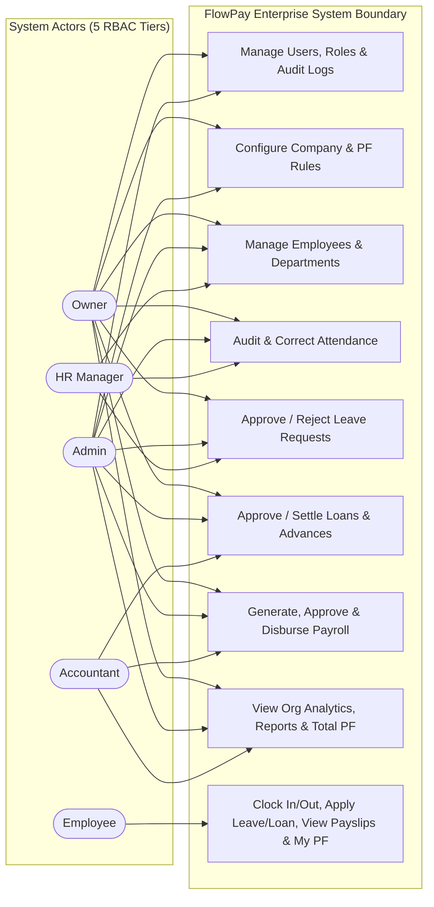
*Figure 3.1: Role-Based Use Case Diagram across the Five RBAC Tiers (`Owner`, `Admin`, `HR`, `Accountant`, `Employee`).*

## 3.2 Entity-Relationship (ER) Model (11 PostgreSQL Tables)

The relational schema in PostgreSQL 15 comprises **11 normalized tables** (`users`, `employees`, `departments`, `attendance_records`, `leave_requests`, `loans`, `loan_repayments`, `payroll_records`, `company_settings`, `notifications`, `audit_logs`) protected by foreign key constraints, `CHECK` constraints, and partial/composite unique indexes.

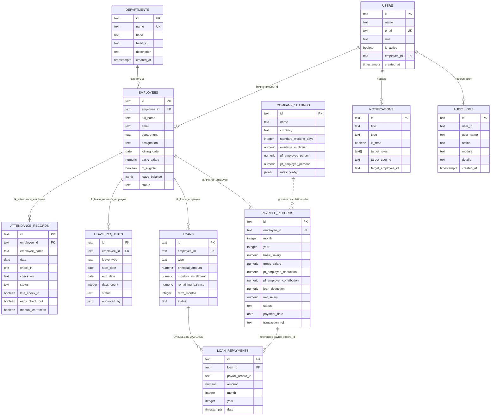
*Figure 3.2: Entity-Relationship (ER) Diagram showing all 11 PostgreSQL Tables, Primary Keys, and Foreign Key Relationships.*

## 3.3 Data Flow Diagrams (DFD Level 0 & Level 1)

### Level 0: Context Diagram

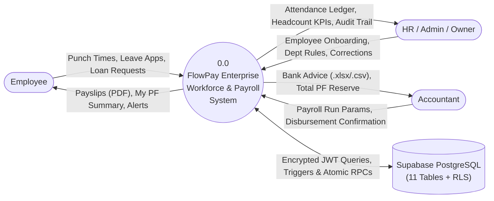
*Figure 3.3(a): Data Flow Diagram — Level 0 Context Diagram.*

### Level 1: Decomposed Core Processes

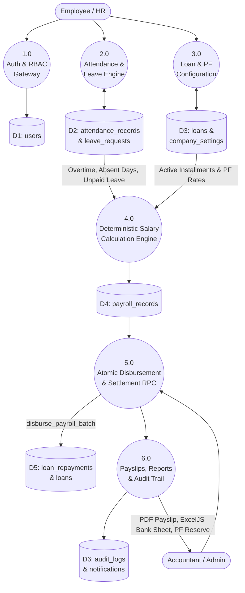
*Figure 3.3(b): Data Flow Diagram — Level 1 Functional Decomposition.*

## 3.4 Sequence Diagram: Payroll Generation to Atomic Disbursement

To prevent race conditions and partial ledger corruption during month-end payouts, **FlowPay** separates generation (`draft`), approval (`approved`), and atomic disbursement (`disburse_payroll_batch` RPC).

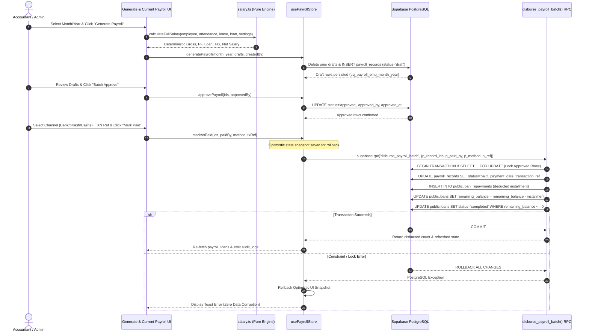
*Figure 3.4: Sequence Diagram for Payroll Generation, Approval, and `disburse_payroll_batch` Atomic RPC.*

## 3.5 System Architecture Diagram (Vercel + Supabase)

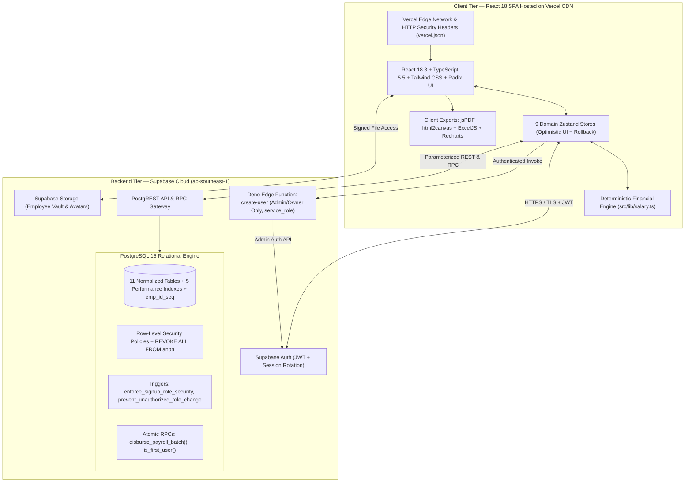
*Figure 3.5: Three-Tier Cloud System Architecture (Vercel CDN Frontend + Supabase Auth, Edge Functions, and PostgreSQL 15).*

---

# Chapter 4: System Implementation & Security Engineering

## 4.1 Deterministic Payroll & Provident Fund Engine

Financial formulas are completely decoupled from React components and stored inside pure, side-effect-free TypeScript functions in `src/lib/salary.ts`.

### Key Mathematical Formulations
1. **IEEE-754 Safe Currency Rounding**:
   $$\text{roundCurrency}(x) = \frac{\lfloor (x + \epsilon) \cdot 100 + 0.5 \rfloor}{100}$$
2. **Gross Salary**:
   $$\text{Gross Salary} = \text{Basic} + \text{House Rent} + \text{Medical} + \text{Transport} + \text{Other Allowances} + \text{Bonus} + \text{Overtime}$$
3. **Overtime & Attendance Deductions** (with Standard Working Days $D_w = 22$, Daily Hours $H_d = 8$ by default):
   $$\text{Daily Rate} = \frac{\text{Basic Salary}}{D_w}, \qquad \text{Hourly Rate} = \frac{\text{Basic Salary}}{D_w \times H_d}$$
   $$\text{Overtime Pay} = \text{Overtime Hours} \times \text{Hourly Rate} \times \text{Multiplier}$$
   $$\text{Absence Deduction} = \text{Absent Days} \times \text{Daily Rate}, \qquad \text{Half-Day Deduction} = \text{Half Days} \times 0.5 \times \text{Daily Rate}$$
   $$\text{Late Deduction} = \left\lfloor \frac{\text{Late Days}}{\text{Late Threshold}} \right\rfloor \times \text{Deduction Days} \times \text{Daily Rate}$$
4. **Provident Fund (PF) & Net Salary Floor**:
   $$\text{Employee PF} = \frac{\text{Basic Salary} \times \text{PF Employee}\%}{100}, \qquad \text{Employer PF} = \frac{\text{Basic Salary} \times \text{PF Employer}\%}{100}$$
   $$\text{Net Salary} = \max\left(0,\ \text{Gross Salary} - (\text{Tax} + \text{Attendance/Leave Deductions} + \text{Loan Installment} + \text{Employee PF} + \text{Other Deductions})\right)$$

### Cumulative Provident Fund Aggregation
The `calculateProvidentFundSummary(records)` helper aggregates all **`paid`** payroll records to compute:
- `employeeTotal`: Cumulative employee PF contributions deducted across paid months.
- `employerTotal`: Cumulative matching employer PF contributions.
- `grandTotal`: Combined Provident Fund reserve (`employeeTotal + employerTotal`).
- `contributionMonths`: Count of distinct paid months containing positive PF contributions.

These metrics are rendered on `DashboardPage.tsx` (both organization-wide **Total Provident Fund (PF) Reserve** for Owner/Admin/Accountant and personal **My Total Provident Fund (PF)** for employees), `EmployeeProfilePage.tsx`, `PayrollDetailPage.tsx`, and `PayslipTemplate.tsx`, while configurable contribution rates (`0–50%`) are governed in `SalarySettingsPage.tsx`.

## 4.2 Database Normalization, Triggers & Atomic RPCs

Schema changes are versioned cleanly through non-destructive incremental SQL migrations:
- **`202611250001_base_schema_and_rls.sql`**: Establishes the 10 baseline tables, composite unique indexes (`uq_payroll_emp_month_year`, `uq_attendance_emp_date`), RLS helper functions (`current_user_role()`, `current_user_employee_id()`, `is_first_user()`), signup/role-change triggers, and `REVOKE ALL FROM anon`.
- **`202611250002_schema_hardening_fk_and_normalization.sql`**: Introduces atomic sequence `emp_id_seq` + `trg_generate_employee_id` (`EMP-001` format), adds Foreign Keys across `attendance_records`, `leave_requests`, `loans`, and `payroll_records`, normalizes loan recoveries into the 11th table `public.loan_repayments` (`ON DELETE CASCADE`), converts date fields to native PostgreSQL `DATE`, adds numeric `CHECK` constraints, and builds 5 performance indexes.
- **`202611250003_disburse_payroll_batch_rpc.sql`**: Defines `disburse_payroll_batch(p_record_ids, p_paid_by, p_method, p_ref)` using `FOR UPDATE` row locking to guarantee atomic payroll disbursement and loan repayment settlement.

## 4.3 Edge Function User Provisioning & Auth Boundaries

Previously, calling `supabase.auth.signUp()` from an Admin browser session risked overwriting the admin's active JWT session. FlowPay resolves this via `supabase/functions/create-user/index.ts`:
1. Verifies the caller's Bearer JWT via the public auth client.
2. Checks `public.users.role` to ensure only `'owner'` or `'admin'` may invoke provisioning (HTTP `403` otherwise).
3. Creates the Auth user server-side using `SUPABASE_SERVICE_ROLE_KEY` with `email_confirm: true` and upserts the `public.users` profile row without perturbing the administrator's browser session.
4. Enforces auth-gated initialization in `MainLayout.tsx` so store data fetches execute strictly after session confirmation.

## 4.4 Frontend State Management, Optimistic UI & Exports

State is partitioned into 9 Zustand stores under `src/stores/`. Critical mutations (`addEmployee`, `updateEmployee`, `deleteEmployee`, `applyLoan`, `approveLoan`, `markAsPaid`, etc.) capture state snapshots prior to Supabase requests and execute deterministic client-side rollbacks + Sonner error toasts if database persistence fails.

Export generation in `src/lib/export.ts` replaces legacy `xlsx` with **`ExcelJS` (`^4.4.0`)** to eliminate prototype pollution/ReDoS CVEs, pairs it with RFC-4180 CSV escaping with UTF-8 BOM (`\uFEFF`) so `৳` renders properly in Excel, and uses `html2canvas` (2x scale) + `jsPDF` for crisp payslips.

## 4.5 Implemented User Interfaces

The following verified system screenshots (`docs/*.png`) demonstrate the implemented web application modules:

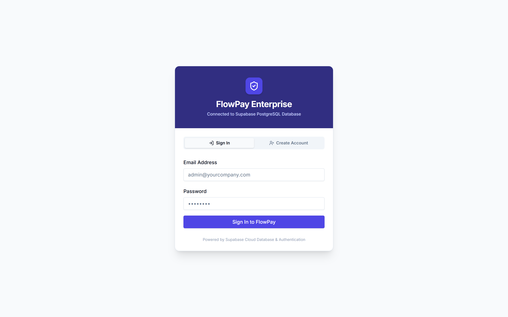
*Figure 4.1: Hardened Authentication Portal (`/login`) without hardcoded credential presets.*

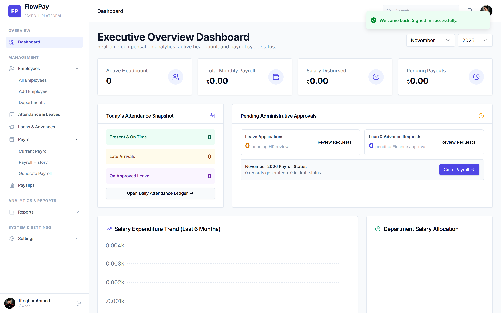
*Figure 4.2: Executive Dashboard (`/`) featuring KPIs, Monthly Payroll Charts, Quick Queues, and Provident Fund Summary.*

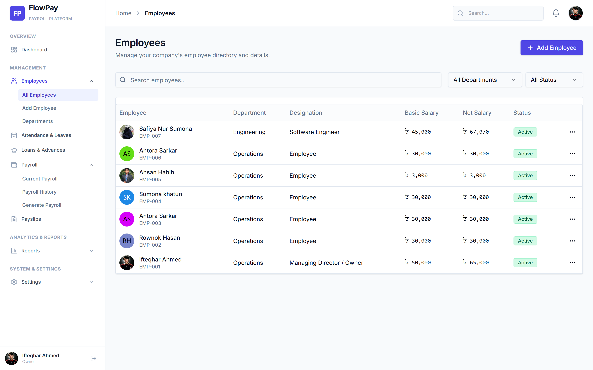
*Figure 4.3: Employee Directory (`/employees`) with search, filters, and ExcelJS/CSV exports.*

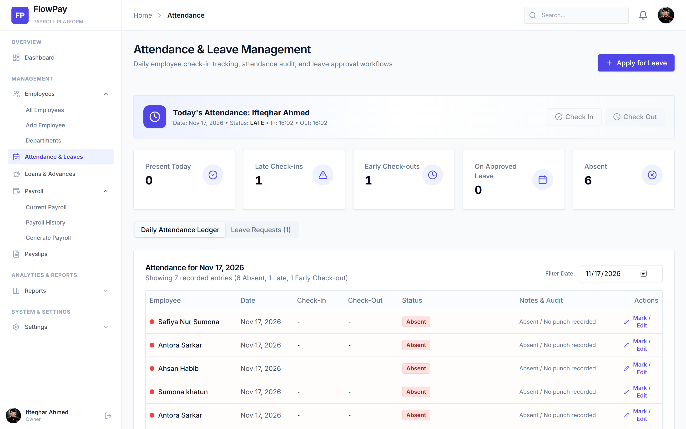
*Figure 4.4: Attendance & Absent Synthesis Ledger (`/attendance`) with 24h military timestamps and manual HR correction.*

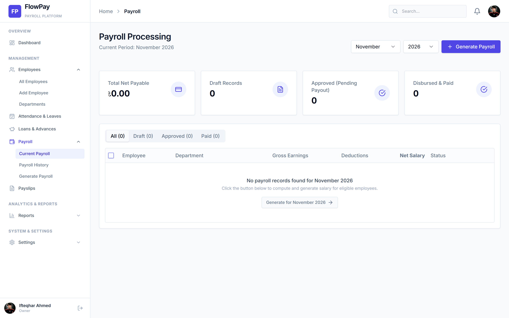
*Figure 4.5: Monthly Payroll Execution & Atomic Batch Disbursement (`/payroll`).*

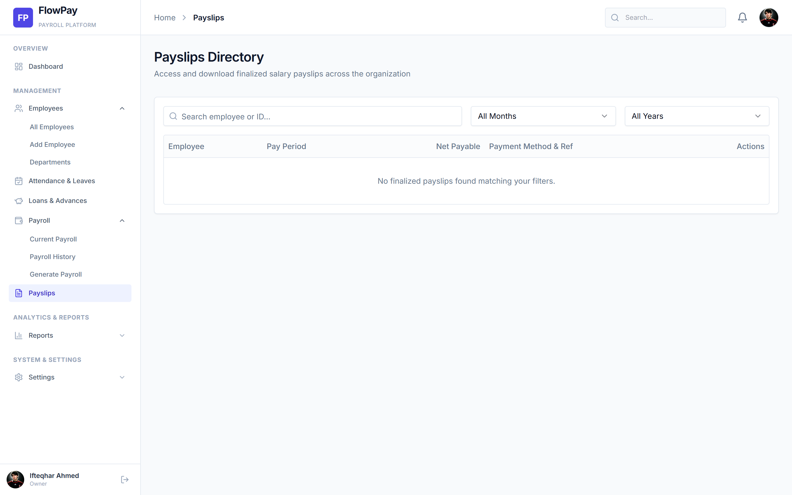
*Figure 4.6: Digital Payslip Center (`/payslips`) with 2x vector PDF export.*

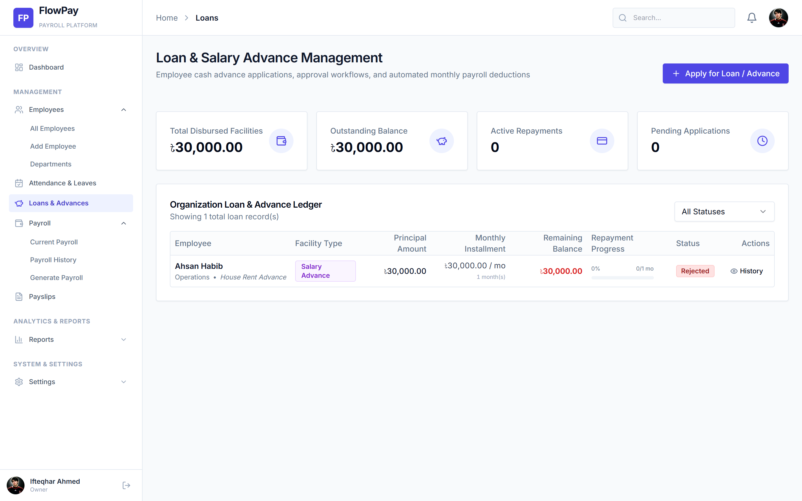
*Figure 4.7: Loans & Salary Advances (`/loans`) backed by normalized `loan_repayments`.*

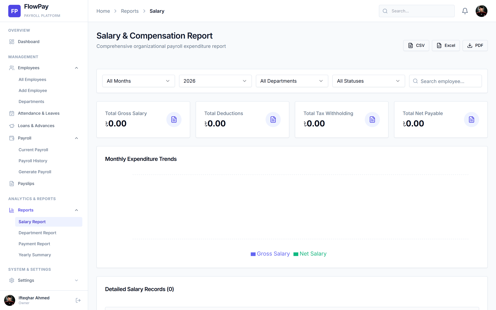
*Figure 4.8: Financial Analytics & Bank Advice Reports (`/reports/*`).*

---

# Chapter 5: Testing, Quality Assurance & Security Audit

## 5.1 Automated Verification Strategy (Vitest & ESLint)

All verification scripts execute under **Vitest `^2.1.8`** (`jsdom` environment) and **ESLint `^10.15.0`** (`eslint.config.js`), ensuring zero regressions after every financial or security modification.

**Table 5.1: Automated Test & Static Analysis Execution Summary**

| Verification Command | Tool / Framework | Scope | Observed Result | Status |
| :--- | :--- | :--- | :--- | :--- |
| `npm run lint` | ESLint v10.15.0 (`typescript-eslint`, `react-hooks`) | Entire `src/` and `tests/` codebase | `0` errors, `0` warnings | **PASS** |
| `npm test` | Vitest v2.1.8 (`tests/payrollCalculations.test.ts`) | Core salary math, overtime, PF & PF summary aggregation | `33 / 33` tests passed | **PASS** |
| `npm test` | Vitest v2.1.8 (`tests/auditValidation.test.ts`) | Technical audit regression assertions (`AUDIT-*`) | `9 / 9` tests passed | **PASS** |
| `npm test` | Vitest v2.1.8 (`tests/stores.test.ts`) | Zustand store optimistic rollback tests (mocked Supabase errors) | `6 / 6` tests passed | **PASS** |
| `npm run build` | Vite v5.3.2 (`Rollup manualChunks`) | Full TypeScript + production chunk build (`3,196` modules) | Built cleanly (`0` warnings/errors) | **PASS** |

## 5.2 Structured Test Case Matrix

**Table 5.2** documents representative test cases executed in the verified **48/48 Vitest suite** across unit, audit, and store integration scenarios.

| Test ID | Test Suite / File | Input Scenario & Parameters | Expected Output | Actual Observed Output | Status |
| :--- | :--- | :--- | :--- | :--- | :--- |
| **TC-01** | `payrollCalculations.test.ts` | Basic salary only (`basicSalary: 50000`, `0` days absent, `0` overtime, PF `0%`) | `grossSalary = 50000`, `totalDeductions = 0`, `netSalary = 50000` | `50000`, `0`, `50000` exact match | **PASS** |
| **TC-02** | `payrollCalculations.test.ts` | Statutory allowance split on `basicSalary: 40000` (50% HR, 30% Med, 20% Trans) | House Rent `20000`, Medical `12000`, Transport `8000`, Total `40000` | `20000`, `12000`, `8000`, `40000` | **PASS** |
| **TC-03** | `payrollCalculations.test.ts` | Fractional overtime (`basicSalary: 44000`, `22` days × `8` hrs, `multiplier: 1.5`, `3.5` hrs OT) | Hourly rate `250`, Overtime pay `1312.50` (`roundCurrency` precision) | `overtimePay = 1312.5` | **PASS** |
| **TC-04** | `payrollCalculations.test.ts` | Provident Fund & Summary (`calculateProvidentFundSummary` on mixed `paid` & `draft` records, rates `10%/10%`) | Aggregates only `paid` records into `employeeTotal`, `employerTotal`, `grandTotal`, and `contributionMonths` | Exact PF totals across paid records only; drafts excluded | **PASS** |
| **TC-05** | `auditValidation.test.ts` (`AUDIT-BUG-01`) | Employee with `2` absent days & `autoDeductAbsenceDays: true` (verify no double deduction) | `absenceDeduction` applied exactly once (`2 × dailyRate`), not duplicated | Single deduction verified | **PASS** |
| **TC-06** | `auditValidation.test.ts` (`AUDIT-CALC-02/03`) | Unpaid leave days + custom deductions with rounding verification | Exact sum of `leaveDeduction` rounded to 2 decimal places (`roundCurrency`) | Exact 2-decimal output | **PASS** |
| **TC-07** | `auditValidation.test.ts` (`AUDIT-LATE-01/02/03`) | Late penalty threshold (`3` lates = `1` day deduction): tests `2` lates, `3` lates, and `6` lates | `2` lates -> `0` days; `3` lates -> `1` day; `6` lates -> `2` days deduction | `0`, `1×dailyRate`, `2×dailyRate` | **PASS** |
| **TC-08** | `auditValidation.test.ts` (`AUDIT-HALF-01`) | Half-day deduction toggle enabled with `1` half-day | Deducts `0.5 × dailyRate` | `0.5 × dailyRate` verified | **PASS** |
| **TC-09** | `auditValidation.test.ts` (`AUDIT-LOAN-01`) | Loan monthly installment `5000` when `remainingBalance = 2200` | Deduction capped at `remainingBalance` (`2200`), preventing over-recovery | `loanDeduction = 2200` | **PASS** |
| **TC-10** | `auditValidation.test.ts` (`AUDIT-SAFE-01`) | Extreme deductions exceeding `grossSalary` | Net salary floor guard enforces `netSalary = 0` (never negative) | `netSalary = 0` | **PASS** |
| **TC-11** | `stores.test.ts` | `usePayrollStore.markAsPaid()` when mocked Supabase RPC `disburse_payroll_batch` throws error | Reverts optimistic state back to `approved` records and throws error | State rolled back cleanly to pre-call snapshot | **PASS** |
| **TC-12** | `stores.test.ts` | `useEmployeeStore` / `useLoanStore` write operations when mocked Supabase returns DB error | Rolls back local Zustand state and prevents phantom UI records | Exact rollback verified (`6 / 6` store tests) | **PASS** |

## 5.3 Security Hardening Summary

**Table 5.3: Identified Security Risks & Implemented Hardening Mitigations**

| Vulnerability / Risk Area | Legacy Exposure | Hardened Implementation |
| :--- | :--- | :--- |
| **Excel Dependency CVEs** | Legacy SheetJS (`xlsx`) carried known Prototype Pollution & ReDoS advisories. | Replaced with **`ExcelJS` (`^4.4.0`)** in `src/lib/export.ts` (`exportToExcel`) and RFC-4180 UTF-8 BOM CSV writer. |
| **Anonymous Database Access** | Default schema grants could permit `anon` key probing of corporate tables. | Executed `REVOKE ALL ON TABLE ... FROM anon` + RLS policies across all 11 tables in `supabase/migrations/`. |
| **Privilege Escalation on Signup** | Self-registration could pass `{ role: 'owner' }` in metadata if unguarded. | Enforced server-side via `is_first_user()` + triggers `enforce_signup_role_security` and `prevent_unauthorized_role_change`. |
| **Admin Session Hijacking** | Client `supabase.auth.signUp()` overwrote active admin session when adding staff. | Moved admin provisioning to **`create-user` Deno Edge Function** executing `adminClient.auth.admin.createUser` server-side. |
| **Non-Atomic Disbursements** | Concurrent disbursement & loan deduction writes risked partial balance corruption. | Replaced sequential client updates with **`disburse_payroll_batch` atomic RPC** (`FOR UPDATE` row locks). |
| **Migration Destructiveness & Secrets** | Earlier migration script risked `DROP TABLE` and exposed connection defaults. | Rewrote `scripts/migrate.js` to apply incremental SQL files via `DATABASE_URL` with TLS verification and strict `src/lib/supabase.ts` env checks. |
| **Clickjacking & MIME Sniffing** | Missing HTTP security response headers on static SPA hosting. | Added strict `X-Frame-Options: DENY`, `X-Content-Type-Options: nosniff`, `Referrer-Policy`, and `Permissions-Policy` in `vercel.json`. |

---

# Chapter 6: Conclusion, Limitations & Future Work

## 6.1 Conclusion & Key Contributions

**FlowPay Enterprise** demonstrates that an SME-oriented payroll and HR platform can combine responsive browser ergonomics with enterprise-grade financial accuracy and database integrity. Key engineering contributions include:
1. A **pure, unit-tested payroll and Provident Fund engine** (`src/lib/salary.ts`) compliant with Bangladesh corporate compensation structures.
2. An **11-table normalized PostgreSQL 15 schema** protected by Row-Level Security, database triggers, `CHECK` constraints, and sequential IDs (`emp_id_seq`).
3. **ACID-guaranteed payroll disbursement** via the `disburse_payroll_batch` stored procedure with `FOR UPDATE` locking and normalized `loan_repayments`.
4. **End-to-end verification** achieving `48/48` passing Vitest tests, `0` ESLint errors/warnings, and hardened production delivery via Vite `manualChunks` on Vercel + Supabase Edge Functions.

## 6.2 Current Limitations

- **Client-Side Clock-In Trust**: Attendance timestamps rely on authenticated browser sessions rather than hardware biometric terminals or geofenced mobile telemetry.
- **Manual Bank / MFS Settlement**: FlowPay prepares bank transfer schedules (`.xlsx`/`.csv`) and records `transaction_ref` numbers after payout rather than executing live money transfers directly via payment gateway APIs.
- **Static Withholding Tax Input**: Monthly tax deduction currently uses configured employee tax figures rather than multi-slab progressive annual tax auto-brackets.

## 6.3 Future Work

1. **Biometric / RFID Attendance Hardware Integration**: Build webhook ingestion endpoints (Supabase Edge Functions) to stream real-time punch events directly from ZKTeco biometric fingerprint, RFID card, or facial recognition terminals into `public.attendance_records`.
2. **bKash / Nagad & Open Banking Live Payout APIs**: Integrate merchant disbursement APIs (bKash Disbursement API, Nagad Corporate Wallet, and Bangladesh Bank BEFTN/NPSB bank APIs) directly inside atomic disbursement callbacks to automate real-time salary settlement and capture gateway-verified `transaction_ref` IDs.
3. **Automated NBR Income Tax Slab Engine**: Implement progressive fiscal-year tax slab calculation aligned with National Board of Revenue (NBR) thresholds (tax-free thresholds, gender/senior exemptions, investment rebates, and monthly TDS amortization).
4. **Automated Email & SMS Payslip Alerts**: Integrate transactional email/SMS gateways (e.g., Resend / Twilio / SSLWireless) triggered post-disbursement to deliver encrypted PDF payslips and monthly PF reserve notifications directly to employees.

---

# IEEE References

[1] IEEE Computer Society, *IEEE Recommended Practice for Software Requirements Specifications (IEEE Std 830-1998)*, New York, NY, USA: IEEE, 1998.  
[2] React Team, *React 18 Documentation: Concurrent Rendering and Hooks Architecture*, Meta Open Source, 2024. [Online]. Available: https://react.dev/  
[3] PostgreSQL Global Development Group, *PostgreSQL 15 Documentation: Row Security Policies, Explicit Locking (`FOR UPDATE`), and PL/pgSQL Functions*, 2024. [Online]. Available: https://www.postgresql.org/docs/15/  
[4] Supabase Inc., *Supabase Architecture: Auth JWTs, Row-Level Security, and Deno Edge Functions*, 2025. [Online]. Available: https://supabase.com/docs  
[5] Poimandres Contributors, *Zustand State Management Library (v4.5)*, GitHub Open Source, 2024. [Online]. Available: https://github.com/pmndrs/zustand  
[6] OWASP Foundation, *OWASP Top 10:2021 — A01 Broken Access Control & A03 Injection Prevention Guidelines*, 2021. [Online]. Available: https://owasp.org/Top10/  
[7] Vitest Contributors, *Vitest Next-Generation Testing Framework (v2.1)*, 2024. [Online]. Available: https://vitest.dev/  
[8] Ministry of Law, Justice and Parliamentary Affairs (Bangladesh), *Bangladesh Labour Act, 2006 (Amended 2013 & 2018): Wages, Working Hours, Leave, and Provident Fund Provisions*, Dhaka, Bangladesh.  
[9] ExcelJS Contributors, *ExcelJS: Workbook Manager for Secure Spreadsheet Generation (v4.4)*, GitHub Open Source, 2024. [Online]. Available: https://github.com/exceljs/exceljs  
[10] Vercel Inc., *Vercel Edge Network & HTTP Security Headers Configuration*, 2025. [Online]. Available: https://vercel.com/docs/projects/project-configuration#headers
