# ফ্লোপে এন্টারপ্রাইজ — পূর্ণাঙ্গ সিস্টেম ও প্রডাক্ট প্রেজেন্টেশন (বাংলা)

**ফ্লোপে (FlowPay): আধুনিক মানবসম্পদ, উপস্থিতি ট্র্যাকিং ও নির্ভুল পে-রোল অটোমেশন সিস্টেম**-এর জন্য একটি পেশাদার, স্লাইড-বাই-স্লাইড প্রেজেন্টেশন ও এক্সিকিউটিভ ডিফেন্স গাইড।

---

## প্রেজেন্টেশন ওভারভিউ

- **শ্রোতা ও প্যানেল**: টেকনিক্যাল রিভিউ কমিটি, এন্টারপ্রাইজ স্টেকহোল্ডার, সিস্টেম আর্কিটেক্ট ও ফিনান্সিয়াল অডিটর।
- **আনুমানিক সময়**: ২০–২৫ মিনিট।
- **মূল প্রতিপাদ্য**: এন্টারপ্রাইজ অটোমেশন, শতভাগ নির্ভুল আর্থিক ক্যালকুলেশন এবং ক্লাউড-স্কেল আর্কিটেকচার।

---

## স্লাইড ১: প্রজেক্ট পরিচিতি ও ভিশন

### ভিজ্যুয়াল প্রিভিউ
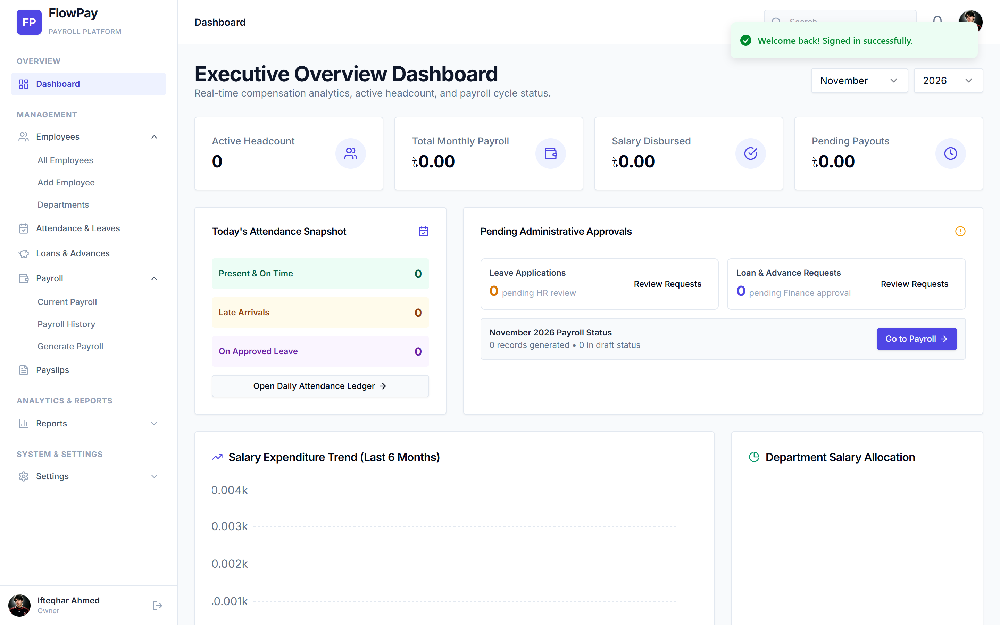

### মূল আলোচনাসমূহ
- **সিস্টেমের নাম**: FlowPay Enterprise
- **ট্যাগলাইন**: স্বয়ংক্রিয় কর্মীবাহিনী ক্ষতিপূরণ ও রিয়েল-টাইম পে-রোল প্ল্যাটফর্ম।
- **কাজের পরিধি**: কর্মীদের লাইফসাইকেল ম্যানেজমেন্ট, ২৪ ঘণ্টার সামরিক নির্ভুলতায় উপস্থিতি লগিং, লোন ও অ্যাডভান্স রিকভারি এবং পে-রোল বিতরণ।
- **লোকাল ও গ্লোবাল স্ট্যান্ডার্ড**: বাংলাদেশের শ্রম আইন অনুযায়ী বিডিটি (`৳`), ২২ কার্যদিবসের স্ট্যান্ডার্ড সাইকেল, ওভারটাইম গুণক এবং মোবাইল ফিনান্সিয়াল সার্ভিসেস (বিকাশ, নগদ, রকেট) সমর্থন।


---

## স্লাইড ২: করপোরেট চ্যালেঞ্জ ও বাস্তব সমস্যাসমূহ

### প্রচলিত সমস্যার ফ্রেমওয়ার্ক

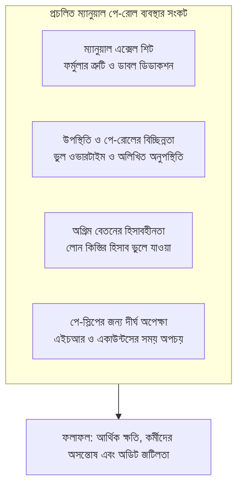

### প্রধান সমস্যাগুলো:
1. **গাণিতিক অসঙ্গতি**: এক্সেলে সূত্র ভুলের কারণে অনুপস্থিতির জন্য দ্বিগুণ বেতন কাটা বা রাউন্ডিংয়ের গরমিল ঘটে।
2. **উপস্থিতির তথ্যের গরমিল**: পাঞ্চ মেশিনের ডেটা একাউন্টস পর্যন্ত পৌঁছাতে মাসের শেষে ৩ থেকে ৫ দিন অতিরিক্ত সময় নষ্ট হয়।
3. **লোন রিকভারি লিক**: কর্মীকে দেওয়া স্যালারি অ্যাডভান্স বা লোনের কিস্তি কাটতে ভুলে যাওয়া প্রতিষ্ঠানের জন্য নীরব আর্থিক ক্ষতি।
4. **স্বচ্ছতার অভাব**: কর্মীরা তাদের ডিডাকশন বা বোনাস কীভাবে নির্ধারিত হলো তা সহজে দেখতে পান না।


---

## স্লাইড ৩: ফ্লোপের সমাধান ও মূল বৈশিষ্ট্যসমূহ

### সমাধান ম্যাট্রিক্স

| প্রধান স্তম্ভ | ফ্লোপে যেভাবে সমাধান করে |
| :--- | :--- |
| **ডিটারমিনিস্টিক ক্যালকুলেশন** | ১০০% বিশুদ্ধ গাণিতিক ফাংশন; গ্রস, অ্যালাউন্স, পিএফ এবং নেট পে নির্ভুলভাবে বের করে। |
| **স্বয়ংক্রিয় এবসেন্ট সিন্থেসিস** | ক্যালেন্ডারের যেকোনো দিনে পাঞ্চ না করা এবং ছুটি না থাকা কর্মীদের স্বয়ংক্রিয়ভাবে 'Absent' হিসেবে চিহ্নিত করে। |
| **সিঙ্ক্রোনাইজড লোন অ্যামরটাইজেশন**| সক্রিয় লোন বা অগ্রিম বেতনের মাসিক কিস্তি স্বয়ংক্রিয়ভাবে বেতন থেকে কেটে নেয় যতক্ষণ না বাকি টাকা শূন্য হয়। |
| **এক ক্লিকে ভেক্টর PDF পে-স্লিপ** | কর্মীরা যেকোনো সময় ডিজিটাল স্বাক্ষর ও ট্রানজেকশন রেফারেন্সসহ অফিশিয়াল পে-স্লিপ ডাউনলোড করতে পারেন। |
| **হাইব্রিড বিতরণ মাধ্যম** | প্রাতিষ্ঠানিক ব্যাংক অ্যাকাউন্ট ও মোবাইল ব্যাংকিং (বিকাশ, নগদ, রকেট) উভয়ের মাধ্যমেই বেতন পরিশোধের সুযোগ। |


---

## স্লাইড ৪: প্রযুক্তিগত স্ট্যাক ও আধুনিক আর্কিটেকচার

### সিস্টেম আর্কিটেকচার টপোলজি

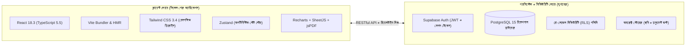

### ব্যবহৃত প্রযুক্তি:
- **ফ্রন্টএন্ড**: React 18 ও TypeScript 5.5—যা রান-টাইম ত্রুটি সম্পূর্ণ দূর করে।
- **স্টেট ম্যানেজমেন্ট**: Zustand-এর ৯টি স্বাধীন ডোমেন স্টোর—যা **Optimistic UI** সুবিধা দেয় (ক্লিক করার সাথে সাথে স্ক্রিন আপডেট হয়)।
- **ডাটাবেজ**: PostgreSQL 15 (Supabase Cloud-এ হোস্ট করা), যা ফরেন কি কনস্ট্রেইন্ট এবং ট্রানজেকশনাল ইন্টিগ্রিটি নিশ্চিত করে।
- **ডকুমেন্ট প্রসেসিং**: SheetJS (`xlsx`) দিয়ে এক্সেল শিট এক্সপোর্ট এবং `jsPDF` ও `html2canvas` দিয়ে ভেক্টর PDF রেন্ডারিং।


---

## স্লাইড ৫: নিরাপদ প্রমাণীকরণ ও ভূমিকা-ভিত্তিক অ্যাক্সেস নিয়ন্ত্রণ (RBAC)

### ভিজ্যুয়াল প্রিভিউ
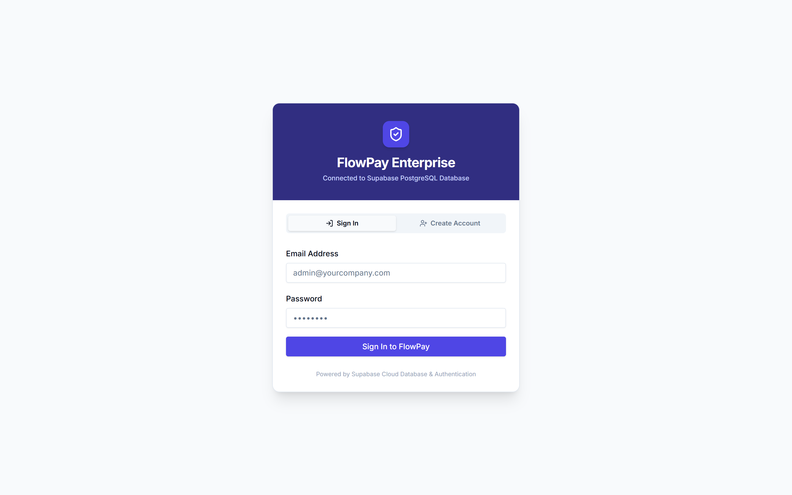

### নিরাপত্তা স্পেসিফিকেশন
- **৫টি স্তরের রোল পারমিশন**: `Owner` (মালিক), `Admin` (অ্যাডমিন), `Accountant` (হিসাবরক্ষক), `HR` (মানবসম্পদ) এবং `Employee` (সাধারণ কর্মী)।
- **প্রথম সুপার অ্যাডমিন বুটস্ট্র্যাপ**: একদম ফাঁকা ডাটাবেজে প্রথম যে ব্যক্তি সাইন-আপ করবেন তিনি স্বয়ংক্রিয়ভাবে 'Owner' মর্যাদা পান। এর পরের সকল পাবলিক সাইন-আপ সরাসরি নিরাপদ 'Employee' রোলে যায়।
- **পোস্টগ্রেস্ রো-লেভেল সিকিউরিটি (RLS)**: কেউ ব্রাউজারের কনসোল থেকে সরাসরি ডেটা দেখার চেষ্টা করলেও ডাটাবেজ পলিসি অননুমোদিত অ্যাক্সেস আটকে দেয়।

### পারমিশন হায়ারার্কি

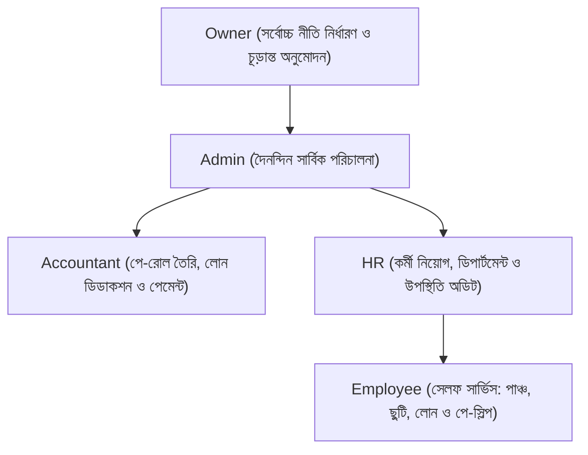


---

## স্লাইড ৬: এক্সিকিউটিভ ড্যাশবোর্ড ও রিয়েল-টাইম বিজনেস ইন্টেলিজেন্স

### ভিজ্যুয়াল প্রিভিউ


### ড্যাশবোর্ডের প্রধান সুবিধাসমূহ
- **রিয়েল-টাইম কেপিআই (KPIs)**: মোট সক্রিয় কর্মী সংখ্যা, মাসিক বেতনের বাজেট, মোট পরিশোধিত অর্থ এবং অনুমোদনের অপেক্ষায় থাকা আইটেম।
- **ইন্টারেক্টিভ চার্ট**: Recharts এর মাধ্যমে তৈরি মাসিক খরচের ট্রেন্ড (Area Chart) এবং ডিপার্টমেন্টভিত্তিক খরচ বণ্টন (Bar Chart)।
- **কুইক অ্যাকশন কিউ**: পেন্ডিং থাকা ছুটির আবেদন এবং লোন পর্যালোচনার ওয়ান-ক্লিক শর্টকাট।
- **ভূমিকা-ভিত্তিক অ্যাডাপ্টিভ ডিসপ্লে**: সাধারণ কর্মী লগইন করলে ড্যাশবোর্ডটি স্বয়ংক্রিয়ভাবে তার ব্যক্তিগত বাৎসরিক আয়, ছুটির ব্যালেন্স ও উপস্থিতি কার্ডে রূপান্তরিত হয়।


---

## স্লাইড ৭: কর্মী ব্যবস্থাপনা ও বিধিবদ্ধ ভাতা কাঠামো

### ভিজ্যুয়াল প্রিভিউ
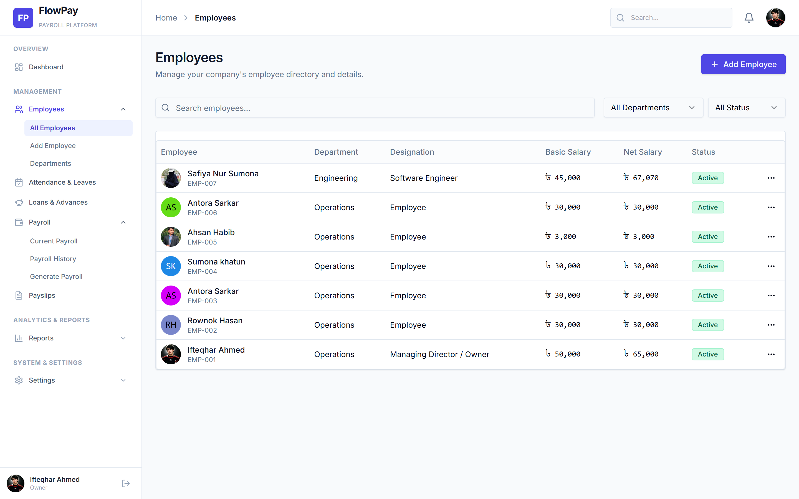

### উল্লেখযোগ্য কারিগরি বৈশিষ্ট্য
- **ব্রাউজার ক্যানভাস ইমেজ কম্প্রেশন**: ছবি আপলোডের সময় ব্রাউজারের ভেতর HTML5 Canvas স্বয়ংক্রিয়ভাবে ছবিটিকে চারকোনা করে এবং ৫ মেগাবাইট ছবিকে ২৫ কিলোবাইটের WebP ফরম্যাটে সংকুচিত করে।
- **স্বয়ংক্রিয় অ্যালাউন্স ইঞ্জিন**: মূল বেতন (Basic Salary) লিখলেই বাংলাদেশের শ্রম আইনের মানদণ্ড অনুযায়ী ভাতা বিভাজন হয়ে যায়:
  - **বাড়ি ভাড়া ভাতা (House Rent)**: বেসিকের ৫০%
  - **চিকিৎসা ভাতা (Medical Allowance)**: বেসিকের ৩০%
  - **যাতায়াত ভাতা (Transport Allowance)**: বেসিকের ২০%
- **মাল্টি-চ্যানেল পেমেন্ট প্রোফাইল**: প্রাতিষ্ঠানিক ব্যাংক অ্যাকাউন্ট (অ্যাকাউন্ট ও রাউটিং নম্বর) এবং মোবাইল ব্যাংকিং ওয়ালেট (বিকাশ, নগদ, রকেট) সংরক্ষিত থাকে।


---

## স্লাইড ৮: সামরিক নির্ভুলতায় উপস্থিতি ও স্বয়ংক্রিয় এবসেন্ট সনাক্তকরণ

### ভিজ্যুয়াল প্রিভিউ
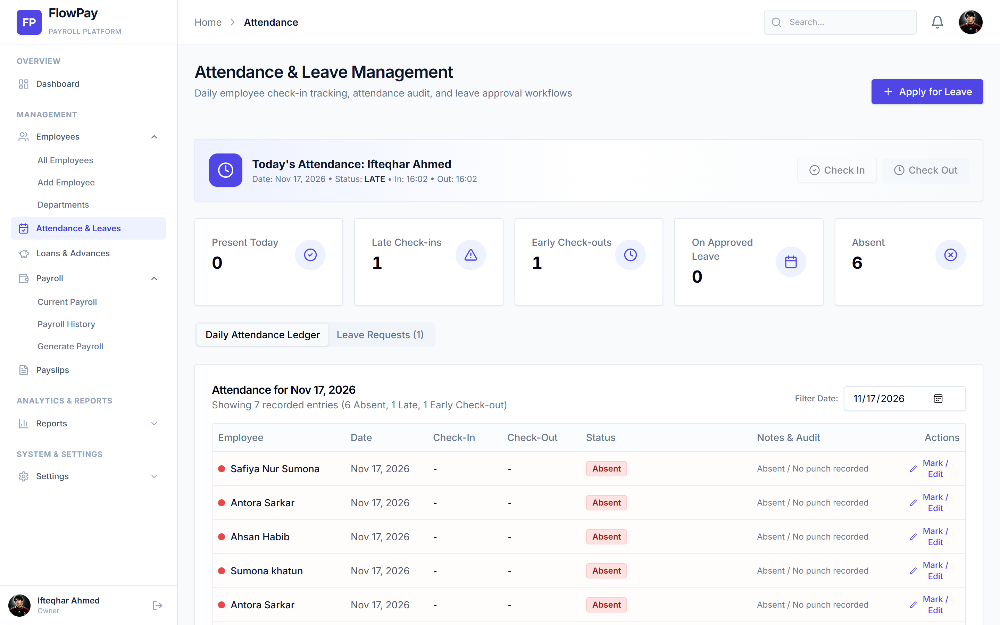

### উদ্ভাবনী কারিগরি দিক
- **২৪ ঘণ্টার মিলিটারি টাইম ট্র্যাকিং**: প্রতিটি ক্লক-ইন এবং ক্লক-আউট মিনিটের হিসাবে নিবন্ধিত হয়।
- **দেরি ও সময়ের পূর্বে প্রস্থান স্বয়ংক্রিয় সনাক্তকরণ**:
  - সকাল ০৯:১৫ এর পরে আসলে স্বয়ংক্রিয়ভাবে **`Late`** স্ট্যাটাস পড়ে।
  - বিকেল ১৭:০০ (০৫:০০ PM)-এর পূর্বে বের হলে **`Early Checkout`** ফ্ল্যাগ যুক্ত হয়।
- **অ্যাবসেন্ট সিন্থেসিস (Absent Synthesis)**: ক্যালেন্ডারের যেকোনো তারিখের লেজারে সিস্টেম সকল সক্রিয় কর্মীর তালিকা পরীক্ষা করে। যার পাঞ্চ নেই এবং কোনো অনুমোদিত ছুটি নেই, তাকে স্বয়ংক্রিয়ভাবে লাল মার্কারসহ **`Absent`** হিসেবে দেখানো হয়।
- **এইচআর অডিট কারেকশন**: ভুলবশত পাঞ্চ করতে ভুলে গেলে এইচআর ম্যানেজার অডিট নোট লিখে তা সংশোধন করতে পারেন।


---

## স্লাইড ৯: ছুটির আবেদন ও ব্যালেন্স অটো-সিঙ্ক

### ওয়ার্কফ্লো ডায়াগ্রাম

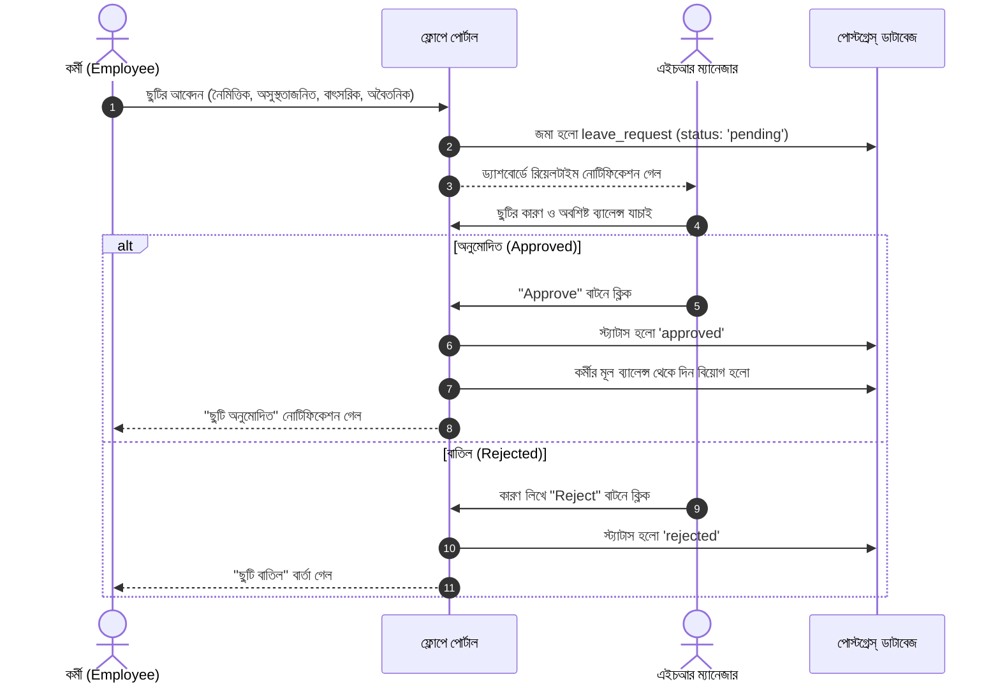


---

## স্লাইড ১০: লোন ও অগ্রিম বেতন স্বয়ংক্রিয় রিকভারি

### ভিজ্যুয়াল প্রিভিউ
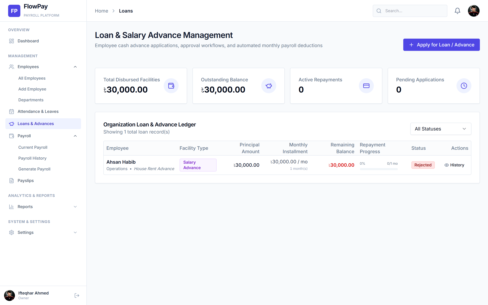

### মূল বৈশিষ্ট্যসমূহ
- **জরুরি অগ্রিম ও পার্সোনাল লোন**: স্বল্পমেয়াদী স্যালারি অ্যাডভান্স (১–৩ মাস) এবং দীর্ঘমেয়াদী পার্সোনাল লোন (৬–২৪ মাস) সমর্থন।
- **স্বয়ংক্রিয় কিস্তি কর্তন**: লোন অনুমোদিত হওয়ার পর প্রতি মাসের পে-রোলে ওই কর্মীর কিস্তির টাকা স্বয়ংক্রিয়ভাবে ডিডাকশন অংশে বসে যায়।
- **ব্যালেন্স শূন্য হলে অটো-ক্লোজ**: কিস্তি কাটতে কাটতে যখন বাকি টাকা ০ হয়ে যায়, সিস্টেম লোনটিকে `Completed` করে দেয় এবং পরের মাস থেকে আর কোনো টাকা কাটে না।
- **আগেভাগে পরিশোধের সুবিধা**: কর্মী চাইলে এককালীন ক্যাশ দিয়ে যেকোনো সময় লোন ক্লোজ করতে পারেন।


---

## স্লাইড ১১: নির্ভুল পে-রোল ক্যালকুলেশন ইঞ্জিন (`src/lib/salary.ts`)

### গাণিতিক মডেলের ফ্লোচার্ট

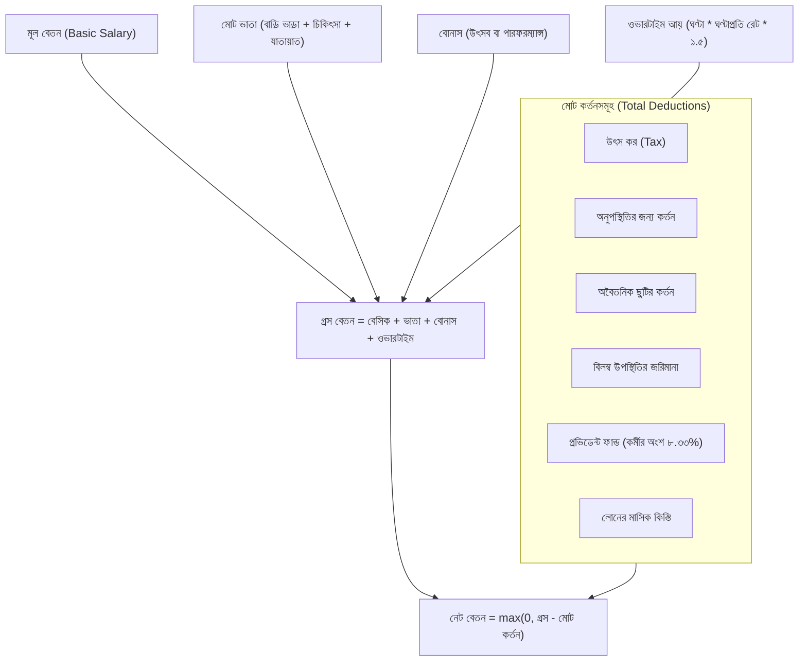

### গাণিতিক ফর্মুলা ও সুরক্ষা:
1. **ওভারটাইম রেট**:
   $$\text{ঘণ্টাপ্রতি রেট} = \frac{\text{মূল বেতন}}{\text{স্ট্যান্ডার্ড কর্মদিবস} \times \text{দৈনিক কর্মঘণ্টা}}$$
2. **অনুপস্থিতির ডিডাকশন**:
   $$\text{অনুপস্থিতির কর্তন} = \text{অনুপস্থিত দিন} \times \frac{\text{মূল বেতন}}{\text{স্ট্যান্ডার্ড কর্মদিবস}}$$
3. **নেট স্যালারি ফ্লোরিং সেফগার্ড**:
   $$\text{নেট বেতন} = \max\left(0, \text{গ্রস বেতন} - \text{মোট কর্তন}\right)$$


---

## স্লাইড ১২: মাসিক পে-রোল সম্পাদন ও পেমেন্ট রিকনসিলিয়েশন

### ভিজ্যুয়াল প্রিভিউ
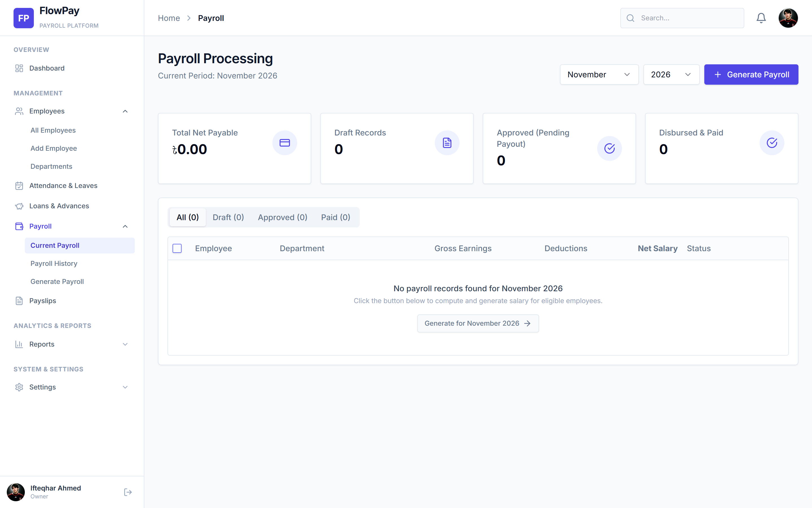

### পে-রোল প্রক্রিয়ার ৪টি সহজ ধাপ:
1. **স্বয়ংক্রিয় জেনারেশন (`/payroll/generate`)**: মাস ও বছর নির্বাচন করলেই সিস্টেম উপস্থিতির খাতা থেকে ওভারটাইম ও এবসেন্ট দিন এবং লোন থেকে কিস্তি এনে ড্রাফট তৈরি করে।
2. **পর্যালোচনা ও বিশেষ সমন্বয়**: হিসাবরক্ষক ড্রাফট দেখে প্রয়োজনে বিশেষ বোনাস বা রিইমবার্সমেন্ট যোগ করতে পারেন।
3. **ব্যাচ অনুমোদন**: ম্যানেজমেন্ট এক ক্লিকে পুরো মাসের ড্রাফট `Approved` করে দেয়।
4. **বেতন বিতরণ ও ট্রানজেকশন আইডি**: ব্যাংক ট্রান্সফার বা বিকাশ সিলেক্ট করে ব্যাংকের ট্রানজেকশন রেফারেন্স (`TXN-REF`) এন্ট্রি দিয়ে `Paid` মার্ক করা হয়।


---

## স্লাইড ১৩: ডিজিটাল পে-স্লিপ ও তাৎক্ষণিক ভেক্টর PDF ডাউনলোড

### ভিজ্যুয়াল প্রিভিউ
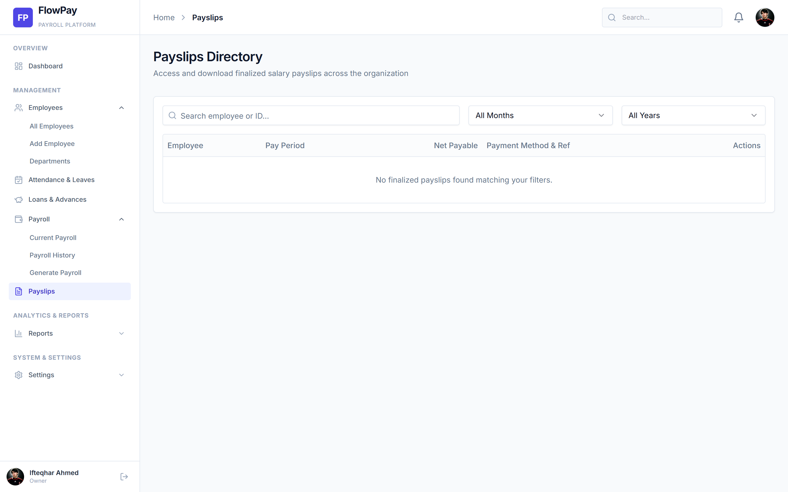

### পে-স্লিপ সেন্টারের বিশেষত্ব
- **হাই-রেজোলিউশন ভেক্টর PDF**: `html2canvas` ও `jsPDF` দিয়ে ২x স্কেলে ক্রিস্প এবং স্পষ্ট প্রিন্ট-রেডি ফরম্যাটে তৈরি।
- **আয় ও ব্যয়ের পূর্ণাঙ্গ বিবরণী**: আর্নিংস ও ডিডাকশন আলাদা কলামে বিস্তারিতভাবে দেখানো হয়।
- **ডিজিটাল বৈধতা**: ডিজিটাল সিগনেচার, পে-আউটের তারিখ এবং ডাটাবেজ ইউনিক আইডিসহ সংরক্ষিত থাকে।
- **কর্মীদের সেলফ-সার্ভিস**: কর্মীরা ঘরে বসেই যেকোনো ডিভাইসে তাদের অতীতের যেকোনো মাসের পে-স্লিপ দেখতে পারেন।


---

## স্লাইড ১৪: আর্থিক অ্যানালিটিক্স, রিপোর্ট ও ব্যাংক শিট এক্সপোর্ট

### ভিজ্যুয়াল প্রিভিউ
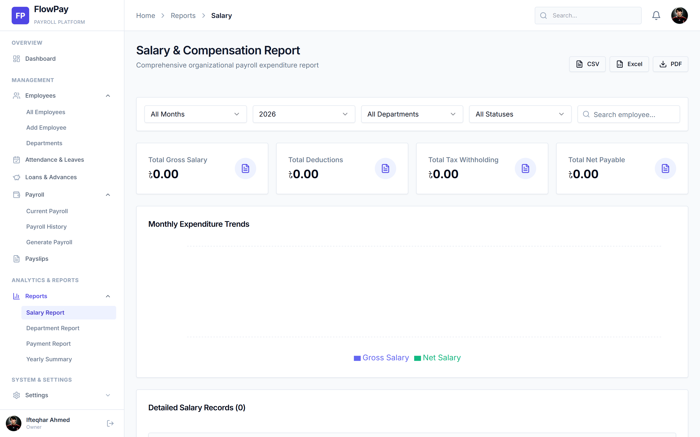

### রিপোর্টের বৈচিত্র্য
- **ব্যাংক অ্যাডভাইস শিট**: করপোরেট অনলাইন ব্যাংকিংয়ে আপলোড করার জন্য এক ক্লিকে এক্সেল (`.xlsx`) ও সিএসভি আকারে রেডি শিট।
- **ডিপার্টমেন্টভিত্তিক খরচ বিশ্লেষণ**: কোন বিভাগে মোট কত টাকা বেতন ব্যয় হচ্ছে তার গ্রাফিক্যাল ডিসপ্লে।
- **বাৎসরিক বাজেট সামারি**: গত ১২ মাসের মোট গ্রস ও নেট ব্যয়ের তুলনামূলক রিয়েল-টাইম চার্ট।


---

## স্লাইড ১৫: সিস্টেম সিকিউরিটি, অডিট লগ ও কমপ্লায়েন্স

### নিরাপত্তা কাঠামোর ম্যাট্রিক্স

| সিকিউরিটি মাত্রা | কীভাবে বাস্তবায়ন করা হয়েছে |
| :--- | :--- |
| **অপরিবর্তনীয় অডিট লগ** | প্রতিটি বেতন পরিবর্তন, ছুটির অনুমোদন বা টাকা প্রদানের ঘটনা `public.audit_logs`-এ সংরক্ষিত হয়। |
| **ডাটাবেজ এনক্রিপশন** | সম্পূর্ণ নেটওয়ার্ক ট্রাফিক SSL/TLS এনক্রিপ্টেড এবং পাসওয়ার্ড bcrypt দিয়ে হ্যাশ করা। |
| **এসকিউএল ইনজেকশন প্রতিরোধ** | সুপাবেজ এসডিকে এবং পোস্টগ্রেস্ প্রিপেয়ার্ড স্টেটমেন্টের মাধ্যমে প্যারামিটারাইজড কুয়েরি। |
| **সেশন সুরক্ষা** | স্বল্পমেয়াদী JWT টোকেন এবং নিরাপদ সেশন রিফ্রেশ মেকানিজম। |


---

## স্লাইড ১৬: স্বয়ংক্রিয় সফটওয়্যার টেস্টিং ও গুণগত মান নিশ্চিতকরণ

### টেস্ট রানার সারাংশ

```bash
# পে-রোল ক্যালকুলেশন টেস্ট রান
npm test
# ফলাফল: ৩০ টি টেস্টের ৩০ টিতেই সফল (100% Passed)

# সিস্টেম আর্কিটেকচার ও অডিট টেস্ট রান
npx tsx tests/auditValidation.test.ts
# ফলাফল: ৯ টি টেস্টের ৯ টিতেই সফল (100% Passed)
```

### যেসব জটিল দৃশ্যপট টেস্ট করা হয়েছে:
- ২২ কর্মদিবসের স্ট্যান্ডার্ড বেসিক রেট নির্ণয়।
- ভগ্নাংশ ঘণ্টার নিখুঁত ওভারটাইম গুণক।
- একই দিনে অনুপস্থিতি ও ছুটির ডাবল ডিডাকশন প্রতিরোধ।
- লোনের কিস্তি অবশিষ্ট ব্যালেন্সের বেশি না কাটার সুরক্ষা।
- নেট বেতন কোনো অবস্থাতেই শূন্যের নিচে না যাওয়ার ফ্লোরিং গার্ড।


---

## স্লাইড ১৭: প্রোডাকশন ডেপ্লয়মেন্ট ও স্কেলেবিলিটি

### প্রযুক্তিগত সুবিধা
- **ভিট অপ্টিমাইজড বান্ডেল**: দ্রুততম সময়ে রেন্ডারিং এবং ব্রাউজার ক্যাশিং।
- **পোস্টগ্রেস্ কানেকশন পুলার**: হাজার হাজার রিকোয়েস্ট একসাথে সামলানোর জন্য সুপাবেজের ট্রানজেকশন পুলার সক্রিয়।
- **আইডেমপোটেন্ট মাইগ্রেশন**: ডাটা না হারিয়ে ডাটাবেজ আপডেট করার স্বয়ংক্রিয় মাইগ্রেশন স্ক্রিপ্ট।
- **ফুল রেসপন্সিভ ডিজাইন**: ডেক্সটপ মনিটর থেকে শুরু করে যেকোনো অ্যান্ড্রয়েড বা আইফোনে ব্যবহারযোগ্য।


---

## স্লাইড ১৮: ভবিষ্যৎ পরিকল্পনা ও উপসংহার

### ভবিষ্যৎ উন্নয়ন পরিকল্পনা
1. **বায়োমেট্রিক ডিভাইস ইন্টিগ্রেশন**: ফিঙ্গারপ্রিন্ট ও ফেসিয়াল অ্যাটেনডেন্স ডিভাইসের সাথে সরাসরি IoT ওয়েবহুক সংযোগ।
2. **ডাইরেক্ট ব্যাংক এপিআই**: ওপেন ব্যাংকিং এবং বিকাশ মার্চেন্ট এপিআই-এর মাধ্যমে সফটওয়্যার থেকেই সরাসরি ১-ক্লিকে টাকা পাঠানো।
3. **এআই-চালিত অ্যানোমালি ডিটেকশন**: অস্বাভাবিক ওভারটাইম বা অস্বাভাবিক উপস্থিতির প্যাটার্ন শনাক্ত করতে মেশিন লার্নিং ব্যবহার।

### চূড়ান্ত বক্তব্য
- **FlowPay Enterprise** করপোরেট পে-রোল ও কর্মীবাহিনী ব্যবস্থাপনাকে করেছে ঝামেলাহীন, স্বয়ংক্রিয় এবং স্বচ্ছ।
- এটি মানবীয় ভুলের অবসান ঘটিয়ে মাসের শেষের জটিল কাজকে কয়েক মিনিটের সহজ কাজে পরিণত করেছে।


---
*ফ্লোপে এন্টারপ্রাইজ প্রেজেন্টেশন • সংস্করণ ২.০ • নভেম্বর ২০২৬*
