# FlowPay Enterprise — Executive Product & Architecture Presentation (English)

A comprehensive, slide-by-slide technical and executive defense presentation for **FlowPay: Modern Human Resources, Attendance & Payroll Management System**.

---

## Presentation Overview

- **Audience**: Technical Review Committee, Enterprise Stakeholders, System Architects, and Financial Executives.
- **Estimated Duration**: 20–25 Minutes.
- **Theme**: Enterprise-grade Automation, Precision Financial Engineering, and Scalable Cloud Architecture.

---

## Slide 1: Title & Executive Introduction

### Visual Preview
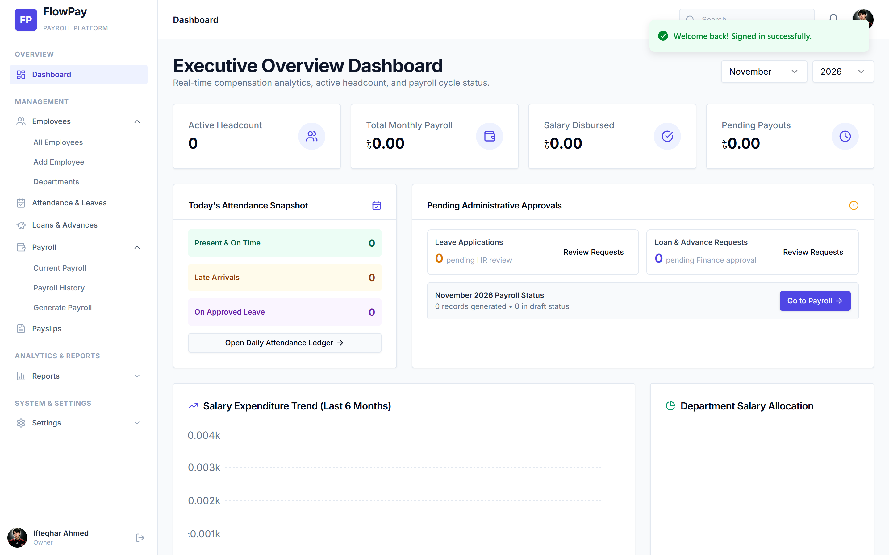

### Key Discussion Points
- **System Name**: FlowPay Enterprise
- **Tagline**: Automated Workforce Compensation & Real-Time Payroll Intelligence Platform.
- **Scope**: End-to-end Human Resource Operations, Daily Time & Attendance Tracking, Dynamic Loan Recoveries, and Deterministic Payroll Disbursement.
- **Core Market Focus**: Multi-currency flexibility with built-in statutory compliance for Bangladesh labor standards (BDT `৳`, 22-day cycles, standard overtime multipliers, and Mobile Financial Services).


---

## Slide 2: Industry Challenges & Market Problem Statement

### The Problem Matrix

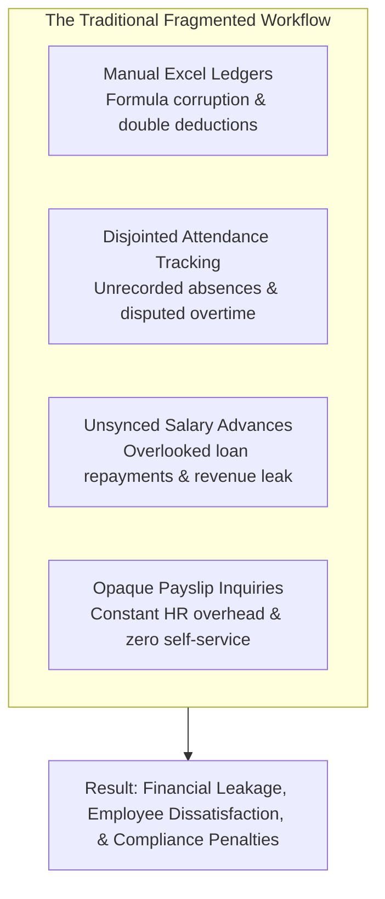

### Key Operational Pain Points
1. **Mathematical Inconsistencies**: Manual salary formulas frequently cause double deductions for absences and rounding drift.
2. **Attendance Disconnect**: Time-tracking clocks are decoupled from payroll; HR spends days manually aggregating overtime and tardiness.
3. **Loan Recovery Leakage**: Salary advances and loans are forgotten or manually tracked on notebooks, leading to financial loss.
4. **Lack of Audit Trail**: No tamper-proof logs indicating who approved raises, changed attendance records, or disbursed salaries.


---

## Slide 3: The FlowPay Solution & Core Value Proposition

### System Capabilities Matrix

| Functional Pillar | How FlowPay Solves It |
| :--- | :--- |
| **Deterministic Calculations** | Pure mathematical formulas guarantee exact Gross, Allowances, PF, and Net Pay with zero rounding anomalies. |
| **Automated Absence Synthesis** | Daily evaluation flags unexcused absences automatically, eliminating manual roll-calls. |
| **Synchronized Loan Amortization**| Monthly loan installments deduct automatically from salary until remaining balance reaches zero. |
| **Instant Vector PDF Payslips** | Employees preview and download print-ready, digitally validated PDF payslips in 1 click. |
| **Hybrid Disbursement** | Native support for corporate banking routing numbers and MFS channels (bKash, Nagad, Rocket). |


---

## Slide 4: Technology Stack & Modern Architecture

### Architecture Topology

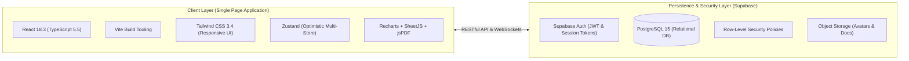

### Technology Breakdown
- **Frontend Framework**: React 18 with TypeScript 5 for type safety and runtime stability.
- **State Architecture**: Decentralized Zustand stores providing instantaneous **Optimistic UI** updates with background PostgreSQL synchronization.
- **Database Engine**: PostgreSQL 15 hosted on Supabase, enforcing foreign keys, unique period constraints, and cascading integrity.
- **Reporting Engine**: SheetJS (`xlsx`) for bidirectional Excel workflows and `jsPDF` for client-side vector document rendering.


---

## Slide 5: Secure Authentication & Role-Based Access Control (RBAC)

### Visual Preview
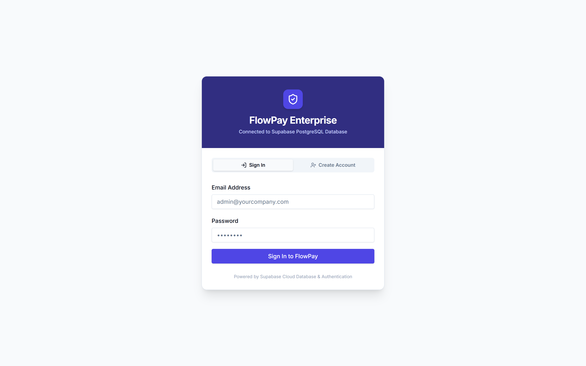

### Security Specifications
- **Multi-Tier RBAC**: 5 strictly partitioned roles: `Owner`, `Admin`, `Accountant`, `HR`, and `Employee`.
- **First Super Admin Bootstrap**: The first user to register on an empty instance is automatically elevated to `Owner`. All subsequent public signups strictly default to `Employee`.
- **Database Row-Level Security (RLS)**: Even if API requests are manipulated on the client side, PostgreSQL policies block unauthorized reads and writes at the database layer.

### Permissions Overview

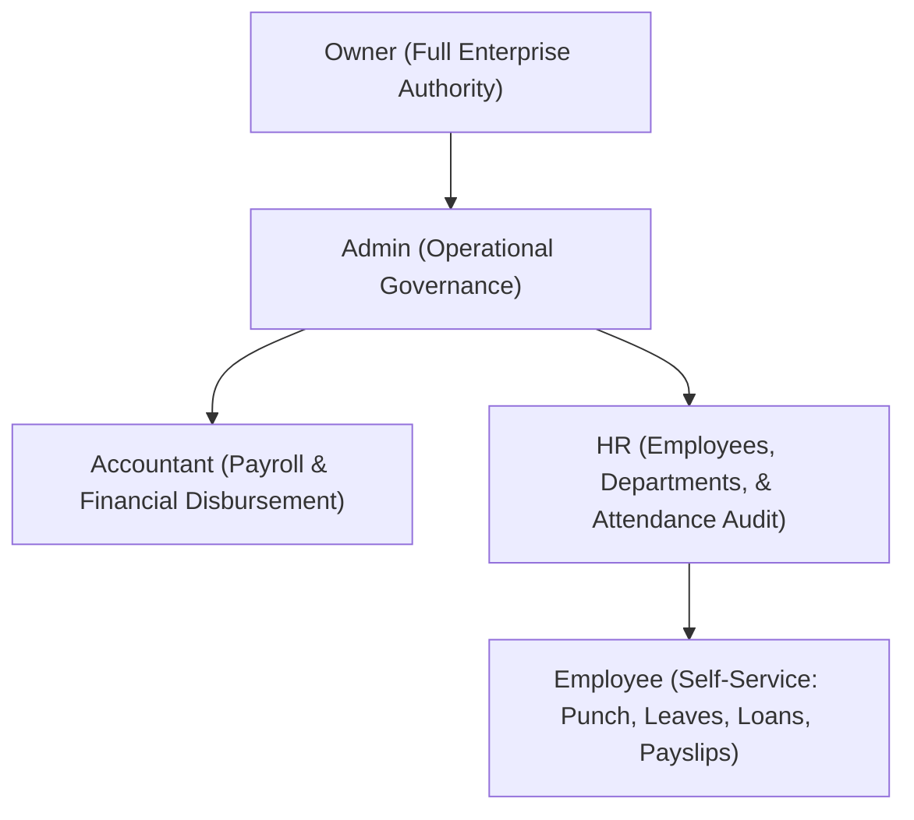


---

## Slide 6: Executive Dashboard & Operational Telemetry

### Visual Preview


### Dashboard Capabilities
- **Real-Time KPIs**: Total active headcount, monthly payroll expenditure, disbursed amounts, and pending approvals.
- **Dynamic Charting**: Monthly salary expense trajectory via Recharts Area Charts and departmental cost allocation via Bar Charts.
- **Action Queues**: Instant shortcuts for pending leave requests, unapproved loans, and unresolved attendance disputes.
- **Adaptive Role Rendering**: When an employee logs in, the dashboard dynamically morphs into a personal portal showing their year-to-date earnings, recent attendance logs, and leave quotas.


---

## Slide 7: Employee Lifecycle & Statutory Allowance Breakdown

### Visual Preview
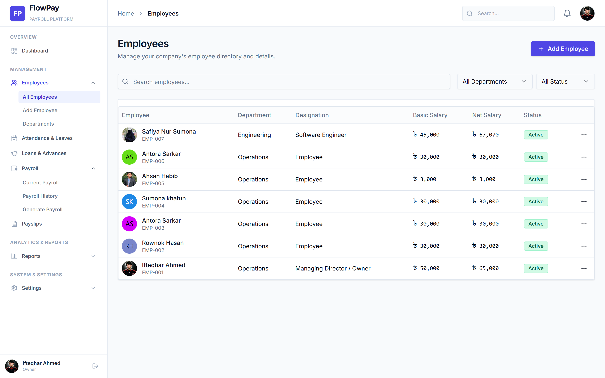

### Core Features
- **Client-Side Image Compression**: Profile photos are automatically resized, cropped to a square, and compressed to ~25KB WebP data on an HTML5 canvas before upload.
- **Automated Allowance Engine**: Entering the Basic Salary automatically calculates standard Bangladesh labor splits:
  - **House Rent Allowance**: 50% of Basic
  - **Medical Allowance**: 30% of Basic
  - **Transport Allowance**: 20% of Basic
- **Multi-Channel Payout Profile**: Stores both institutional banking coordinates (Account, Routing) and Mobile Financial Services accounts (bKash, Nagad, Rocket).


---

## Slide 8: Real-Time Attendance & Automated Absence Detection

### Visual Preview
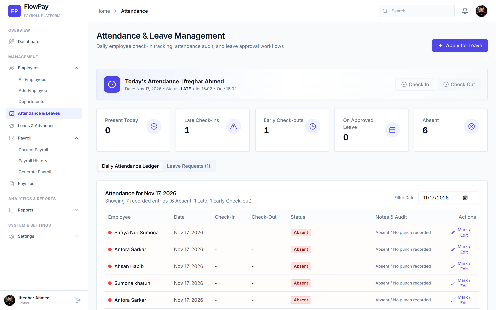

### Technical Innovations
- **High-Precision 24h Military Telemetry**: Clock-in and clock-out timestamps are tracked down to the exact minute.
- **Automated Tardiness & Early Departure Flags**:
  - Check-in after 09:15 AM triggers `status: 'late'` and renders an amber indicator.
  - Check-out before 17:00 (5:00 PM) triggers `status: 'early_checkout'` with an orange badge.
- **Absence Day Synthesis**: The daily attendance ledger cross-references the entire active employee roster against check-in records and approved leave applications. Anyone missing is automatically rendered with an **Absent** status in real time.
- **Audited Manual Corrections**: Managers can click 'Mark / Edit' to correct punch discrepancies; all manual modifications are tagged and stamped with the editor's identity.


---

## Slide 9: Leave Application & Quota Synchronization

### Workflow Diagram

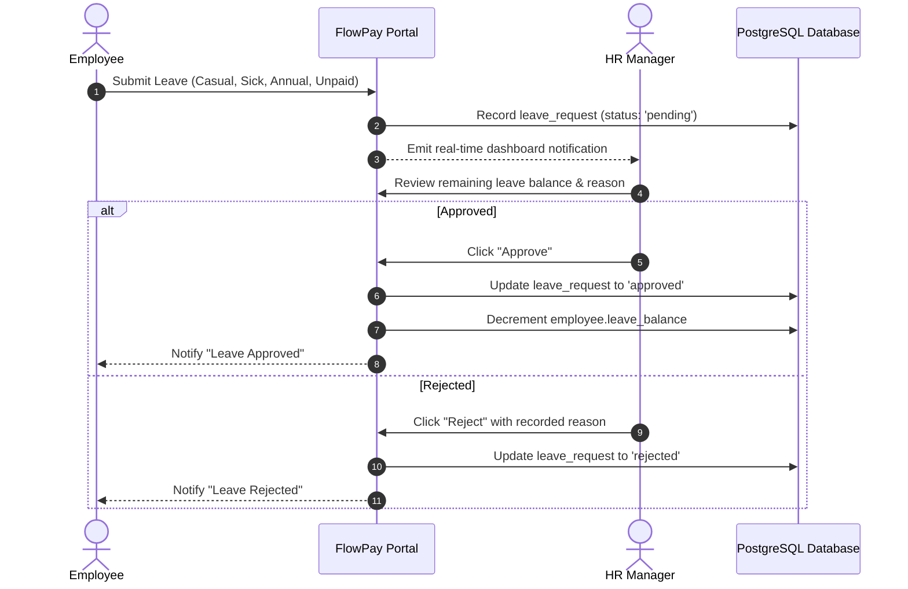


---

## Slide 10: Loans & Automated Salary Advance Amortization

### Visual Preview
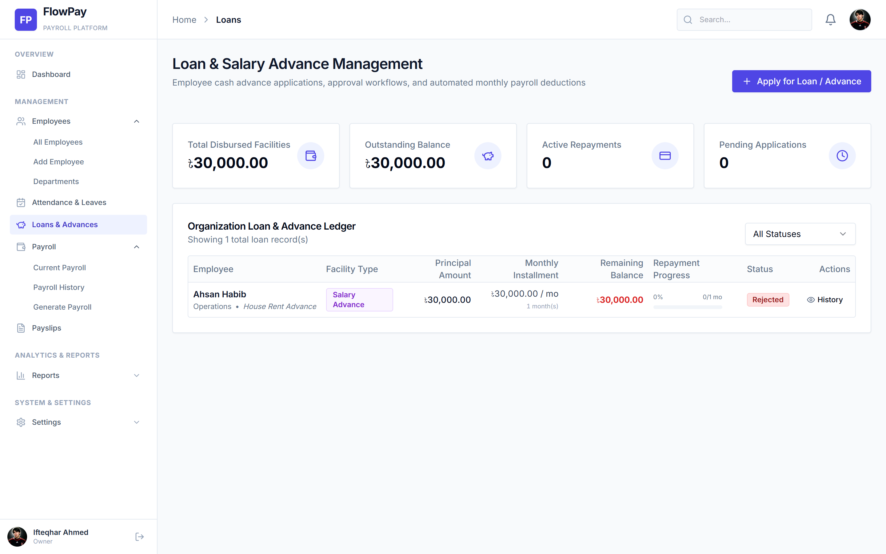

### Key Features
- **Dual Amortization Types**: Supports both emergency **Salary Advances** (short-term, 1–3 months) and **Personal Loans** (extended, 6–24 months).
- **Automated Installment Recovery**: Approved loan installments are automatically deducted from monthly payroll records.
- **Zero-Balance Auto-Completion**: As soon as the final installment is deducted, the loan automatically marks itself as `Completed` and deductions terminate.
- **Audited Early Settlements**: Employees can settle balances early via lump-sum cash payments with 1-click reconciliation.


---

## Slide 11: The Deterministic Salary Engine (`src/lib/salary.ts`)

### Mathematical Specification

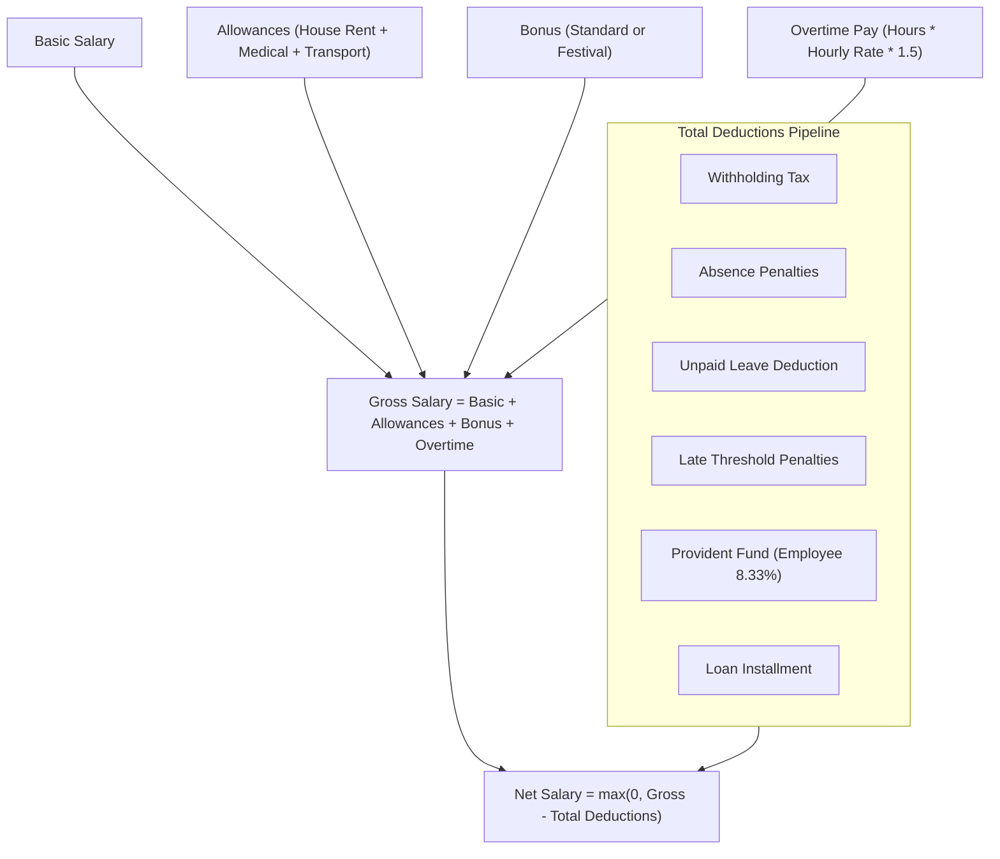

### Mathematical Rigor:
1. **Hourly Overtime Rate**:
   $$\text{Hourly Rate} = \frac{\text{Basic Salary}}{\text{Standard Working Days} \times \text{Daily Working Hours}}$$
2. **Absence Penalty Rate**:
   $$\text{Absence Deduction} = \text{Absent Days} \times \frac{\text{Basic Salary}}{\text{Standard Working Days}}$$
3. **Net Salary Safeguard**:
   $$\text{Net Salary} = \max\left(0, \text{Gross Salary} - \sum \text{Deductions}\right)$$


---

## Slide 12: Monthly Payroll Execution & Disbursement Reconciliation

### Visual Preview
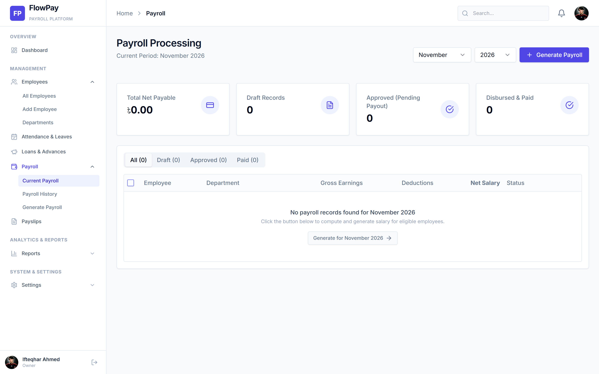

### The 4-Phase Payroll Lifecycle:
1. **Discovery & Generation (`/payroll/generate`)**: Automated scanning pulls verified overtime hours, unexcused absence days, and active loan installments into draft records.
2. **Audit & Adjustment**: Accountants review individual calculations and apply discretionary bonuses or adjustments.
3. **Batch Approval**: Executive management approves the batch with 1 click, transitioning records from `Draft` to `Approved`.
4. **Disbursement**: Selecting payment channels (Bank Transfer, bKash, Nagad, Cash), stamping transaction reference numbers (`TXN-REF`), and marking records as `Paid`.


---

## Slide 13: Instant Payslips & Digital PDF Verification

### Visual Preview
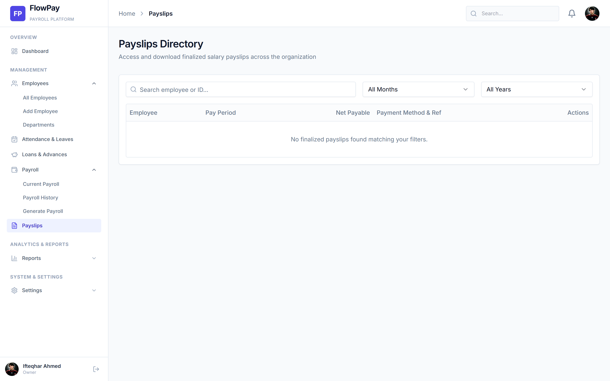

### Payslip Capabilities
- **Print-Ready Vector PDF Output**: Rendered at 2x scale via `html2canvas` and `jsPDF` for crisp typography and logos.
- **Granular Itemization**: Distinct columns for itemized earnings and itemized deductions.
- **Tamper-Evident Signatures**: Stamped with authorized digital signatures, generation timestamps, and unique database UUIDs.
- **Employee Self-Service**: Employees can access their complete historical payslip archive 24/7 from their smartphones.


---

## Slide 14: Financial Analytics, Reports & Banking Exports

### Visual Preview
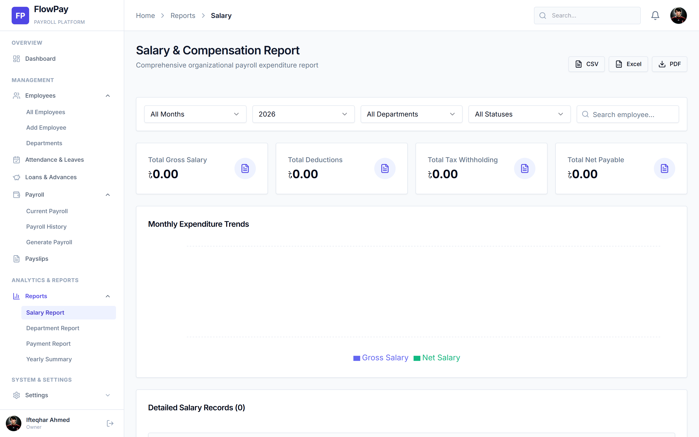

### Export Capabilities
- **Bank Transfer Schedules**: Export clean, structured Excel (`.xlsx`) and CSV sheets ready for batch bank upload.
- **Departmental Allocation**: Visual breakdown of total human capital investment per department.
- **Annual Fiscal Review**: 12-month gross versus net salary expenditure charts for executive forecasting.


---

## Slide 15: Compliance, Immutable Audit Trail & System Security

### Security Infrastructure Overview

| Security Dimension | Technical Implementation |
| :--- | :--- |
| **Audit Logging** | Every sensitive action (salary change, leave decision, payment disbursement) is written to `public.audit_logs`. |
| **Data Protection** | Encrypted transport via SSL/TLS and bcrypt password hashing via Supabase Auth. |
| **SQL Injection Prevention** | Fully parameterized SQL queries through Supabase JS SDK and PostgreSQL prepared statements. |
| **Session Integrity** | Short-lived JSON Web Tokens (JWT) with automatic refresh token rotation. |


---

## Slide 16: Automated Quality Assurance & Verification

### Test Suite Execution Summary

```bash
# Executing financial calculation unit tests
npm test
# Result: 30 / 30 assertions passing (100% success rate)

# Executing architectural security & audit validation
npx tsx tests/auditValidation.test.ts
# Result: 9 / 9 integration assertions passing
```

### Key Scenarios Covered:
- Standard 22-day working cycle salary derivation.
- Overtime multiplier scaling across fractional hours.
- Prevention of duplicate absence and unpaid leave deductions.
- Loan amortization installment capping at remaining balance.
- Floor safeguards guaranteeing that Net Salary never yields negative values.


---

## Slide 17: Production Deployment & System Scalability

### Operational Topology
- **Continuous Integration / Continuous Deployment**: Automated build verification with Vite Rollup optimization.
- **Database Scalability**: PostgreSQL connection pooling handled via Supabase Transaction Pooler (`aws-0-ap-southeast-1.pooler.supabase.com:5432`).
- **Zero-Downtime Schema Migrations**: Managed via idempotent migration scripts (`scripts/migrate.js`).
- **Responsive PWA Readiness**: Adaptive layouts optimized for both 4K desktop command centers and mobile smartphone viewports.


---

## Slide 18: Strategic Roadmap & Conclusion

### Future Innovation Roadmap
1. **Biometric Hardware Integration**: Direct IoT webhook integration with ZKTeco and fingerprint/facial attendance terminals.
2. **Direct Bank API Integration**: Automated salary transfers via direct Open Banking and MFS merchant APIs.
3. **AI-Powered Payroll Anomalies**: Machine learning detection for unusual overtime spikes or attendance irregularities.

### Summary
- **FlowPay Enterprise** delivers a modern, deterministic, and transparent payroll experience.
- Replaces manual spreadsheets with a unified, high-reliability platform.
- Eliminates human calculation errors and reduces month-end payroll execution from days to minutes.


---
*FlowPay Enterprise Presentation • Version 2.0 • November 2026*
