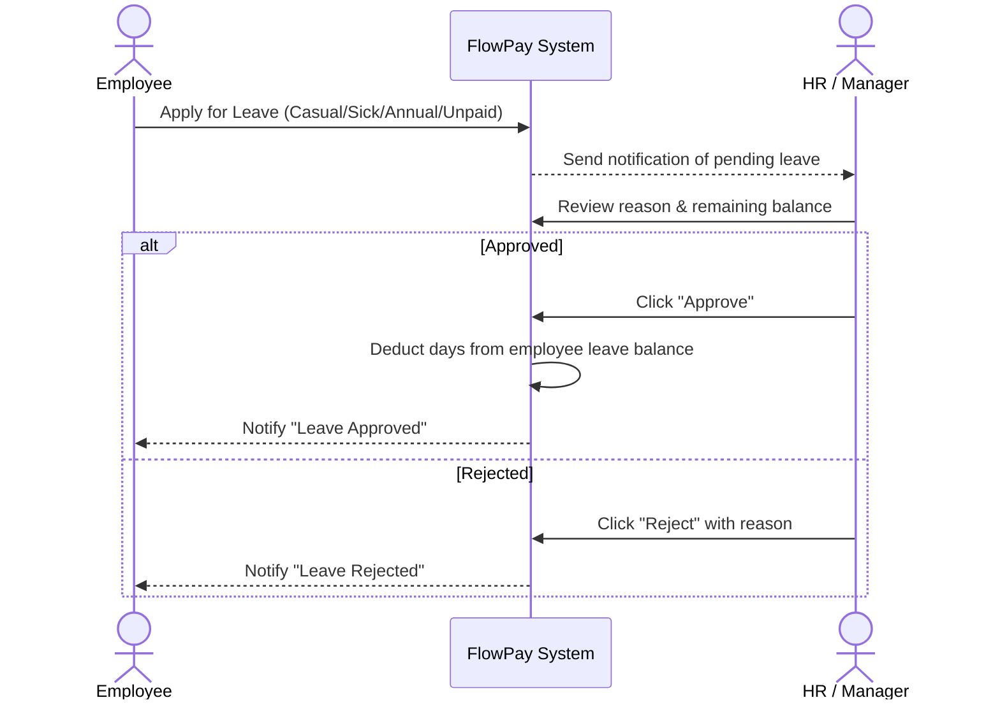
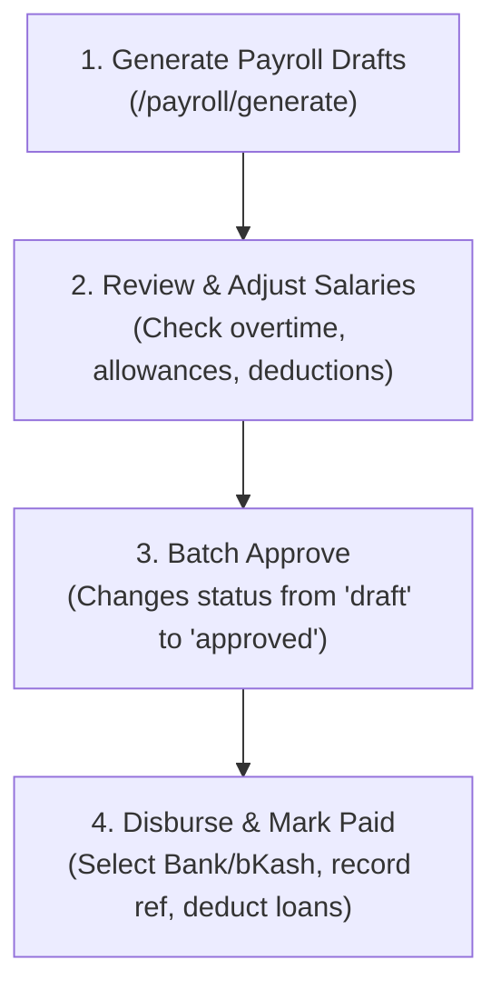

# FlowPay — Complete User Guide & Operational Manual

Welcome to **FlowPay**, an all-in-one Human Resource, Attendance, and Payroll Management System. This guide provides a comprehensive, step-by-step manual explaining what FlowPay is, how its features work, and how each role in your organization can use it effectively.

---

## Table of Contents

1. [Introduction & Core Purpose](#1-introduction--core-purpose)
2. [User Roles & Access Levels](#2-user-roles--access-levels)
3. [Getting Started & Interface Navigation](#3-getting-started--interface-navigation)
4. [Company Setup & Compensation Rules (Owner / Admin)](#4-company-setup--compensation-rules-owner--admin)
5. [Department & Employee Management (HR / Admin)](#5-department--employee-management-hr--admin)
6. [Daily Time & Attendance Tracking (All Roles)](#6-daily-time--attendance-tracking-all-roles)
7. [Leave Application & Approval Workflow](#7-leave-application--approval-workflow)
8. [Loans & Salary Advances](#8-loans--salary-advances)
9. [Monthly Payroll Lifecycle: Step-by-Step (Accountant / Admin)](#9-monthly-payroll-lifecycle-step-by-step-accountant--admin)
10. [Payslip Center & Employee Self-Service](#10-payslip-center--employee-self-service)
11. [Reports, Analytics & Financial Exports](#11-reports-analytics--financial-exports)
12. [Audit Trail & Account Security](#12-audit-trail--account-security)
13. [Frequently Asked Questions (FAQ) & Troubleshooting](#13-frequently-asked-questions-faq--troubleshooting)

---

## 1. Introduction & Core Purpose

### 1.1 What is FlowPay?
FlowPay is a centralized platform designed to handle an organization's complete workforce compensation lifecycle. It bridges human resources and accounting by tying daily attendance, overtime, unpaid leaves, and loans directly into automated monthly salary generation.

### 1.2 Key Problems FlowPay Solves:
- **Zero Manual Math**: Eliminates error-prone Excel calculations for basic pay, allowances, overtime hours, absence penalties, and tax withholding.
- **Accurate Attendance Synchronization**: Integrates daily check-in/out timestamps and automatic absence detection directly into payroll deductions.
- **Automated Loan Recovery**: When employees take a salary advance or personal loan, FlowPay automatically deducts the agreed monthly installment during payroll runs until the balance hits zero.
- **Transparent Self-Service**: Employees can check in daily, view their salary breakdown, apply for leaves, track loan balances, and download PDF payslips without bothering HR.
- **Bangladesh & Global Standards**: Native support for Bangladeshi Taka (`৳`), 22-day working cycles, overtime multipliers, festival bonuses, and mobile banking disbursements (bKash, Nagad, Rocket).

---

## 2. User Roles & Access Levels

FlowPay provides fine-grained Role-Based Access Control (RBAC). When users log in, the interface adapts specifically to their permitted responsibilities:

| Role | Who It's For | Primary Responsibilities & Permissions |
| :--- | :--- | :--- |
| **Owner** | Business Owner / CEO | Full unrestricted system access. Manages company profile, defines salary rules, approves payroll, manages user accounts, and views all audit logs. |
| **Admin** | General Manager / Operations | Complete operational control. Can manage employees, departments, approve payroll, record disbursements, and adjust attendance. |
| **Accountant** | Finance & Payroll Officers | Manages payroll generation wizard, reviews loan deductions, marks salaries as paid, and exports financial/bank reports. |
| **HR** | Human Resources Officers | Manages employee onboarding, organizational departments, daily attendance corrections, and leave application approvals. |
| **Employee** | All Team Members | Self-service access: clocks in/out, views their personal profile and salary structure, requests leaves, applies for advances, and downloads PDF payslips. |

---

## 3. Getting Started & Interface Navigation

### 3.1 Accessing FlowPay
- Open your web browser and navigate to the FlowPay address (e.g., `http://localhost:5173/` or your production domain).
- **First Time Setup**: The very first user to register on a fresh FlowPay installation is automatically granted the **Owner** role. All subsequent registrations default to the **Employee** role.
- **Demo Presets**: On the login screen, 5 preset buttons (`Owner`, `Admin`, `Accountant`, `HR`, `Employee`) allow instant 1-click testing with preloaded sample data.

### 3.2 The Navigation Layout
- **Sidebar (Desktop)**: Located on the left side, providing instant navigation to Dashboard, Employees, Attendance, Payroll, Payslips, Loans, Reports, and Settings.
- **Header**: Displays current date, quick link to your profile, a notification bell with real-time badges, and a 1-click Sign Out button.
- **Mobile Drawer**: On smartphones and tablets, tap the hamburger menu (☰) in the top-left corner to access all navigation links.

---

## 4. Company Setup & Compensation Rules (Owner / Admin)

Before running payroll or onboarding staff, configure your company policies under **Settings**:

### 4.1 Company Profile (`/settings/company`)
- Enter your **Company Legal Name**, corporate address, contact email, and phone number.
- Set the **System Currency** (default: `BDT`) and **Currency Symbol** (default: `৳`).
- Upload your corporate logo to appear on all exported PDF payslips and reports.

### 4.2 Salary & Compensation Rules (`/settings/salary`)
FlowPay calculates compensation based on customizable rules:
1. **Standard Working Days**: Set to `22` days (standard business month) or custom. This is used to derive daily salary rates.
2. **Daily Working Hours**: Set to `8` hours. Used to calculate precise hourly overtime rates.
3. **Overtime Multiplier**: Standard is `1.5x` (or `2.0x`). Overtime pay is computed as:
   $$\text{Hourly Rate} = \frac{\text{Basic Salary}}{\text{Standard Working Days} \times \text{Daily Working Hours}}$$
   $$\text{Overtime Pay} = \text{Overtime Hours} \times \text{Hourly Rate} \times \text{Overtime Multiplier}$$
4. **Late Attendance Deduction**:
   - Enable late deductions.
   - Set **Grace Minutes** (e.g., `15` minutes — arrival after 09:15 AM is flagged as Late).
   - Set **Threshold** (e.g., every 3 late days deducts 1 day of basic salary).
5. **Absence Deductions**: Enable automatic deduction for unexcused absent days.
6. **Festival Bonuses**: Enable festival bonuses (Eid, Puja, New Year) as a percentage of basic salary or fixed amount.

---

## 5. Department & Employee Management (HR / Admin)

### 5.1 Setting Up Departments (`/departments`)
1. Click **Add Department**.
2. Enter the Department Name (e.g., *Engineering*, *Marketing*, *Human Resources*, *Finance*).
3. Assign a Department Head and a brief description.

### 5.2 Onboarding a New Employee (`/employees/add`)
The employee onboarding form is organized into 5 logical sections:

1. **Personal Information**:
   - Full Name, Email, Phone number, and National ID / Passport.
   - **Profile Photo**: Click to select any picture. FlowPay's built-in canvas engine automatically crops it into a square and compresses it to ~25KB WebP/JPEG for fast loading.
2. **Employment Details**:
   - Select Department and Job Designation (e.g., *Senior Software Engineer*).
   - Set Joining Date.
   - Set initial leave quotas (Casual: 10, Sick: 14, Annual: 15).
3. **Salary & Allowance Structure**:
   - Enter the **Basic Salary** (e.g., `৳50,000`).
   - FlowPay automatically pre-fills standard statutory allowance splits:
     - **House Rent Allowance**: 50% of Basic (`৳25,000`)
     - **Medical Allowance**: 30% of Basic (`৳15,000`)
     - **Transport Allowance**: 20% of Basic (`৳10,000`)
   - You can manually override any allowance or add custom fixed bonuses.
   - Toggle **Provident Fund (PF)** eligibility (default: 8.33% employee deduction + 8.33% employer contribution).
4. **Banking & Payment Channel**:
   - Choose payment method: `Bank Transfer`, `Mobile Banking (bKash/Nagad/Rocket)`, `Cash`, or `Check`.
   - If Bank Transfer: Enter Bank Name, Account Number, and Routing Number.
   - If Mobile Banking: Select provider (bKash/Nagad) and personal account number.
5. **Emergency Contacts & Documents**:
   - Add emergency contact name, relation, and phone.
   - Attach PDF/image copies of contracts, resume, or national ID to the employee vault.

---

## 6. Daily Time & Attendance Tracking (All Roles)

FlowPay provides a unified attendance interface under `/attendance` with dual views for employees and managers.

### 6.1 Employee Self-Service Punching
1. At the start of the workday, log in and go to **Attendance**.
2. In the **Punch Card**, click **Clock In**.
   - Your arrival time is stamped in 24-hour precision (e.g., `09:05`).
   - If you clock in after 09:15 AM, the status badge automatically displays an amber **Late** flag.
3. At the end of the workday, click **Clock Out**.
   - If you clock out before 05:00 PM (17:00), the status badge displays an orange **Early** departure flag.
   - Total hours worked are automatically calculated.

### 6.2 The Daily Attendance Ledger & Absent Day Synthesis
For HR Managers and Admins, the **Daily Attendance Ledger** provides full company oversight:
- Pick any calendar date using the date selector.
- The ledger displays **all active employees**.
- **Automated Absence Synthesis**: If an employee has no clock-in record and no approved leave on that date, FlowPay automatically flags them as **`Absent`** with a red status indicator.
- **Manual HR Override**: Click **Mark / Edit** next to any record to manually input check-in/out times or update the status. FlowPay marks the record with a `Manual Correction` tag and logs the editor's name for auditing.

---

## 7. Leave Application & Approval Workflow

FlowPay manages vacation and sick days while preventing payroll conflicts.

### 7.1 How an Employee Applies for Leave:
1. Navigate to **Attendance → Leaves** tab.
2. Click **Apply for Leave**.
3. Select **Leave Type** (*Casual*, *Sick*, *Annual*, or *Unpaid*).
4. Choose **Start Date** and **End Date** (business days are automatically computed).
5. Enter a clear reason and click **Submit Request**.

### 7.2 How HR Approves or Rejects Leaves:
1. Open the **Leave Management** tab on `/attendance`.
2. Review pending requests showing employee name, leave type, duration, and reason.
3. Click **Approve** or **Reject** (with explanation).
4. Upon approval:
   - If paid leave: Days are deducted from the employee's remaining quota.
   - If unpaid leave: The days are recorded so that month-end payroll automatically calculates the appropriate unpaid salary deduction.

---

## 8. Loans & Salary Advances

FlowPay provides a formal loan and advance tracking system under `/loans` that guarantees repayment without accounting slips.

### 8.1 Applying for an Advance or Loan:
1. Employee visits **Loans & Advances** and clicks **Apply for Loan**.
2. Select type: **Salary Advance** (short-term, 1-3 months) or **Personal Loan** (longer-term, 6-24 months).
3. Enter the **Principal Amount** (e.g., `৳30,000`) and **Term in Months** (e.g., `3` months).
4. The system calculates the **Monthly Installment** (`৳10,000/month`).
5. Enter the purpose and submit.

### 8.2 Approval & Repayment Cycle:
- Once an Admin or Accountant clicks **Approve**, the loan becomes **Active**.
- **Automated Deduction**: During every monthly payroll run, FlowPay automatically adds the monthly installment (`৳10,000`) to the deductions section of the employee's payroll.
- **Completion**: When the remaining balance reaches `৳0`, the loan status automatically updates to **Completed**, and deductions stop immediately.
- **Early Settlement**: If an employee pays cash early, the Accountant can click **Settle Early** to close the balance with a single click.

---

## 9. Monthly Payroll Lifecycle: Step-by-Step (Accountant / Admin)

Generating payroll takes only a few minutes each month following this 4-phase lifecycle:

### Step 9.1: Run the Payroll Generation Wizard (`/payroll/generate`)
1. Click **Generate Payroll**.
2. Select the **Month** and **Year** (e.g., November 2026).
3. FlowPay automatically evaluates:
   - **Attendance Ledger**: Detects total overtime hours and unpaid absence days for every employee.
   - **Loan Store**: Pulls active monthly loan installments.
   - **Settings Engine**: Applies festival bonus rates and tax rules.
4. Click **Next: Review Calculations**.

### Step 9.2: Review & Adjust
1. Inspect the detailed preview table showing:
   - **Basic Pay**
   - **Allowances** (House Rent, Medical, Transport)
   - **Overtime Pay** (calculated from verified hours)
   - **Bonus**
   - **Gross Salary**
   - **Deductions** (Tax, Absence penalties, Unpaid leave, Loan installments, Employee PF)
   - **Net Salary**
2. If any employee needs a special manual adjustment (e.g., performance bonus or special reimbursement), click **Edit** on their row to adjust figures.
3. Click **Generate Draft Payroll**.

### Step 9.3: Batch Approval (`/payroll`)
1. Navigate to **Current Payroll**.
2. Select all employees in the draft batch using the top checkbox (or select individual employees).
3. Click **Batch Approve**. The records update from `Draft` to `Approved`.

### Step 9.4: Disbursement & Payout Reconciliation
1. In the Approved list, select the employees ready for payout.
2. Click **Mark as Paid**.
3. Select the disbursement channel:
   - `Bank Transfer`
   - `Mobile Banking (bKash / Nagad / Rocket)`
   - `Cash`
   - `Company Check`
4. Enter the banking transaction reference number (e.g., `TXN-8849201`).
5. Confirm payout. The system:
   - Stamps the payment date and marks status as `Paid`.
   - Records the loan installment as received in `loanStore`.
   - Sends real-time notifications to employees that their salary has arrived.
   - Locks the payroll record against accidental modifications.

---

## 10. Payslip Center & Employee Self-Service

### 10.1 Accessing Payslips (`/payslips`)
- Employees can open the **Payslips** page at any time to view their lifetime payment archive.
- Filter by month or year to find specific salary records.

### 10.2 Downloading Official PDF Payslips
1. Click **View Payslip** next to any paid record.
2. An official, branded modal preview opens showing:
   - Company Name, Tax ID, and Contact Details.
   - Employee ID, Designation, Department, and Joining Date.
   - Itemized Earnings column (Basic, House Rent, Medical, Transport, Overtime, Bonus).
   - Itemized Deductions column (Tax, Unpaid Leave, Absences, Loan Repayment, Employee PF).
   - Final Net Payable Amount in words and figures.
   - Digital signature verification and transaction reference.
3. Click **Download PDF** to export a high-resolution, print-ready document.

---

## 11. Reports, Analytics & Financial Exports

FlowPay provides comprehensive financial intelligence under `/reports`:

| Report Name | Route | What It Displays & Exports |
| :--- | :--- | :--- |
| **Salary Report** | `/reports/salary` | Department-wise monthly salary distribution, average salaries, and total payout. Exportable to Excel (`.xlsx`) and CSV. |
| **Department Report** | `/reports/department` | Headcount breakdown and monthly budget allocation per organizational unit. |
| **Payment Method Report** | `/reports/payment` | Channel breakdown showing total BDT sent through Bank Transfer vs. bKash vs. Nagad vs. Cash. Useful for bank upload sheets. |
| **Yearly Summary** | `/reports/yearly` | 12-month fiscal year trend chart comparing monthly Gross Budget vs. Net Disbursed amounts. |

---

## 12. Audit Trail & Account Security

### 12.1 Audit Logs (`/settings/audit-logs`)
FlowPay maintains an immutable security audit trail:
- Every sensitive action (generating payroll, approving loans, modifying attendance, editing employee salaries, changing roles) is automatically logged.
- Logs record the **User Name**, **Action**, **Module**, **Timestamp**, and a detailed text summary of what changed.
- Restricted to Admins and Owners to ensure regulatory compliance.

### 12.2 Updating Profile & Password (`/profile`)
- Click your name in the top right corner to visit **My Profile**.
- Update your display name, contact phone, and upload a new profile picture.
- Change your account password securely via Supabase Auth.

---

## 13. Frequently Asked Questions (FAQ) & Troubleshooting

#### Q1: Why did an employee receive an "Absent" status on the attendance ledger?
**Answer**: If an employee has no clock-in punch recorded for that date and has no approved leave application covering that date, FlowPay automatically classifies them as Absent. If the employee worked but forgot to clock in, an HR Manager can click **Mark / Edit** to record their punch manually.

#### Q2: How does FlowPay prevent double deductions for absences?
**Answer**: FlowPay's calculation engine isolates unpaid leave days from unexcused absence days. If an employee was on approved unpaid leave, they are only deducted for unpaid leave; they are never deducted twice.

#### Q3: What happens if an employee's total deductions exceed their gross pay?
**Answer**: FlowPay's financial engine includes a strict **Net Salary Floor Safeguard**: Net salary can never drop below `৳0.00`.

#### Q4: How do I change an employee's bank or bKash number?
**Answer**: Go to **Employees**, click **Edit** on the employee's row, update the banking or mobile banking section, and click **Save Changes**. Future payroll runs will immediately reflect the new payout details.

#### Q5: Can an employee view other employees' salaries or payslips?
**Answer**: **No.** FlowPay enforces strict Role-Based Access Control. Users with the `Employee` role can only access their own profile, attendance, and personal payslips. They receive an unauthorized access denial if they attempt to view other employees' financial data.

---

*FlowPay Operational Manual • Version 2.0 • November 2026*
